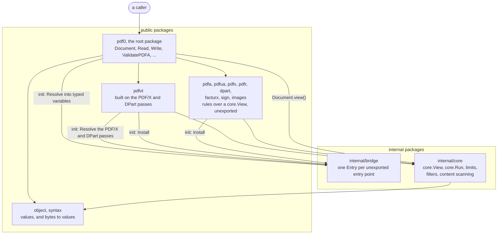
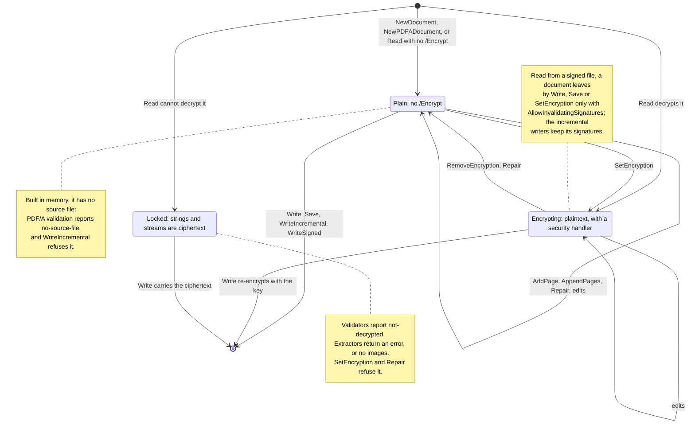
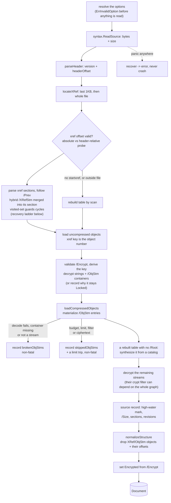
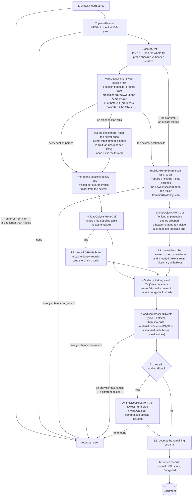
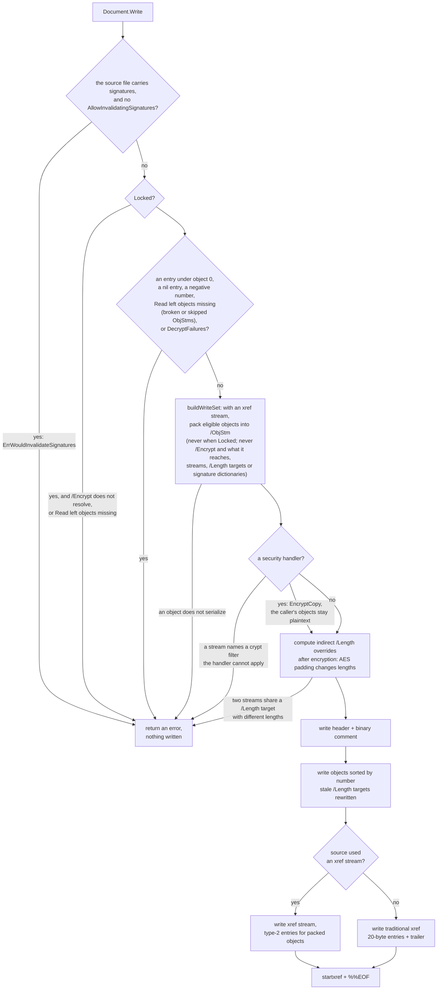

# Architecture

How bytes flow through pdf0's core: **Read** (bytes → object model) and **Write**
(object model → bytes), over one shared, typed object model. Read this before
changing the parser or serializer. For the public API surface, see the package
godoc.

Each subsystem built on that core has its own map:

| Subsystem | Doc |
|-----------|-----|
| The validator family (PDF/A, PDF/UA, PDF/X, PDF/VT, PDF/R, DPart, Factur-X) | [validators.md](validators.md) |
| Inside the PDF/A rule engine | [pdfa.md](pdfa.md) |
| PDF/UA accessibility validation | [pdfua.md](pdfua.md) |
| Setting text with a font | [text.md](text.md) |
| What the font writer puts in a file | [font-embedding.md](font-embedding.md) |
| Font validation and font programs | [fonts.md](fonts.md) |
| XMP metadata | [xmp.md](xmp.md) |
| Encryption (standard security handler) | [encryption.md](encryption.md) |
| Signing, verification, PAdES, timestamps, revocation | [signing.md](signing.md) |
| Image extraction and the codec stack | [images.md](images.md) |
| `cmd/pdf0`, the command-line dev aid | [cli.md](cli.md) |
| Test data, oracles, fuzzing and CI | [testing.md](testing.md) |
| Reading untrusted input: limits, deadlines, `limit` findings | [untrusted-input.md](untrusted-input.md) |
| Every resource guard, and how a trip is reported | [limits.md](limits.md) |
| Symptom-first troubleshooting | [troubleshooting.md](troubleshooting.md) |
| Decisions that keep coming up | [adr/](adr/README.md) |

## Packages

pdf0 was one flat package. It is now a core plus one package per subsystem, and
the split follows two rules.

**Each type is declared in exactly one place, and named from there.** A
dictionary is `object.Dictionary`, a PDF/A finding is `pdfa.Violation`, a
conformance level is `pdfa.PDFA2b`. The root package declares the entry points
over a document — `Read`, `Document` and its methods, one validator function per
standard, the builders — and what those entry points own: their options,
results and errors. It gives a second name to exactly one group: the object
model's types, aliased in `object_api.go` (`pdf0.Dictionary` is
`object.Dictionary`), because every caller writes them and a second import for
them would buy nothing.
Everything else is named from the package that owns it — `pdfa.SkeletonOptions`,
`syntax.NewParser`, `object.Equal`, `sign.CheckCertRevocation` — and the root
package declares no second name for it. The errors that come from internal
packages (`ErrWrongPassword`, `ErrInvalidMetadataText`, …) are declared in the
root because it is their only public home; that is ownership, not a second
name. The lint `TestRootReexportsOnlyTheObjectModel` holds that policy.

**A subsystem is a regular package if it carries public API, `internal/` if it
does not.** `internal/crypt` is the clear case of the second: its whole exported
surface exists so the reader, the writer and the white-box tests can reach it,
and no caller ever names it — every entry point is a `Document` method. The
distinction matters for godoc too: an `internal` package's names cannot be
linked to from outside, so anything a caller must read about has to live in a
regular package.

| Package | Holds |
|---------|-------|
| `object` | The ISO 32000-2 7.3 value types. Data only — no parsing, no resolution. |
| `syntax` | Lexer, parser, serializer: bytes ↔ objects, one object at a time. |
| `pdfa` | The PDF/A rules, level model, XMP machinery and document builder. |
| `pdfua`, `pdfx`, `pdfvt`, `pdfr`, `dpart` | One validator each, with its finding type. |
| `sign` | Signature verification: CMS, PAdES, revocation, time-stamp tokens. |
| `facturx` | The Factur-X and Order-X containers, and the invoice embedder. |
| `images` | Image extraction, and embedding an image as an XObject. |
| `content` | The content-stream builder: drawing operators, checked as they are written. |
| `htmlpdf` | The backend that writes forme's laid-out HTML and CSS into a document. |
| `internal/core` | What every subsystem needs: the view, resolution, filters, content scanning, limits. |
| `internal/crypt` | The standard security handler. No public API of its own. |
| `internal/xmp` | The one XMP model every metadata writer edits, with merge semantics. |
| `fonts` | Setting text with a font: shaped glyphs into content-stream operators, and the font into the document. The shaping itself, and the sfnt/CFF/Type 1 program reader under it, are [github.com/mgilbir/forme](https://github.com/mgilbir/forme). |
| `simplefont` | What ISO 32000 says about simple fonts independent of the font program: the standard Latin encodings (Annex D.2), the standard Latin and Symbol character sets (Annex D.2, D.5; ISO 19005-1 6.3.8), and how a code selects a TrueType glyph (9.6.6.4). Text extraction, the PDF/A font rules and `fonts` read it. |
| `internal/finding` | The panic boundary, the reserved rule identifiers, deterministic ordering. |
| `internal/bridge` | The entry points the public packages keep unexported because they take `core.View`; see below. |
| `internal/testfiles`, `internal/hostile`, `internal/lint` | Test support: where committed and fetched test data is and whether it is complete; running a hostile-input test in a capped child process; the repository-wide static checks, the documentation checks among them. |
| `internal/signtest` | Fixtures shared by tests in packages that cannot share a `_test.go`. The font-program equivalent is [forme](https://github.com/mgilbir/forme)'s `fonttest`, exported rather than internal because two modules read font programs and one copy of the fixtures is the point. |

### `core.View`: the document seen from below

A subsystem needs the object graph, the trailer, the version, the resolved
limits and the cancellation signal — not the `Document` type, which is the
public facade and must stay at the top. `core.View` is that value: everything
below the API boundary reads one, and `Document.view()` is where the boundary
is.

It carries a `*core.Run` for per-operation state, so the memo tables a
validation builds are private to that run and two concurrent validations of the
same document cannot see each other's.

### Crossing the boundary: `internal/bridge`

The rules of `pdfa`, `pdfua`, `pdfx`, `pdfvt`, `pdfr`, `dpart`, `facturx`,
`sign` and `images` run over a `core.View`, and the root package has to call
them. A function that takes a `core.View` cannot be exported from a public
package: no caller outside the module can name the type, so it would be listed
on pkg.go.dev as API nobody can call (it was, about thirty times over: audit
2026-09-22 C163). So those entry points are unexported, and each package
installs them in `internal/bridge` from an `init` function. The root package
resolves each one into a typed variable of its own when it is initialised
(`bridge.go`), and so does `pdfvt` for the PDF/X and DPart passes it builds on.
The dependencies all point down, and `Document` sits on top
([ADR 0011](adr/0011-view-and-bridge.md)):

The entries are typed `any` inside the bridge, because the signatures carry the
public packages' own types and the bridge cannot import the packages that import
it. The type is checked once, when the consumer is initialised: a missing
install or a mismatched signature panics at the start of every binary and test
that links the consumer, never on a later call. After initialisation the
entries are read-only. `TestBridgeEntriesInstalledAndResolved` checks that no
entry is left unresolved, and the lint
`TestPublicAPIMentionsNoInternalType` (`internal/lint`) fails on any exported
identifier of a public package whose signature, fields or methods mention an
internal type.

### Handing work back across the boundary

Two rules need something the root package has and their own package must not
depend on: the PDF/A embedded-file rule needs the *reader*, and the Factur-X
container needs the PDF/A-3 verdict, which needs the reader and the read-time
limit report. Neither is a package-level variable. The caller installs the
function on the run — `pdfa`'s `setEmbeddedChecker` and `facturx`'s
`setPDFAChecker`, both reached through the bridge — so nothing is shared
between concurrent operations, and the default when none is
installed *declines to answer* rather than guessing: "pdf0 could not tell" must
never reach a caller as "the document is wrong."

### Findings and the `Violation` interface

`pdf0.Violation` is declared in the root package, where it is consumed. The
finding types are declared in their own packages and satisfy it structurally, by
carrying `Error`, `RuleID` and `ObjectNum` — so no validator package imports its
own caller.

### Where the code is

Each subsystem, the files that hold it, and the doc that maps it. The root
package's files are named one by one, except `doc.go`, which holds the package
documentation; a subpackage is named whole.

| Subsystem | Where | Map |
|-----------|-------|-----|
| Core object model, parser, serializer | `object/`, `syntax/`, `document.go`, `xref.go`, `objstm.go`, `objstm_write.go`, `source.go`, `incremental.go`, `compare.go`, `object_api.go` (the object-model aliases), `streamdata.go` (decoding a stream for a caller), `internal/core/filters.go` | this doc |
| Resource limits and cancellation | `limits.go` (the options), `limits_report.go` (a trip reported as a finding), `cancel.go`, `internal/core/meter.go` (the work meter) | [untrusted-input.md](untrusted-input.md), [limits.md](limits.md) |
| What every validator shares | `violations.go`, `validator_guard.go` (the answer to a nil document), `runcache.go` (the per-run cache), `bridge.go` (the root's side of `internal/bridge`), `internal/finding` | [validators.md](validators.md) |
| PDF/A validation | `pdfa/` (rules in `pdfa/pdfa.go`, `pdfa/final_rules.go`, `pdfa/fonts.go`, `pdfa/content_operators.go`, `pdfa/filestructure.go`, `pdfa/pdfa_levela.go`; the builder in `pdfa/create.go`), with `pdfa_api.go`, `embedded.go`, `preflight.go` and `save.go` in the root | [pdfa.md](pdfa.md) |
| The other validators | `pdfua/`, `pdfx/`, `pdfvt/`, `pdfr/`, `dpart/`, `facturx/`, with `pdfua_api.go`, `pdfx_api.go`, `pdfvt_api.go`, `pdfr_api.go`, `dpart_api.go` and `facturx_api.go` in the root | [validators.md](validators.md), [pdfua.md](pdfua.md) |
| Building documents | `content/`, `create.go`, `page_add.go`, `builderinput.go` (the input checks every builder shares), `form.go`, `pattern.go`, `pattern_uncolored.go`, `shading.go`, `softmask.go`, `outline.go`, `annotation.go`, `structure.go` | [building.md](building.md) |
| Pages: listing, extracting, appending | `pages.go`, `pagetree.go`, `pageimport.go` | the godoc of `Document.ExtractPages` and `Document.AppendPages` |
| Setting text and embedding fonts | `fonts/`, `simplefont/`, `faceembed.go`, with shaping and program parsing in [forme](https://github.com/mgilbir/forme) | [text.md](text.md), [font-embedding.md](font-embedding.md) |
| Font validation | `pdfa/fonts.go`, `internal/core/fontuse.go` (which fonts the content shows text in) | [fonts.md](fonts.md) |
| HTML and CSS to PDF | `htmlpdf/`, with the whole layout engine in [forme](https://github.com/mgilbir/forme) | [htmlpdf.md](htmlpdf.md), [htmlpdf-backend.md](htmlpdf-backend.md) |
| XMP metadata | `internal/xmp` (the model every writer edits), `pdfa/xmp.go`, `pdfa/xmp_schemas.go` (the validator's reading) | [xmp.md](xmp.md) |
| Signatures and PAdES | `sign/`, with `sign.go`, `sign_api.go`, `signedfile.go` and `doctimestamp.go` in the root | [signing.md](signing.md) |
| Encryption (standard security handler) | `crypt_api.go`, `internal/crypt`, `internal/saslprep`, `internal/pdfdoc` | [encryption.md](encryption.md) |
| Images and codecs | `images/`, `images_api.go`, `internal/ccitt`, `internal/jbig2`, `internal/core/function.go` (PDF functions) | [images.md](images.md) |
| Text extraction | `text.go`, `internal/core/tounicode.go`, `internal/core/cmap.go` | [text.md](text.md#getting-the-text-back) |
| Command-line front end (dev aid, not the supported surface) | `cmd/pdf0` | [cli.md](cli.md) |

## Document lifecycle

A `Document` is in one of three encryption states, and that state — not
`Encrypted`, which stays true on a decrypted file — decides what the other
methods do with it:

Validation is not a transition: every validator works on a shallow copy of the
document with its own per-run cache (`validationCache`, `core.Run`), so it
never changes the caller's `Document`, and two validations of one document can
run at once. Each ends by appending the run's limit trips
([limits.md](limits.md#how-a-trip-reaches-the-caller)).

Leaving a state is writing it. `Write` regenerates the file in any state
(below) — unless the document was read from a file that carries signatures or
document time-stamps, which regenerating it would invalidate: `Write`, `Save`
and `SetEncryption` then refuse (`ErrWouldInvalidateSignatures`) until the
caller consents with `AllowInvalidatingSignatures`
([ADR 0019](adr/0019-signature-consent-on-the-document.md)). `Save` is `Write`
that refuses a document failing the PDF/A level it claims;
`WriteIncremental` appends to the file a document was read from, so it refuses
one built in memory, one whose table was rebuilt, any encrypted one, and one
read from an encrypted file even after `RemoveEncryption`; and the signing
writers refuse an encrypted document. A Locked `Write` keeps the
ciphertext under the file's own `/Encrypt` and `/ID`, regenerating the layout
([ADR 0014](adr/0014-read-never-fails-on-encrypt.md)).

## The object model

Every PDF value implements the `object.Object` interface: `Boolean`, `Integer`, `Real`, `String`,
`Name`, `Array`, `Dictionary`, `Stream`, `Null`, `IndirectObject`,
`IndirectRef`. A `Document` holds `Objects` (object number →
`IndirectObject`), the `Trailer` dictionary, and — after `Read` — a source
record, `Source()`: the file's bytes, its cross-reference sections and
revisions, the highest object number and `/Size` it uses, and each object's byte
offset (used by the byte-level validation rules). Read normalises the file
structure out of `Objects` and `Trailer`; the record keeps what incremental
writers, the object-number allocator (`Add`) and byte-level checks still need.
`Dictionary` is opaque: it keeps its entries in insertion order for faithful
round-tripping, holds one entry per key, and is read and changed only through
its methods, whose mutators maintain the lookup index so that reads are pure and
safe to run concurrently — see [ADR 0008](adr/0008-opaque-dictionary.md).
`Dictionary`, `Stream` and `IndirectObject` are `Object`s only as pointers
(their marker method has a pointer receiver), so each type has exactly one form
a type switch has to handle.

## Read

`Read` (`document.go`) slurps the file and rebuilds the object model. It recovers
aggressively from malformed files and, by design, **never panics** — any panic
escaping the parse is recovered and returned as an error.

**Decryption of strings and object-stream containers runs before object streams
are materialized**, and the order is load-bearing: an `/ObjStm` container is
itself an encrypted stream, but the objects stored inside it are *not*
separately encrypted. Materializing first would decrypt the inner objects a
second time and corrupt them. The other streams are decrypted *after*, because
which crypt filter applies to one — an embedded file follows `/EFF` — is decided
by a file specification that may itself be inside an object stream. An
`/Encrypt` dictionary never fails the read; see
[encryption.md](encryption.md#the-ordering-constraint-and-what-is-exempt).

### The recovery ladder

Most defects are recovered rather than fatal. A wrong or wrong-typed stream
`/Length` falls back to searching for `endstream`; an offset-shifted
cross-reference is probed absolute-vs-header-relative; an object stream that
does not decode, is missing, is not a stream, or holds an object that does not
parse is recorded in `brokenObjStms` and its objects are simply absent. One
pdf0 declines to unpack — over the materialisation budget or a decode limit,
under a filter it does not implement, still ciphertext — is recorded in
`skippedObjStms` instead, with a trip every validator reports under "limit";
it is never reported as malformed. Both leave objects missing, so Write
refuses either.

The cross-reference table has the deepest recovery, because a damaged xref is the
most common way a real-world file is broken. `Read` (`readDocument` in
`document.go`) escalates through a ladder and fails only when every rung is
exhausted. Its steps are numbered in the code as below; a cancelled context
stops it at any step, with an error.

**What is actually fatal.** `Read` returns an error, and no `Document`, only
when:

- an option value is zero or negative: an error wrapping `ErrInvalidOption`,
  before anything is read;
- `r` returns an error, or holds fewer bytes than `size` claims, or `size` is
  negative (a truncated read would otherwise look like trailing whitespace);
- there is no `%PDF-` header in the first 1024 bytes;
- the cross-reference data is unusable — no `startxref`, one outside the file,
  or a newest section that does not parse — *and* the scan finds no object
  header in the whole file. A failure to load the objects of a table the file
  supplied triggers the same scan, and is fatal only if it finds nothing;
- a rebuilt document has no `/Type /Catalog` to synthesize `/Root` from, among
  its compressed objects either. The error is the cross-reference failure that
  led to the rebuild, or else `rebuilt cross-reference table found no document
  catalog`;
- a type-2 entry's index names a different object in its object stream's own
  index. That one is deliberate: it is not missing data but two parts of the
  file disagreeing about which object is object N, and choosing either is a
  guess a crafted file could steer
  ([ADR 0015](adr/0015-objstm-index-mismatch-is-fatal.md));
- the context of `ReadContext` or `ReadWithPasswordContext` ends, at any step:
  an error wrapping `ctx.Err()`, never a partial document
  ([ADR 0016](adr/0016-readcontext-returns-nil.md));
- a panic, recovered and returned as an error.

An `/Encrypt` dictionary never fails the read
([ADR 0014](adr/0014-read-never-fails-on-encrypt.md)), and neither does a
section whose cross-reference stream decodes to more in-use entries than the
file could hold (one per four bytes, plus 4096): it counts as unparseable, and
the ladder takes over. A rebuilt read is reported by `Source().Rebuilt`.

This depth is deliberate: it lets the PDF/A validator *report* a malformation
instead of failing to open the file. A validator that cannot read a broken file
cannot tell you why it is broken.

## Write

`Document.Write` (`document.go`) regenerates a clean file. It refuses first a
document whose source file carries signatures, unless the caller consented with
`AllowInvalidatingSignatures` (the rewrite would invalidate them), then documents
it cannot faithfully serialize; it re-encrypts a document decrypted on Read, writes
a Locked one's ciphertext back unchanged under its original `/Encrypt` and `/ID`
(so the result opens with the right password, and `Write` returns nil), and
regenerates the cross-reference section in the same form the source used — a
cross-reference stream, or a traditional table. Every refusal comes before
anything is written; its godoc lists them.

The order of the middle three steps is load-bearing: the write set is built
first so that what is encrypted is what is written, and `/Length` is computed
last because encryption changes the length of the data it describes. An object
that does not serialize (a NaN or an infinite number) can still fail the write
once objects are being written, as can an error from `w`, and the output is
then partial.

`Write` is idempotent: `Read → Write → Read → Write` produces byte-identical
output (guarded by `TestWriteIsIdempotent`).

`Write` regenerates rather than preserves the on-disk layout. The object model
round-trips exactly, but object order and which objects share an `/ObjStm` are
regenerated. To amend a file without rewriting it, use `WriteIncremental`
(`incremental.go`), which appends a new section listing only the changed object
numbers to the bytes in the source record and leaves them untouched — this is
what signature workflows require, since rewriting would break every existing
signature. The new section has the form of the one it chains to (a
cross-reference stream after a stream, a table otherwise), its `/Size` is never
below the file's, and its second `/ID` string is refreshed.

## Validate

Validation reads the object model and reports findings; it never mutates the
document. Each standard has its own validator: which entry point to call and how
to read its result is [validators.md](validators.md); the PDF/A engine's
dispatch, executed-content model and rule-file map are
[pdfa.md](pdfa.md).

## Resource limits

pdf0 parses untrusted input, so every unbounded loop and every allocation sized
by a number the file supplies is capped, with defaults safe for hostile input.
The caps worth tuning are `With*` options on `Read`, resolved once into a
`core.Limits` stored on the `Document` and passed to the code that enforces
them, so every validator and extractor run on the document inherits them. A
guard that trips never becomes a verdict: a validator reports it under the
reserved rule `limit`, and an extractor as an error.

- How to set them, the generated table of options and defaults, and how to
  read a `limit` finding: [untrusted-input.md](untrusted-input.md).
- Every guard in the package and how a trip is reported:
  [limits.md](limits.md).
- Why options rather than a struct or a context:
  [ADR 0009](adr/0009-functional-options.md); the measurements behind the
  defaults and the limits left internal:
  [proposals/configurable-limits.md](proposals/configurable-limits.md).

## Cancellation

A limit bounds what a document may cost; a context bounds how long one
operation may take. The entry points whose cost is the document's have a
`…Context` variant taking `ctx` as their first parameter. The signal rides on
the operation — a validation's per-run state, or a parameter threaded through
`Read`'s and `Write`'s loops — and is never stored on the `Document`. It is
polled at layered boundaries, coarsest first: per check, per page and content
stream, per `core.CancelScanBytes` of content tokenized, per
`core.CancelReadChunk` decompressed, and per object in `Read` and `Write`.

- Every variant, generated from the API, and what each returns when stopped:
  [untrusted-input.md](untrusted-input.md#bounding-time-the-context-variants).
- Why variants and not an option: [ADR 0010](adr/0010-context-variants.md);
  why a cancelled read returns nil: [ADR 0016](adr/0016-readcontext-returns-nil.md).
- Where the checks sit, what they cost, and the measured latency: the design
  comment in `cancel.go`.
