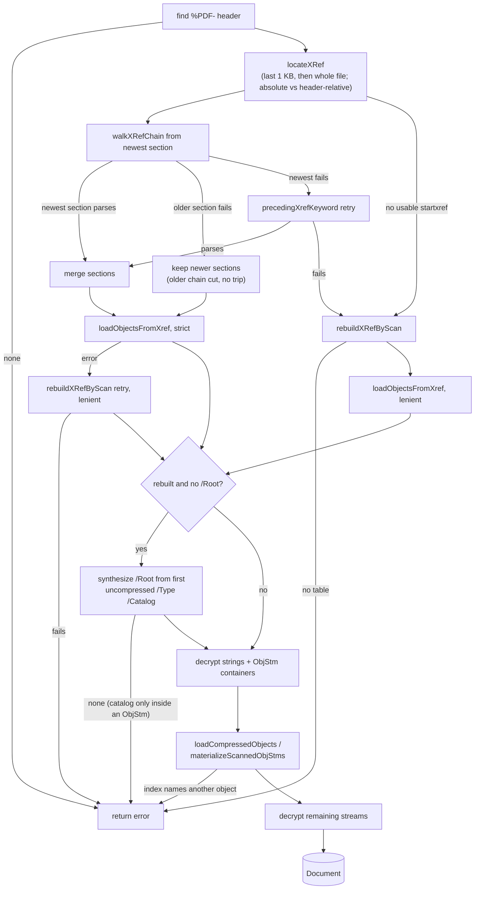
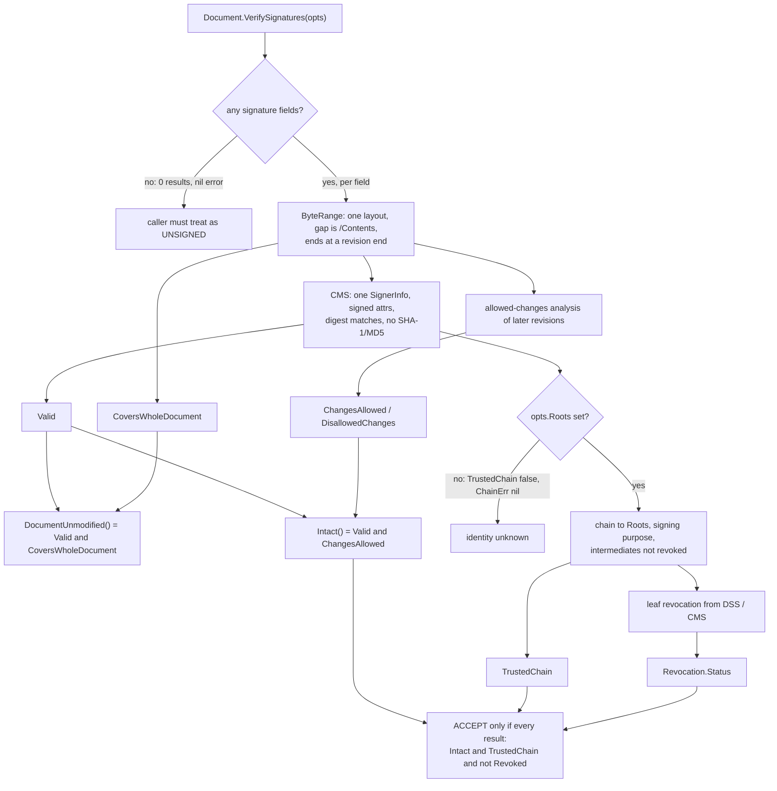
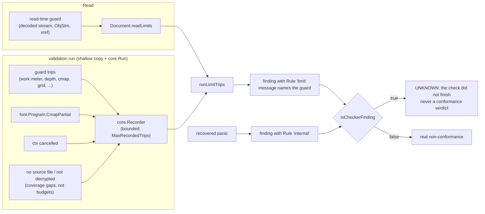
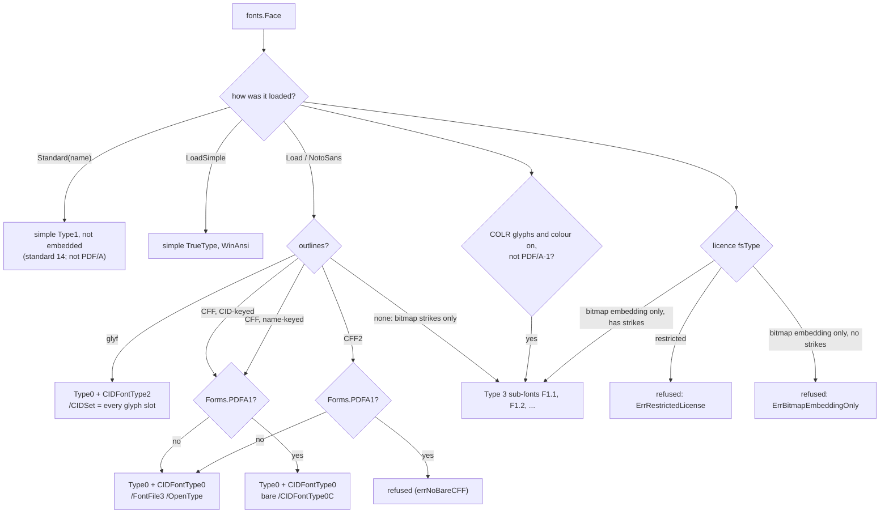
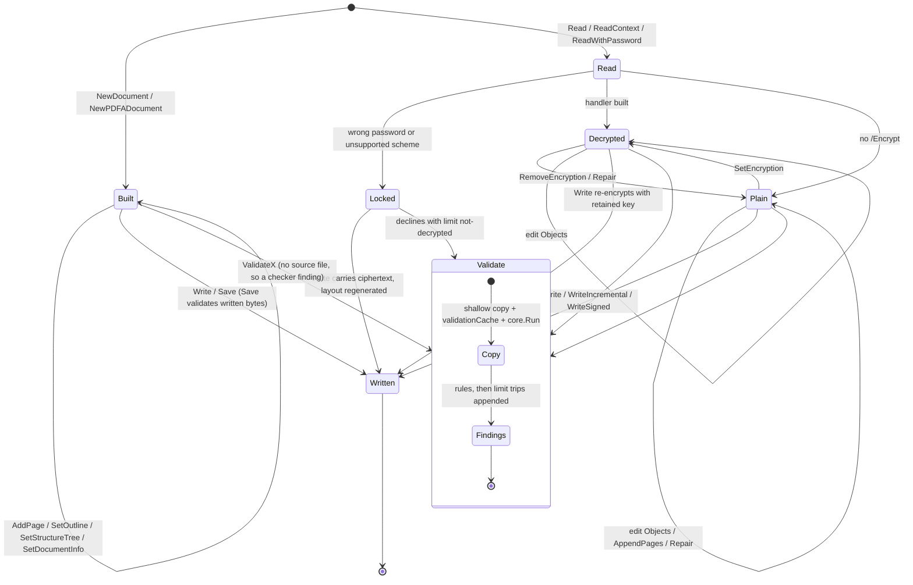

# pdf0 Documentation Audit — 2026-10-11

This audit treats every reader-facing surface as a first-class artifact. It checks four things: that each surface tells the truth about the code, that it leads with what matters, that it is sized so its concerns don't collide, and that architecture is drawn rather than narrated. Audited against `main` at `a01b2c7` (2026-10-10), working tree clean.

**Bottom line.** The docs are unusually well built. There are question-first indexes, Mermaid in eight docs, generated CI and dataset sections, and a doc lint (`internal/lint`) that holds every code span, quoted message and snippet to the code. Because of that lint, the remaining drift is *semantic*: names resolve, but the behaviour they describe is wrong or has moved on. The worst cases are behavioural claims that the code does not honour, and several turn out to be **code defects that the docs paper over**:

- The signing docs' verify snippet accepts an unsigned PDF.
- `Intact()` and PAdES `Conformant` stay true after a later "signature" that does not verify paints a full-page overlay.
- `ValidatePAdES` cannot see a revoked signer.
- The recovery-ladder diagram promises a recovery that `Read` fails.
- `ExtractImages` truncates silently on a budget trip, though the option's godoc promises an error.
- `ExtractText` on a Locked document returns `""` and a nil error.

The largest *absence* is the authoring half of the library. `NewDocument`, `AddPage`, `content.Builder`, font embedding, image embedding, outlines, structure trees, links, gradients and soft masks have no narrative doc at all, and the README routes "Content, pages and building" to a doc that has no such section. The `fonts` work of #331 (CIDSet, PDF/A-1 bare CFF) never reached `docs/fonts.md`. Ten of the sixteen public packages have no package doc comment, so pkg.go.dev shows nothing for `pdfa`, `sign`, `images` or `syntax`.

**Severity counts: 9 High · 37 Medium · 21 Low · 2 Info (69 findings).** Of the 69, 65 are CONFIRMED by an executed check or a direct code read. Three are CONFIRMED in fact but PLAUSIBLE in impact or intent (D12, D36, D60), and one is PLAUSIBLE (D69). The prior docs audit (2026-07-27, D1–D21) was spot-checked, and all of its findings are fixed in the tree.

Method: seven parallel readers each owned a doc cluster and read it in full against the code, running examples, the CLI, throwaway programs (`/tmp`, `replace` to the repo) and the corpus ratchets. The lead then re-ran every High and every code-behaviour claim independently before it went into this report. Findings that did not survive were dropped. Baseline at audit time: `go test ./internal/lint` green, `scripts/check-links.sh` green (38 files), all 8 examples exit 0, corpus ratchets green (TestCorpus pass=776 fail=1278 FP=0 missed=0).

> **For the maintainer — code defects surfaced by this audit.** D2, D3, D4, D5, D6 and D25 are behaviour the code gets wrong, not only text. They are recorded here because the docs promise the opposite. Fixing the doc alone would document a bug. D2 (the signature-overlay acceptance) is security-relevant and deserves its own issue.

---

## 1. Summary table

| ID | Sev | Document | Issue | Status |
|----|-----|----------|-------|--------|
| D1 | High | `docs/signing.md:36-50`, `docs/troubleshooting.md:265` | The "which verdict" snippet never checks `len(results)`, so an **unsigned** PDF passes it (`VerifySignatures` → 0 results, nil error) | CONFIRMED (executed) |
| D2 | High | `docs/signing.md:82-86,145-150,266-270`; `sign/changes.go` | `Intact()` and PAdES `Conformant` stay **true** after an incremental update adds a non-verifying "signature" field whose widget paints a full-page overlay; the docs say `Intact()` catches post-signing change. **Code defect** | CONFIRMED (executed) |
| D3 | High | `docs/signing.md:259-271`; `sign/pades.go` | `PAdESResult` carries no revocation; a revoked leaf yields `Conformant=true, TrustedChain=true`, and the doc says trust "is reported beside it" | CONFIRMED (code) |
| D4 | High | `docs/architecture.md:210-226` (recovery ladder) | Diagram materializes scanned ObjStms *before* synthesizing `/Root`; the code synthesizes first, so a rebuilt file whose catalog is in an object stream **fails to Read**. **Code defect + stale diagram** | CONFIRMED (executed) |
| D5 | High | `images_api.go:22-25,69` vs `limits.go` `WithMaxWork` | `ExtractImages`/`Images` drop a work-budget trip silently (0 images, no signal); `WithMaxWork` promises "an extraction stops with an error naming it" | CONFIRMED (executed) |
| D6 | High | `text.go:28`, `crypt_api.go:141` | `ExtractText` on a Locked document returns `""` with **nil** error, breaking "the error is nil exactly when every page's text is in the result" | CONFIRMED (executed) |
| D7 | High | README "Layout", `docs/README.md`, `doc.go` | Authoring API (`NewDocument`, `AddPage`, `content.Builder`, `fonts` load/draw/embed, `images.Embed`, outline, structure tree, links, gradients, patterns, soft masks, `SetDocumentInfo`) has **no narrative doc**; README routes it to architecture.md, which has no such section | CONFIRMED |
| D8 | High | `docs/fonts.md:33-36,99-104,355-366,524-548` | #331 drift: `checkFontSubsetCompleteness` "all" (skips A-4); `checkCIDSetMatchesProgram` and PDF/A-1 font-file check undocumented; writer `/CIDSet` described as "glyphs kept" (it lists every slot for TrueType); `Forms.PDFA1` / bare CFF / CFF2 refusal undocumented | CONFIRMED (executed) |
| D9 | High | 10 public packages | `pdfa`, `pdfua`, `pdfx`, `pdfvt`, `pdfr`, `dpart`, `facturx`, `sign`, `images`, `syntax` have **no package doc**; the overview is a detached file comment pkg.go.dev never shows. Root synopsis says "PDF 2.0 parser, serializer, and PDF/A validator" | CONFIRMED |
| D10 | Med | `docs/limits.md:72-74`, `IsCheckerFinding` godoc, `NewPDFADocument` godoc | "A `limit` finding fires on no corpus file… the input is adversarial": false. It fires on every in-memory document (`no-source-file`), every Locked one, an Isartor file; and "NewPDFADocument passes ValidatePDFA" does not hold in memory | CONFIRMED (executed) |
| D11 | Med | `ValidatePDFUA2` godoc (`pdfua_api.go`) | "clause identifiers follow ISO 14289-2": shared checks emit 14289-1 numbers (pdfua.md says so correctly) | CONFIRMED (executed) |
| D12 | Med | `docs/pdfua.md:126,229,256-270` | Calls `checkUACharMapping` "false-positive-free"; ValidatePDFUA flags 30/141 veraPDF PDF_UA-1 and 8/54 PDF_UA-2 *pass* files; no doc says those files are not an oracle and no test ratchets UA catch rate (now 150/155) | CONFIRMED (numbers); PLAUSIBLE (that they are true FPs) |
| D13 | Med | `CONTRIBUTING.md:20,116,138`, `docs/testing.md:54-56` | "Touched a validator, run `make test-corpus`" runs `-run TestCorpus`, skipping `TestRuleCoverage` (a CI ratchet), `TestLevelACorpus`, etc.; pass locally, fail CI | CONFIRMED |
| D14 | Med | `docs/cli.md:36-62,409`; `cmd/pdf0/main.go:126,131` | cli.md says Level A `-level 1a` "exits 2"; it validates (exit 1/0). Synopsis ≠ binary help (binary's `usage()` is stale) | CONFIRMED (executed) |
| D15 | Med | `docs/cli.md:28-32` | "two usable tags… `@latest` is v0.3.2… install `@main`": tags run to v0.5.0, which carries the behaviour | CONFIRMED |
| D16 | Med | `Document.Repair` godoc (`preflight.go:31-55`) | "only removes forbidden document-level constructs"; it also **removes encryption** and adds an `/ID` | CONFIRMED (code) |
| D17 | Med | `CONTRIBUTING.md:134` | "Guard every recursion with a visited-set" contradicts `TestRecursiveWalkersAreBounded` ("a visited set does not help") | CONFIRMED |
| D18 | Med | `examples/simple_pdf`, `simple_pdf17`, `simple_pdfa` headers; `doc.go:12` | `simple_pdf` writes a PDF 2.0 file with no `/ID` (required, Table 15) and doc.go calls Write's output "conformant"; `simple_pdfa` says "this repository ships no font" (`fonts.NotoSans` exists) and cites non-existent Example tests | CONFIRMED (executed) |
| D19 | Med | `docs/proposals/configurable-limits.md` | "Eleven options" listing three that do not exist (`WithMaxCIDRangeSpan`, `WithMaxRoleMapSteps`, `WithMaxPostScriptSteps`); there are 10; "Factur-X has no Context variant" (it has); dead file refs | CONFIRMED |
| D20 | Med | `doc.go:71-77`, `docs/architecture.md:408-420` | Context-variant lists omit `SaveContext`, `StreamDataContext` (and `htmlpdf.RenderContext`, `fonts.*Context`) | CONFIRMED |
| D21 | Med | `docs/architecture.md:256-268` (Write diagram) | Re-encrypt runs before `/Length` overrides in code (order matters for AES padding); `buildWriteSet` and three refusals missing | CONFIRMED (code) |
| D22 | Med | `docs/architecture.md:364`, proposal Group D, `WithMaxImagePixels` godoc | Say JBIG2 budgets are internal; `WithMaxImagePixels` now lowers (cannot raise) them, and no godoc says so | CONFIRMED (code) |
| D23 | Med | `docs/signing.md:254-256` | "a commercial TSA means fetching the token yourself": no API accepts an external token | CONFIRMED |
| D24 | Med | `docs/signing.md:36-50` | The snippet rejects every B-LTA document unless the TSA root is in `Roots` (doc-timestamp results fail `TrustedChain`); `TSARoots` not shown | CONFIRMED (code) |
| D25 | Med | `pdfvt/pdfvt.go:97,138`; `docs/validators.md:35-41` | pdfvt re-prefixes a nested `internal` finding as `pdfx-4/internal` / `dpart/internal`, which `IsCheckerFinding` does not recognise, so a recovered panic reads as non-conformance. **Code defect** | CONFIRMED (code) |
| D26 | Med | `docs/fonts.md:106-108` vs `:584-587,740-744` | Says bitmap-embedding-only licences are refused (`ErrBitmapEmbeddingOnly`); they embed as Type 3 when strikes exist | CONFIRMED |
| D27 | Med | `docs/fonts.md:457-460` | Licensing claim "this repository contains no typeface at all, `find` returns nothing"; `testdata/colrv1/test_glyphs-glyf_colr_1.ttf` is tracked | CONFIRMED |
| D28 | Med | `docs/htmlpdf.md:351-357` | "build a font set" never says how (`layout.FontSet` returns `*shape.Face`); `Input.Resources` / resolver undocumented | CONFIRMED |
| D29 | Med | `docs/images.md` | Image *embedding* (`images.Embed`, `EmbedJPEG`, `EmbedStencil`) documented nowhere | CONFIRMED |
| D30 | Med | `docs/testing.md` | Tool-gated tests (gs, pdftoppm, hb-view, python/skia, docker veraPDF) and 10 env vars (`PDF0_VERAPDF`, `PDF0_SKIA_PYTHON`, `PDF0_WORK_*`, `PDF0_LARGE_PDF`, `PDF0_CLI_BIN`, `CORPUSPROBE`) undocumented | CONFIRMED |
| D31 | Med | README "Build and test", `CONTRIBUTING.md:5-10`, `docs/testing.md` | No pre-push list matches CI; CI also fails on dict-copy check, devtools build, links, mermaid, no-binaries, four example runs | CONFIRMED |
| D32 | Med | `docs/validators.md:299-326` | Rule-file table duplicates pdfa.md and disagrees: `pdfa/outputintent.go` is builder-only; the checks are in `pdfa/pdfa.go`; `content_facts.go` missing | CONFIRMED |
| D33 | Med | `docs/proposals/html-css-rendering.md:563,658` | §9 "Parsers ← next", §11a "pdf0#267 is not yet merged… land that first": #267 merged; status note claims no section reads as instructions | CONFIRMED |
| D34 | Med | `docs/adr/0001-corpus-as-oracle.md:43`; `docs/adr/README.md` | "cannot run in CI": CI's `corpus` job runs it. ADR README says records are never edited, yet 0002 was rewritten in place | CONFIRMED |
| D35 | Med | `docs/cli.md` (info, ua, merge transcripts) | "real captured output" is stale (`objects: 6` vs 5, ua order/object numbers, merge "no output" vs two `not carried:` lines); fixture files never named | CONFIRMED (executed) |
| D36 | Med | `docs/limits.md:291`; `document.go:476-479` | "an xref stream over [the limit] makes Read rebuild… and that is reported": only for the newest section; an older section is cut silently | CONFIRMED (code); impact PLAUSIBLE |
| D37 | Med | `Option`, `With*`, `Read` godoc; `PageTextError` | `ErrInvalidOption` (non-positive value) documented only on an unexported helper; extraction limit errors have no `errors.Is` target ("message begins 'resource limit reached'") | CONFIRMED (executed) |
| D38 | Med | `README.md` | One file is four docs (pitch + quick start, limits/cancellation guide, contributor guide, architecture/Layout + `core.View`); "build a document" absent | CONFIRMED |
| D39 | Med | `doc.go` | Validation (the commonest task) arrives at line ~135 after limits/cancellation; encryption paragraph sits under `# Cancellation`; formalis change-history in godoc | CONFIRMED |
| D40 | Med | `docs/validators.md:1-53` | Entry-point table buried behind 50 lines of implementation (`validationCache`, `runCheck`, audit IDs); PDF/A internals duplicated from pdfa.md | CONFIRMED |
| D41 | Med | `docs/architecture.md:290-505`, `docs/limits.md`, `proposals/configurable-limits.md` | ~215 of 505 lines of architecture.md are limits + cancellation how-to/rationale; three docs carry the same facts and already disagree (D19, D20, D22) | CONFIRMED |
| D42 | Med | `docs/fonts.md` | Opens "about reading fonts to validate them", but its first H2 and half its body are the writer; index routes only "understand a font finding"; 764 lines, 16 H2s, zero code snippets | CONFIRMED |
| D43 | Med | `docs/README.md` | No row for: build a document, set text, embed an image, the examples; `proposals/bitmap-fonts-type3.md` not indexed | CONFIRMED |
| D44 | Med | `docs/troubleshooting.md:253-272` | Missing the signing symptoms users hit: no results, `ChainErr` nil, B-LTA timestamp untrusted, `ErrAlreadySigned`, reserved space exceeded, Locked refusal | CONFIRMED |
| D45 | Med | `docs/signing.md:220-258` | No signing how-to snippet (`WriteSigned`, B-T, `WriteArchivalTimestamp` + `ValidationData`); only a pointer to the example | CONFIRMED |
| D46 | Med | (diagrams) | Undrawn: Document lifecycle, signature verify pipeline, limit-trip reporting, font writer dispatch, PDF/VT and Factur-X composition, test-data skip/fail decision. Stale: D4, D21, D57 | CONFIRMED |
| D47 | Low | `README.md:226`, `Document.Locked` godoc vs `encryption.md:55`, `troubleshooting.md:91` | Locked Write is "verbatim" in two places and "layout regenerated" in two; code re-serializes (layout regenerated) | CONFIRMED (code) |
| D48 | Low | `README.md:47-49` | "Encrypt / decrypt … RC4, AES-128, and AES-256, via … `SetEncryption`": SetEncryption produces AES-256 only | CONFIRMED |
| D49 | Low | `docs/troubleshooting.md:105-112` | Attributes an added stream naming an undefined crypt filter to "could not be decrypted on read"; real message differs | CONFIRMED (executed) |
| D50 | Low | `docs/encryption.md:63-64,112` | "Any other /V–/R pair is Malformed" (out-of-range → Unsupported); "exactly two" passthrough refusals (three) | CONFIRMED (code) |
| D51 | Low | `docs/signing.md:71,222` | `ChainErr` is nil when no roots are passed; Locked documents get a different refusal message than the one quoted | CONFIRMED (executed) |
| D52 | Low | `docs/audits/README.md:15,30`; `remediation-2026-09-22.md:6-8` | 07-27 docs audit still "Current — being worked off" (all merged #231–#237); 09-22 remediation "In review" with "#313 placeholder" (merged 3f13cb9) | CONFIRMED |
| D53 | Low | `docs/proposals/bitmap-fonts-type3.md:73,83-85,113-114,175` | Sub-font naming, home-font encoding, PDF/A-1 handling and COLR oracle differ from what was built; status note lists only two differences | CONFIRMED |
| D54 | Low | `docs/limits.md:76-78,274` | Guard inventory misses `no-source-file`, `graph-nesting`; says names are "`limit*` constants in limits_report.go" (4 there; ~20 are `core.Guard*`); "`cmap-size` (above)" has no antecedent | CONFIRMED |
| D55 | Low | `docs/architecture.md:229-241,302,348`, `README.md:116` | Fatal list omits `ErrInvalidOption`, bad size, I/O error, cancellation; "each option gives the largest real value measured" (3 do not); "100 MB" vs MiB; "978-file" vs godoc "1000-file" | CONFIRMED |
| D56 | Low | `docs/xmp.md:219,28,141`; `docs/pdfa.md:34,90,96,99` | `level == PDFA4` (code: `Part()==4`, includes 4e/4f); "four fields" (five: `Check`); "1b only" rules gate on part 1 (1a too); `checkSignatureCoversFile` filed under 6.1.6 (is 6.4.3) | CONFIRMED |
| D57 | Low | `docs/pdfa.md:145-147,346-358` | Executed-content diagram uses removed names (`getCatalog`, `collectPages`, `contentUsedNamesCached`); cache guidance ("…Valid bool" memo fields) obsolete | CONFIRMED |
| D58 | Low | `docs/pdfua.md:100,107,235,264,290` | Dispatch named `validatePDFUA` (is `validateView`); checks "inline" (are `checkUACatalogBasics`); `pdfua2.go` "package comment" (is not); "self-skips when empty" (fails when empty, skips when absent) | CONFIRMED |
| D59 | Low | godoc (various) | `ValidatePDFX`/`ValidatePDFVT` "empty result means no violations"; `ValidatePDFUA` lists 5 of ~30 families; `ValidateDParts` "not bounded… not cancellable" (it is); `ExtractText` "glyphs without ToUnicode are dropped" (falls back); `Read` "malformed… always yields an error"; facturx "this package"/`Embed`; unexported names in godoc | CONFIRMED |
| D60 | Low | `pdfua.RunCheck`, `pdfua.WithPart`, `sign.BuildTimestampToken`, `BuildSignedDataFull`, `JoinFieldName`, `VerifyCMS` | Exported plumbing used only by the root or tests; `VerifyCMS` (crypto only, no trust) undocumented in signing.md | CONFIRMED (callers); intent PLAUSIBLE |
| D61 | Low | `README.md:271-306` | Layout table omits `cancel.go`, `limits*.go`, `pattern*.go`, `shading.go`, `softmask.go`, `streamdata.go`, … ; "Every file carries a header comment… and spec clause" (≈45 do not) | CONFIRMED |
| D62 | Low | `README.md:83,102`, `doc.go:138` | Sample message `[PDF/A-4 6.2.10] object 12` (actual `6.2.10.4.1`); quick start ignores the `ReadFile` error | CONFIRMED (executed) |
| D63 | Low | `docs/testing.md:120,147-155,180,198,317-320` | notoemoji row omits COLRv1; two dataset tables (one missing emoji); ISO spec PDF filenames unstated; gensaslprep check misdescribed; check-mermaid needs npx/network; committed COLRv1 font unlisted | CONFIRMED |
| D64 | Low | `docs/cli.md:3-15,235,402-420` | Intro says the same thing twice; `-level declared` on an undeclared file exits 1 (a `limit` finding) unstated; "does not expose" omits htmlpdf, fonts, building, `Save`, options, Context | CONFIRMED (executed) |
| D65 | Low | `docs/fonts.md:411-435,498-514,368-379`; `docs/htmlpdf.md:54-60,178,370`; `docs/images.md:89,119,276` | Misplaced `###` heading in DoS list; repeated sentence; file map validation-only; `layout.Warn` where `htmlpdf.Warn` exists; copied forme reftest numbers; `walkImages` → `walkImagesRun`; filter list mismatch | CONFIRMED |
| D66 | Low | API surface | Same concept named differently: `pdfua.Violation.Clause` vs `Rule` elsewhere; `Level` (int) vs `Part` (string); `pdfx.Level` zero value is `PDFX4` (pdfa deliberately avoided this) | CONFIRMED |
| D67 | Low | `CONTRIBUTING.md:20,141`; `examples/flavored:47`; `examples/text:10`; `simplefont/doc.go` | "`cmd/` developer aids" (are `internal/cmd/`); PDF/R omitted from validator list; "four files" (three); run line without `> out.pdf`; half the simplefont godoc is commit provenance | CONFIRMED |
| D68 | Info | code nits found while checking | Literal `%%EOF` printed in the no-source-file message (`pdfa/pdfa.go:310` passes `%%` to a non-formatter); merge `>>` message claims truncation; rule-coverage 2b ratchet has slack (64/10 vs 63/11); devtools lack `-h`; ci.yml "three fuzz targets" | CONFIRMED |
| D69 | Info | `docs/adr/0007-bidi-in-forme.md` | "L4's mirroring did not have to be exported": forme v0.10.0 exports `MirrorOf`, `Mirrored`, `MirrorRunes` (later change in forme) | PLAUSIBLE |

---

## 2. Doc map

### Current

| Surface | Lines | Mode | Audience | Found via | Verdict |
|---|---|---|---|---|---|
| `README.md` | 310 | pitch + quick start + limits guide + contributor + architecture | everyone | repo root | Overloaded (D38); no authoring path (D7) |
| `doc.go` (root godoc) | 183 | reference | API user | pkg.go.dev | Synopsis undersells (D9); validation buried (D39) |
| package godoc ×16 | — | reference | API user | pkg.go.dev | 10 missing (D9) |
| `CONTRIBUTING.md` | 210 | how-to | contributor | README | Good; generated CI section; D13, D17, D31 |
| `docs/README.md` | 99 | index | everyone | README | Question-first, good; gaps D43 |
| `docs/architecture.md` | 505 | explanation (+ how-to for limits/cancel) | contributor, agent | index | Two halves (D41); stale diagrams D4, D21 |
| `docs/validators.md` | 326 | reference + explanation | user, contributor | index | Table buried (D40), duplicates pdfa.md (D32) |
| `docs/pdfa.md` | 399 | explanation | contributor | index | Accurate in substance; name drift D56, D57 |
| `docs/pdfua.md` | 316 | explanation | contributor | index | D12, D58 |
| `docs/xmp.md` | 332 | explanation | contributor | index | D56 only |
| `docs/fonts.md` | 764 | explanation + writer reference | contributor (claims), user (needs) | index ("font finding") | Mis-scoped, unsplit, drifted (D8, D26, D27, D42) |
| `docs/htmlpdf.md` | 384 | reference + explanation | user | index | Missing "how to supply fonts/images" (D28) |
| `docs/images.md` | 296 | reference + explanation | user, contributor | index | Read side only (D29) |
| `docs/signing.md` | 396 | how-to + reference | user | index | Leads well; unsafe snippet edges (D1, D3, D24) |
| `docs/encryption.md` | 476 | reference + explanation | contributor | index | Accurate; small drift D50 |
| `docs/limits.md` | 420 | reference | user, contributor | index | Point buried after routing table; D10, D54 |
| `docs/troubleshooting.md` | 331 | how-to | user | index | Good shape; missing symptoms D44 |
| `docs/cli.md` | 442 | reference | dev-tool user | index | Transcripts stale (D14, D15, D35) |
| `docs/testing.md` | 456 | reference | contributor | index | No pre-push block (D31); tools/env gap (D30) |
| `docs/adr/` ×8 + index | ~470 | explanation | maintainer | index | Index complete; 0001 stale (D34); missing ADRs (§6) |
| `docs/proposals/` ×3 | 1764 | design record | maintainer | index (2 of 3) | Stale instructions (D19, D33, D53) |
| `docs/audits/` ×9 + index | ~4.8k | historical | maintainer | index | Statuses stale (D52) |
| `examples/` ×8 | — | tutorial-by-code | user | README "see examples/" | Not named anywhere; two headers wrong (D18) |
| `cmd/pdf0 -h` | — | reference | dev-tool user | binary | `usage()` stale (D14) |
| Makefile / ci.yml / scripts comments | — | reference | contributor | source | Accurate; good |

### Proposed

The organising change: split **using pdf0** (tutorials and how-tos, user audience) from **inside pdf0** (explanation, contributor/agent audience). The index's question-first table stays, and it gains user-task rows.

```
README.md                 — what/why, install, 3 quick starts (read+validate, BUILD a document, render HTML), feature table, status. ≤150 lines.
                            Limits/cancellation → 4 lines + link. Build/test + corpus → link CONTRIBUTING. Layout + core.View → architecture.md.
doc.go + 16 package docs  — every public package gets `// Package x` (promote the existing detached file overview). Root synopsis names the real scope.
docs/README.md            — index; add rows: build a document, set text, embed an image/font, render HTML, the examples catalogue.

Using pdf0 (user)
  docs/building.md        NEW  tutorial+how-to: NewDocument → AddPage(content.Builder) → Save; outline, structure tree, links,
                               gradients/patterns/soft masks, SetDocumentInfo. Links each example.            (D7)
  docs/text.md            NEW  how-to: load a face (NotoSans/Load/LoadSimple/Standard), Page.Faces vs Embed ordering, Draw vs Encode,
                               bounded shaping, licence errors, PDF/A forms; writer diagram (§5.4).             (split of fonts.md, D42)
  docs/htmlpdf.md         KEEP the call, errors, RenderContext, + "supplying fonts and images" (D28); per-operation backend
                               table moves to htmlpdf-backend.md
  docs/images.md          KEEP + "Writing images" section (D29)
  docs/validators.md      SLIM reference: entry-point table FIRST, "reading a result" (IsCheckerFinding, what clean is worth),
                               composition diagrams for PDF/VT and Factur-X. PDF/A internals → pdfa.md      (D40, D32)
  docs/signing.md         KEEP + signing how-to (D45), verify pipeline diagram, fixes D1/D3/D24
  docs/untrusted-input.md NEW  how-to: Read options, Context variants, reading `limit` findings (from architecture.md §Resource limits
                               + §Cancellation + limits.md's opening). limits.md becomes the guard inventory only.  (D41)
  docs/troubleshooting.md KEEP + signing symptoms (D44)
  docs/cli.md             KEEP, transcripts generated/golden-tested (D35)

Inside pdf0 (contributor / agent)
  docs/architecture.md    the object model, Read, recovery ladder, Write, packages/core.View/bridge, Document lifecycle diagram;
                               absorbs README's Layout table (generated, D61)
  docs/limits.md          guard inventory + reporting flow diagram (reference)
  docs/pdfa.md, pdfua.md, xmp.md, encryption.md   KEEP
  docs/font-embedding.md  NEW  writer reference: CID-keyed CFF, variable/CFF2, bitmap Type 3, COLR, cost, /CIDSet rules (from fonts.md)
  docs/font-validation.md RENAME of the remaining fonts.md: types table, collectFontTextUsage, program parsing, encodings, CMaps, CIDSet/CharSet, DoS
  docs/htmlpdf-backend.md NEW  "What the backend cannot draw", per-operation table, how it is known to work
  docs/testing.md         pre-push block FIRST (D31), then tiers, + generated tools/env-var table (D30)
  docs/adr/               + ADRs listed in §6
  docs/proposals/         frozen design records; each status header lists drift since; decisions they hold move to ADRs
  docs/audits/            historical; index statuses corrected (D52)
```

---

## 3. Drift verification

Every accuracy finding, the exact check, and the result. "Executed" means a program was run. "Code" means the claim was traced through the source at `a01b2c7`. Probe programs live outside the repo (`/tmp/leadprobe`, `/tmp/docaudit`, `/tmp/pdfaudit`, `/tmp/uameas`) and use a `replace` directive to the working tree.

| ID | Check run | Result |
|----|-----------|--------|
| D1 | Write an unsigned `NewDocument()`, read it, `VerifySignatures(VerifyOptions{Roots: roots})` | `len(results)=0 err=<nil>`; the doc's `for range results` body never runs |
| D2 | `WriteSigned` → read → `WriteIncremental` adding a `/FT /Sig` widget `Rect [0 0 612 792]` with an `/AP /N` painting the page white + "Pay 1,000,000", `/V` = sig dict with bogus `/ByteRange [0 1 2 3]` → `VerifySignatures`, `ValidatePAdES` | `Signature1: Valid=true Intact=true Trusted=true Disallowed=[]`; `PAdES Signature1 Conformant=true Issues=[]`; `Evil: Valid=false`. Cause: `sign/changes.go` `addedSignatureField` requires only presence of `/ByteRange`/`/Contents` |
| D3 | `go doc ./sign PAdESResult \| grep -i revoc` → empty; `sign/verify.go:385-403`: `TrustedChain=true` is set before `leafRevocation` runs and is not cleared by a revoked leaf | A `ValidatePAdES`-only caller sees `Conformant=true, TrustedChain=true` for a revoked signer |
| D4 | Fixture: xref-stream file, catalog (obj 2) inside `/ObjStm` 1, `startxref` pointing 3 bytes into the xref stream → `pdf0.Read` | `good.pdf OK`; `bad.pdf ERR expected 'xref' or object number at offset 264`. `document.go:306-330`: root synthesis scans `doc.Objects` (uncompressed only) and returns `firstErr`; ObjStm materialization runs later (`:353`) |
| D5 | `Read(..., WithMaxWork(1))` on `PDF 2.0 image with BPC.pdf`; `ExtractImages()`, `range Images()`; default budget for comparison | default 2 images; budget-1: `ExtractImages: 0`, `Images(): 0`, no error channel; `images_api.go:23` `out, _ := extractImages(...)` |
| D6 | One-page Helvetica doc, `SetEncryption("user","owner")`, Write; `ReadWithPassword(...,"user").ExtractText()` vs `Read(...).ExtractText()` | opened: `"\nHello locked" err=<nil>`; locked: `locked=true: "" err=<nil>` |
| D7 | `grep -rn -E 'NewDocument\b\|SetOutline\|SetStructureTree\|AddForm\|AddTilingPattern\|LinearGradient\|LuminositySoftMask\|AddPage' docs/*.md README.md CONTRIBUTING.md` (excluding audits/proposals) | 0 narrative hits; `grep -n AddPage\|Builder docs/architecture.md` → 0; README:295 routes "Content, pages and building" there. The lead's own first attempt to draw text guessed `b.Font`, `TextPosition`, `map[string]*fonts.Face` — all wrong — and had to read `examples/text` |
| D8 | `pdfa/fonts.go:1301-1304` `if level.Part() == 4 { return nil }`; `pdfa/pdfa.go:279` registers `checkCIDSetMatchesProgram`; `fonts/embed.go:655-705` `cidSet` comment "every slot of the program, not the glyphs kept"; decoded `/CIDSet` of `examples/text` output: 4515 bits set for ~40 glyphs drawn; `go doc ./fonts Forms` shows `PDFA1` | Doc rows/paragraphs at fonts.md:33-36, 99-104, 359, 362-366, 524-548 contradict each |
| D9 | `for d in dpart facturx images pdfa pdfr pdfua pdfvt pdfx sign syntax; do grep -l '^// Package '$d' ' $d/*.go; done` | 0 files each; `go doc ./pdfa` first line is `const CheckPDFAIDConformance`; root: "Package pdf0 is a PDF 2.0 parser, serializer, and PDF/A validator." |
| D10 | `NewPDFADocument(PDFA2b)` → `ValidatePDFA` in memory; Isartor `6.3.3.3 …/isartor-6-3-3-3-t01-fail-a.pdf` | in-memory: one finding `limit … no-source-file`; Isartor: `limit … predefined-cmap`. Both contradict limits.md:72 and `IsCheckerFinding`'s godoc ("Neither kind fires on any file in the veraPDF corpus") |
| D11 | `go doc . ValidatePDFUA2` line 5; run on a sample | godoc "clause identifiers follow ISO 14289-2"; output `[PDF/UA-2 7.18.5]`, `[PDF/UA-2 7.2]` (14289-1 numbers); only `8.2.4`, `8.2.5.29`, `4` are part-2 |
| D12 | `/tmp/uameas/main.go` over `testdata/verapdf-corpus/PDF_UA-{1,2}`, counting non-checker findings | `PDF_UA-1: pass=141 fp=30 fail=155 detected=150 missed=5`; `PDF_UA-2: pass=54 fp=8 fail=84 detected=67 missed=17` (lead re-run). Top PDF_UA-1 clauses on pass files: 7.2 `/Lang` (23), 7.18.1 (6). `checkUACharMapping` fires on `7.21.7-t01-pass-a.pdf` |
| D13 | `go test -list TestCorpus ./... \| grep -c TestCorpus` → 17; `TestRuleCoverage` in `coverage_test.go`, `TestLevelACorpus` in `pdfa_levela_test.go` | Neither name contains `TestCorpus`, so `make test-corpus` (`-run TestCorpus`) skips them; CI's corpus job runs `go test ./...` |
| D14 | `/tmp/pdf0bin -h \| grep -E 'validate\|repair'`; `pdf0 validate -level 1a /tmp/a4.pdf; echo $?` | help: `validate [-level 1b\|2b\|3b\|4]` (doc: `LEVEL\|declared`); `-level 1a` prints 6 `[PDF/A-1a …]` findings, exit 1 — not exit 2 as cli.md:409 says |
| D15 | `git tag` | v0.1.0 v0.3.2 v0.4.0 v0.4.1 v0.4.2 v0.5.0; `secret.go` (56ab9c3) is an ancestor of v0.4.0 |
| D16 | `preflight.go:69-74` (`d.RemoveEncryption()`, "removed document encryption"), `:130-141` (adds `/ID`) | Godoc mentions neither as an action |
| D17 | `internal/lint/recursion_test.go:19` "a visited set does not help" | CONTRIBUTING:134 prescribes it |
| D18 | `go run ./examples/simple_pdf \| tail -c 120` | trailer `<< /Root 2 0 R /Size 6 >>` — no `/ID`; `grep '^func Example' fonts_embed_test.go` → none; `fonts.NotoSans` exists (`fonts/face.go`) |
| D19 | `go doc -all . \| grep '^func With' \| grep -v Signature` → 10; `grep -n 'WithMaxCIDRangeSpan\|WithMaxRoleMapSteps\|Eleven' docs/proposals/configurable-limits.md` | 10 options; proposal lists 11 including 2–3 that do not exist; `ValidateFacturXContext` / `ValidateOrderXContext` exist (`go doc .`) |
| D20 | `go doc -all . \| grep 'Context('` | `SaveContext`, `StreamDataContext` exist; absent from doc.go:71-77 and architecture.md:413-420 |
| D21 | `document.go:1046-1084` | `buildWriteSet`, then re-encrypt, then `/Length` overrides; diagram node C orders them the other way |
| D22 | `internal/jbig2/jbig2.go:125` `bitmapMax := min(max(maxPixels,0), maxJBIG2Pixels)`; `go doc . WithMaxImagePixels` | Option lowers the JBIG2 bound; nothing says it cannot raise it |
| D23 | `grep -n '^func With' sign.go doctimestamp.go` → `WithSignatureTimestamp(tsaCert, tsaKey crypto.Signer)` only | No token-injection path; the B-T token covers a signature value that exists only inside `WriteSigned` |
| D24 | `sign/verify.go:42-47,294,414-439`: doc-timestamp `TrustedChain` uses `tsaRoots()` (falls back to `Roots`) | Snippet's `!r.TrustedChain` fires on a B-LTA doc time-stamp from another TSA |
| D25 | `pdfvt/pdfvt.go:97,138` filter only `finding.LimitRule`, then `add(basePrefix+v.Rule, …)` | An `internal` finding becomes `pdfx-4/internal`; `IsCheckerFinding` matches exact `limit`/`internal` |
| D26 | `fonts/type3.go:110-129`, `fonts/embedding.go` header | 0x0200 face with strikes embeds as Type 3; refused only without strikes |
| D27 | `git ls-files '*.ttf' '*.otf'` | `testdata/colrv1/test_glyphs-glyf_colr_1.ttf` |
| D28 | `go doc ./htmlpdf Input` | `Fonts layout.FontSet` (interface over `*shape.Face`), `Resources`; neither explained in htmlpdf.md |
| D29 | `go doc ./images \| grep ^func`; grep docs for `images.Embed` | `Embed`, `EmbedJPEG`, `EmbedStencil` exist; 0 doc hits |
| D30 | `grep -rn 'os.Getenv\|LookupEnv' --include=*_test.go .` vs `grep` of docs | 10 env vars absent from docs/ (only `PDF0_SKIA_PYTHON` in `testdata/colrv1/README.md`) |
| D31 | Compare README:163-168 / CONTRIBUTING:5-10 with `.github/workflows/ci.yml` build-test steps | 5 failing-capable CI steps + example runs missing from both |
| D32 | `grep '^func' pdfa/outputintent.go` | `resolve`, `ICCComponents`, `iccMajorVersion`; `checkOutputIntents` in `pdfa/pdfa.go` |
| D33 | `grep -n 'not yet merged\|← \*\*next' docs/proposals/html-css-rendering.md`; `git log --merges --grep '#267'` | lines 563, 658; 52ec26b merged #267 |
| D34 | `grep -n CI docs/adr/0001-corpus-as-oracle.md` → :43 "cannot run in CI"; ci.yml `corpus` job; `git log -- docs/adr/0002*` (fa0fd71 rewrite) | Both stale |
| D35 | `pdf0 info` / `ua` / `merge` on `examples/simple_pdf` / `simple_pdfa` output | `objects: 5` (doc 6); ua sorted by clause (doc unsorted) with different object numbers; merge prints two `not carried:` lines (doc: "no output"), 10 objects (doc 16) |
| D36 | `document.go:476-479` `return sections, true, nil` on an older-section failure | No rebuild, no `noteReadLimit` |
| D37 | `Read(..., WithMaxWork(0))` | error wrapping `ErrInvalidOption`; rule stated only on unexported `positiveLimit` (limits.go:91-104); no exported limit sentinel/type |
| D47 | `document.go:975-1010`: Locked path validates then falls through to normal serialization | Layout regenerated; "verbatim" overstates |
| D48 | `crypt_api.go:146` `crypt.NewAES256` only | — |
| D49 | AES-256 doc + added `/Filter [/Crypt] /DecodeParms [<</Name /Bogus>>]` stream → `Write` | `DecryptFailures=[]`; error "the stream names a crypt filter the security handler cannot apply" |
| D50 | `internal/crypt/params.go:111-113`; `objstm.go:137-141` | out-of-range → `unsupported(...)`; three refusal variants |
| D51 | `VerifySignatures(VerifyOptions{})`; `WriteSigned` on a Locked doc | `ChainErr=<nil>`; "the document is encrypted and was not decrypted (Locked); …" |
| D52 | `docs/audits/docs-audit-2026-07-27.md:29` ("merged"); `git log --oneline --merges --grep '#313'` → 3f13cb9 | Index and plan statuses stale |
| D54 | `grep -c 'no-source-file\|graph-nesting' docs/limits.md` → 0 | `internal/core/view.go:341`, `internal/core/reachable.go:54` |
| D55 | `go doc . WithMaxCmapWork`, `WithMaxTableGridFills`, `WithMaxImagePixels` | No measured value given |
| D56 | `pdfa/xmp_schemas.go:745` `level.Part() == 4`; `go doc ./pdfa Violation` (5 fields); `pdfa/pdfa.go:2283,2639,2878` `Part() != 1` | — |
| D57 | `grep -rn 'contentUsedNamesCached\|getCatalog\|collectPages' pdfa/` → none; `grep -rn 'Valid bool' runcache.go internal/core` → none | — |
| D58 | `grep -n 'func validateView\|func checkUACatalogBasics' pdfua/pdfua.go`; `internal/testfiles/datasets.go:71-72` | — |
| D59 | Probes: in-memory `ValidateDParts` with `WithMaxWork(1000)` on Cerebellum file → `DPart limit … (work)`; corrupt `startxref` → `Read` err nil, `Source().Rebuilt()=true`; `text.go:516-560` encoding fallbacks | Each godoc sentence contradicted |
| D62 | README quick start on `Simple PDF 2.0 file.pdf` | `[PDF/A-4 6.2.10.4.1] object 7: font Helvetica must be embedded …` |

---

## 4. Findings by category

Each finding states the reader task it breaks and a direction. Severity order within each category.

### 4.1 Drift and inaccuracy

**D1 — High — `docs/signing.md:36-50` "Which verdict do I read?"; `docs/troubleshooting.md:265`.**
- *Reader scenario:* an integrator copies the canonical snippet to gate incoming contracts. An attacker strips the signature, or sends any unsigned PDF. `VerifySignatures` returns zero results and a nil error, so the loop never runs and the document is accepted.
- `examples/sign_verify/main.go:65` checks `len(results) != 1`; the doc does not.
- CONFIRMED (executed).
- *Direction:* add `if len(results) == 0 { return errors.New("not signed") }`. Better, require at least one approval signature whose revision is the last one, or whose `Intact()` covers every later revision. State in prose that "no results" means "unsigned", not "no problems". Mirror this in troubleshooting.md.

**D2 — High — `docs/signing.md:82-86, 145-150, 266-270`; `docs/troubleshooting.md:265`; code `sign/changes.go:308-363, 624-658`.**
- *Reader scenario:* a verifier checks the one signature field it cares about (`Signature1`), or relies on `ValidatePAdES`'s `Conformant`. A later incremental update adds a signature field whose widget covers the page with an arbitrary appearance ("Pay 1,000,000") and whose `/V` is a garbage signature. `Signature1` still reports `Intact()==true` and `Conformant==true`.
- signing.md says `Intact()` catches post-signing alteration, and that adding a signature field is permitted. It never says the added signature must itself verify, nor that its appearance may paint anything.
- The doc's own all-results loop is safe, because it rejects the bogus field as `!Intact()`. Any single-field or PAdES-only caller is not.
- This is the "shadow attack" class.
- CONFIRMED (executed; lead re-ran).
- *Direction (code first):* count an added signature field as a permitted change only if its signature verifies, or report a new visible appearance as a change. *Doc:* state that every result must pass, and that a later signature's widget can draw over the page.

**D3 — High — `docs/signing.md:259-271` (PAdES); `sign/pades.go`, `sign/verify.go:385-403`.**
- *Reader scenario:* a compliance workflow calls `ValidatePAdES` and accepts `Conformant && TrustedChain`. The signer's leaf certificate was revoked before signing. `PAdESResult` has no revocation field; `TrustedChain` is set before leaf revocation is evaluated and is not cleared by it. The doc's "Trust is reported beside it (`TrustedChain`, `TimestampTrusted`)" implies trust is complete there.
- CONFIRMED (code).
- *Direction:* add `Revocation` to `PAdESResult` (or document loudly that revocation lives only on `sign.Result` from `VerifySignatures`). Say what `TrustedChain` does and does not include. The field list also omits `Field`.

**D4 — High — `docs/architecture.md:210-226` (recovery-ladder diagram) and "What is actually fatal"; code `document.go:306-330, 353-357`.**
- *Reader scenario:* an agent or maintainer reads the ladder as the spec, so a broken-xref file whose catalog lives in an object stream should open. It does not. Root synthesis scans only uncompressed objects, and it runs before `materializeScannedObjStms`. The diagram draws the opposite order and the working behaviour. The `RB2 --> ROOT` edge also skips materialization, though the retry sets `rebuilt=true` and does materialize.
- CONFIRMED (executed: the fixture with startxref shifted 3 bytes fails with `expected 'xref' or object number at offset 264`).
- *Direction:* move root synthesis after ObjStm materialization in `Read`, then the diagram is right. Until then, redraw the diagram as the code is (§5.1) and add the case to "What is actually fatal".

**D5 — High — `images_api.go:15-25, 63-70` (`ExtractImages`, `Images` godoc) vs `limits.go` `WithMaxWork` godoc.**
- *Reader scenario:* a service extracts images from uploads under a work budget, and a hostile file trips it. `ExtractImages` returns a short (here empty) slice and `Images()` yields nothing. Neither has an error channel and neither godoc warns. `WithMaxWork` says "an extraction stops with an error naming it". `ExtractImagesContext`'s own godoc explains why a bare short slice is indistinguishable from fewer images, which is exactly what the other two return.
- CONFIRMED (executed: default 2 images, budget-1 0 and 0).
- *Direction:* document the truncation on both and point to `ExtractImagesContext`. Consider deprecating `ExtractImages` in favour of the erroring form, and give `Images` an `Err()` companion or a `Seq2`.

**D6 — High — `text.go:20-30` (`ExtractText` godoc), `crypt_api.go:141` (`Locked` godoc).**
- *Reader scenario:* a search indexer treats `err == nil` as "all text extracted". For a Locked document it gets `""` and nil, and indexes the file as blank. The `Locked` godoc says ExtractText will "see ciphertext"; it returns nothing.
- CONFIRMED (executed).
- *Direction (code):* return an error, such as a `*PageTextError` per page wrapping `LockReason()`, or one top-level error. *Doc:* until then, state the Locked exception on `ExtractText` and correct the `Locked` godoc.

**D8 — High — `docs/fonts.md` CIDSet/CharSet section (355-366), writer bullets (33-36, 99-104), CFF sections (524-548).**
- *Reader scenario:* a contributor chasing a veraPDF CIDSet report reads that `checkFontSubsetCompleteness` runs at "all" levels. It returns early at part 4. They also read that the writer's `/CIDSet` lists the glyphs kept; for TrueType it lists every slot, by design, to match veraPDF.
- `checkCIDSetMatchesProgram` (6.2.11.4.2 at A-2/3, both directions) and the PDF/A-1 font-file `/Subtype` check (6.3.2) are not mentioned. `Forms.PDFA1`, the bare `/CIDFontType0C` written under PDF/A-1, and the CFF2-under-PDF/A-1 refusal (`errNoBareCFF`) appear nowhere.
- All of it landed in #331 on 2026-10-09.
- CONFIRMED (executed: decoded `/CIDSet` from `examples/text` has 4515 bits for about 40 glyphs).
- *Direction:* add the two rules to the table and fix the "all" row. Replace the `/CIDSet` sentences with the three-way rule (TrueType: every slot; non-CID CFF: none except PDF/A-1; CID-keyed CFF: kept CIDs), with the veraPDF reason. Document `Forms.PDFA1`.

**D10 — Medium — `docs/limits.md:72-74`, `IsCheckerFinding` godoc (`limits_report.go:56-57`), `NewPDFADocument` godoc (`pdfa_api.go:28`).**
- *Reader scenario:* an operator alerts on any `limit` finding as an attack signal, and every in-memory document and every Locked file fires it.
- README says correctly that an in-memory document carries a checker finding. limits.md and the godoc say it never fires on the corpus and means adversarial input. It fires on `no-source-file`, `not-decrypted`, `predefined-cmap` (an Isartor file), `unsupported-filter`, cancellation, and any caller-lowered limit.
- `NewPDFADocument` "passes ValidatePDFA" only after a write and read back.
- CONFIRMED (executed).
- *Direction:* split the guard list into resource budgets (adversarial or tuning) and coverage gaps (ordinary). List the benign causes on `IsCheckerFinding`. Fix the `NewPDFADocument` sentence.

**D11 — Medium — `ValidatePDFUA2` godoc.**
- *Reader scenario:* an accessibility report maps clause IDs to ISO 14289-2 sections and cites the wrong clauses. pdfua.md:244-245 is correct; the godoc, which users read first, is not.
- CONFIRMED.
- *Direction:* copy pdfua.md's sentence into the godoc.

**D12 — Medium — `docs/pdfua.md:126` ("the deliberately narrow, false-positive-free case"), `:229-230`, "The false-positive oracle" (256-270).**
- *Reader scenario:* a user validates documents produced by a veraPDF-clean toolchain and gets 7.2 `/Lang` and 7.18.1 findings that veraPDF does not raise. The docs claim FP-freedom without saying which oracle; the veraPDF UA *pass* files were never part of it.
- Separately, nothing ratchets the UA fail-file catch rate: it is 150/155 today. The project's own records note 155/155 at an earlier point, so either the corpus pin or the code moved, and no test noticed.
- CONFIRMED (counts re-run by lead); PLAUSIBLE that each hit is a genuine FP.
- *Direction:* either state that the veraPDF UA pass files are not an oracle and why, or treat the 38 hits as FPs. Add a UA ratchet like `TestCorpus` (catch rate plus pass-file findings). See Open questions.

**D13 — Medium — `CONTRIBUTING.md:20-21, 116, 138`; `docs/testing.md:54-56`.**
- *Reader scenario:* a contributor changes a PDF/A rule, runs the advised `make test-corpus`, sees green, and CI's `TestRuleCoverage` ratchet fails. Also missed: `TestLevelACorpus`, `TestFindingsAreInvariantUnderIndirection`, `TestDecryptCorpusFiles`, `TestRepairEncryption`, `TestArlingtonCorpusParserFaithful`.
- CONFIRMED.
- *Direction:* make `test-corpus` run `go test ./...` with `VERAPDF_CORPUS` set (what CI does), or name the extra tests. Either way, say "this is what CI runs".

**D14 — Medium — `docs/cli.md:36-62` (Synopsis), `:409`; `cmd/pdf0/main.go:123-147`.**
- *Reader scenario:* a scripter reads that `-level 1a` "rejects with exit 2", so they do not try Level A. It works.
- The Synopsis claims to be the binary's `-h` output. The binary's `usage()` prints `[-level 1b|2b|3b|4]` and omits 1a/2a/2u/3a/3u/4e/4f/`declared`, which all work. Here the doc is right about the flags and the binary's help is stale.
- CONFIRMED (executed).
- *Direction:* fix `usage()`, add a golden test of `-h`, and delete the Level A row from "does not expose".

**D15 — Medium — `docs/cli.md:28-32`.**
- *Reader scenario:* a user follows "install `@main` to get it" and pins an untagged commit, though `@latest` (v0.5.0) already has the behaviour.
- CONFIRMED.
- *Direction:* drop the tag enumeration, or say "since v0.4.0". Tags belong in `releases`/CHANGELOG, not in a CLI page.

**D16 — Medium — `Document.Repair` godoc (`preflight.go:31-55`).**
- *Reader scenario:* a user repairs a decrypted, password-protected file to PDF/A and writes it. The output is **plaintext**. The godoc says Repair "only removes forbidden document-level constructs" and lists `/AA`. The `RepairAction` list does report "removed document encryption", but only after the fact.
- CONFIRMED (code).
- *Direction:* state both actions (encryption removal, `/ID` insertion) in the godoc and in troubleshooting's repair section. Dropping encryption is security-relevant and belongs in the first sentence.

**D17 — Medium — `CONTRIBUTING.md:134`.**
- *Reader scenario:* a contributor follows "guard every recursion with a visited-set". `TestRecursiveWalkersAreBounded` then rejects the code, and the guidance would leave a stack-overflow path open.
- CONFIRMED.
- *Direction:* "bound depth with `core.View.Descend` (or a compared depth parameter) or iterate; a visited set alone does not stop a long chain of distinct objects", and name the lint.

**D18 — Medium — `examples/simple_pdf`, `examples/simple_pdf17` (headers and code), `examples/simple_pdfa/main.go:5-8`, `doc.go:12`.**
- *Reader scenario:* a newcomer copies the headline "simple" example and ships PDF 2.0 files with no `/ID`, which ISO 32000-2 Table 15 requires.
  - The example hand-builds a `Document` instead of calling `NewDocument()`, which adds `/ID`.
  - `doc.go` says Write produces "conformant PDF bytes".
- `simple_pdfa` says the repository ships no font and points at non-existent Example tests. `fonts.NotoSans()` is bundled, and `examples/text` / `flavored` use it.
- CONFIRMED (executed).
- *Direction:* switch both simple examples to `NewDocument()`, drop "conformant" from doc.go, and rewrite the simple_pdfa header to point at `examples/text`.

**D19 — Medium — `docs/proposals/configurable-limits.md` (status header, §5, §8, §9).**
- *Reader scenario:* an agent treats the "implemented" design record as the option list and calls `WithMaxRoleMapSteps`, which does not exist.
- The record says eleven options and lists three that are gone. It omits `WithMaxWork` and `WithMaxImagePixels`. It says Factur-X/Order-X have no Context variant, contradicting architecture.md. It counts "fourteen" variants (17 now). It names pre-split symbols (`limits`, `defaultLimits`, `limitBound`) and deleted root files.
- CONFIRMED.
- *Direction:* freeze it as history, with a "drift since" block naming these. Move its live decisions to ADRs (§6), and link to the generated defaults table for the current list.

**D20 — Medium — `doc.go:71-77`, `docs/architecture.md:408-420`.**
- *Reader scenario:* a user needing a deadline on `Save` or on decoding one stream reads the "full table" and concludes there is none. `SaveContext` and `StreamDataContext` exist. Package-level ones (`htmlpdf.RenderContext`, `fonts.Face.ShapeContext`/`ShapeWithContext`/`DrawShapedContext`, `facturx.Result.ValidateInvoiceXML(ctx)`) are not listed either.
- CONFIRMED.
- *Direction:* generate the table from `go doc` (the repo already generates CI and dataset sections), and have doc.go link to it instead of restating it.

**D21 — Medium — `docs/architecture.md:256-268` (Write diagram).**
- *Reader scenario:* a contributor changing `/Length` handling reads that overrides are computed before re-encryption. The code re-encrypts first, because AES padding changes lengths.
- `buildWriteSet` (object-stream packing) and three refusals are missing: a nil entry, a negative object number, and two streams sharing a `/Length` target with different lengths.
- CONFIRMED (code).
- *Direction:* redraw (§5 backlog item 6).

**D22 — Medium — `docs/architecture.md:364`, proposal Group D / §9, `WithMaxImagePixels` godoc.**
- *Reader scenario:* a user raises `WithMaxImagePixels` to decode a huge JBIG2 scan, and it still fails at 2^26, because the option can only lower the JBIG2 bound.
- Two docs say JBIG2 budgets are internal and one (limits.md:314) is right. The proposal itself calls a lower-only knob "a documentation trap".
- CONFIRMED (code).
- *Direction:* state the lower-only ceiling in the option's godoc and fix architecture.md:364.

**D23 — Medium — `docs/signing.md:254-256`.**
- *Reader scenario:* a team with a commercial RFC 3161 TSA plans to "fetch the token yourself" and finds no API to pass it in.
- CONFIRMED.
- *Direction:* say plainly that only a locally held TSA key is supported, or add an external-token callback option.

**D24 — Medium — `docs/signing.md:36-50`.**
- *Reader scenario:* the snippet rejects every legitimate B-LTA file whose document time-stamp comes from a TSA outside `Roots`, so users "fix" it by adding the TSA root to signer roots.
- CONFIRMED (code).
- *Direction:* show `TSARoots` in the snippet and branch on `r.DocTimestamp`.

**D25 — Medium — `pdfvt/pdfvt.go:92-140`; promise in `docs/validators.md:35-41`.**
- *Reader scenario:* a PDF/VT run recovers a panic inside the nested PDF/X or DPart check. The caller filters with `IsCheckerFinding`, and the `pdfx-4/internal` finding survives as a non-conformance. facturx handles the same case correctly (`adoptPDFAFindings`).
- CONFIRMED (code); not triggered at runtime, since a panic is needed.
- *Direction (code):* pass `internal` through unprefixed, as `limit` already is.

**D26 — Medium — `docs/fonts.md:106-108` vs `:584-587, 740-744`; `Face.Embed` godoc.**
- *Reader scenario:* a user with a bitmap-embedding-only font reads that it is refused and gives up, though it would embed as Type 3.
- CONFIRMED.
- *Direction:* state the conditional rule once and link to it from the other places.

**D27 — Medium — `docs/fonts.md:457-460` (Third-party data).**
- *Reader scenario:* a distributor or licence reviewer relies on "this repository contains no typeface at all". A conformance font (`testdata/colrv1/test_glyphs-glyf_colr_1.ttf`, with its own LICENSE) is tracked.
- CONFIRMED.
- *Direction:* list it with its licence, and scope the claim to "no typeface a document can be written with, other than forme's bundled Noto Sans". testing.md's committed-exceptions list (D63) needs the same.

**D28 — Medium — `docs/htmlpdf.md:351-357` ("Fonts").**
- *Reader scenario:* a user wants their brand font in a rendered invoice. "Build a font set and put the faces in it" names no constructor. `Input.Fonts` is `layout.FontSet` over `*shape.Face`, not `*fonts.Face`. `Input.Resources` / `layout.NewDirResolver` (images, stylesheets) are never explained, though findings about refused images are.
- CONFIRMED.
- *Direction:* a short how-to with a FontSet and a resolver.

**D29 — Medium — `docs/images.md`.**
- *Reader scenario:* a user wants to put a JPEG on a page. `images.Embed`/`EmbedJPEG`/`EmbedStencil` are documented only in godoc, and `examples/extract_images` uses `Embed` without comment.
- CONFIRMED.
- *Direction:* add a "Writing images" section and an index row.

**D30 — Medium — `docs/testing.md`.**
- *Reader scenario:* a contributor touching Type 3 or COLR runs the suite locally, and the renderer and veraPDF oracles skip silently because `gs`, `pdftoppm`, `hb-view`, skia-python or docker are absent and `PDF0_VERAPDF` / `PDF0_SKIA_PYTHON` are unset. testing.md speaks only of data sets. The `PDF0_WORK_*`, `PDF0_LARGE_PDF`, `PDF0_CLI_BIN` and `CORPUSPROBE` knobs are undocumented, and `testdata/verapdf/` and `testdata/colrv1/` READMEs are not linked.
- CONFIRMED.
- *Direction:* add a generated "tools and environment" table next to the datasets table.

**D32 — Medium — `docs/validators.md:299-326` "Where the rules live".**
- *Reader scenario:* a contributor looking for the output-intent check opens `pdfa/outputintent.go` and finds only the builder side. pdfa.md's table is right, so the two disagree. `content_facts.go`, the shared token pass behind five rules, is missing.
- CONFIRMED.
- *Direction:* delete the table from validators.md and link to pdfa.md (single home).

**D33 — Medium — `docs/proposals/html-css-rendering.md:563, 658` (§9, §11a).**
- *Reader scenario:* an agent reads "Parsers ← next" and "land #267 first", then starts phase-2 work that was done, and moved to forme. The status header promises that no section reads as instructions. §11's never-built `render.HTML(...)` API and "@page overrides only on opt-in" also contradict htmlpdf.md:195-197.
- CONFIRMED.
- *Direction:* mark §9 done, collapse §11a to a historical note, and annotate §11.

**D34 — Medium — `docs/adr/0001-corpus-as-oracle.md:43`; `docs/adr/README.md`.**
- *Reader scenario:* a reviewer believes the ratchet is local-only and does not expect CI to fail on it.
- The ADR README's "never edited, only superseded" rule is already broken: 0002 was rewritten in place (fa0fd71). Readers cannot tell which ADRs are amended.
- CONFIRMED.
- *Direction:* allow dated "Amended" notes in Consequences and say so in the README, or supersede 0001 with a one-paragraph successor.

**D35 — Medium — `docs/cli.md` transcripts (`info`, `ua`, `merge`).**
- *Reader scenario:* a scripter diffs their output against the "real captured output" and assumes their build is broken. The fixtures (`simple.pdf`, `a4.pdf`, `annotated.pdf`, `clean2b.pdf`, …) are never named, so nobody can reproduce them.
- CONFIRMED (executed).
- *Direction:* name each fixture's recipe (`go run ./examples/simple_pdf > simple.pdf`), and generate the transcripts with a golden test, as the CI section already is.

**D36 — Medium — `docs/limits.md:291`; `document.go:476-479`.**
- *Reader scenario:* an auditor reads that an oversized xref stream is always reported. An oversized *older* section cuts the chain silently: no rebuild, no trip, objects only it located are missing.
- CONFIRMED (code); user impact PLAUSIBLE.
- *Direction:* narrow the sentence to the newest section, or record a trip for older sections (code).

**D37 — Medium — `Option` / `With*` / `Read` / `ParseXRefStream` godoc; `PageTextError.Err`.**
- *Reader scenario 1:* a user passes `WithMaxWork(0)` meaning "unlimited" and gets `ErrInvalidOption`. The rule (positive only; use `math.MaxInt64`) lives on an unexported helper.
- *Reader scenario 2:* a user wants `errors.Is(err, <limit>)`. The doc says to match the message prefix "resource limit reached".
- CONFIRMED.
- *Direction:* one sentence on `Option` and `Read`, and export a limit sentinel or type.

**D47–D51, D53–D59, D62, D64, D65, D69 — Low.** These are wording and naming drift; the summary table and §3 carry each one with its check. Direction in each case: correct the sentence to the code as verified. Two are worth a sentence here:
- **D47:** the four places describing a Locked `Write` should share one phrase. Suggested: "the ciphertext is carried unchanged; the file layout is regenerated". Fix the `Locked` godoc too.
- **D59:** godoc is the primary API reference (docs/README says so), so the `ValidatePDFX`/`ValidatePDFVT` "empty result means no violations" sentences should carry the same "not a conformance guarantee; may include checker findings" caveat as `ValidatePDFA`.

### 4.2 Inverted-pyramid violations

**D38 — Medium — `README.md`.**
- *Reader task:* "Can pdf0 make the PDFs I need, and how do I start?" The answer is spread over 310 lines that also serve contributors (Build and test, corpus ratchet) and maintainers (Layout table, the `core.View` paragraph). The opening paragraph spends six of its eleven lines on the dependency list.
- There is a quick start for reading but none for building, which is the commonest task for a PDF library (D7).
- *Shape that serves it:* a ≤150-line README:
  - one paragraph on what it is;
  - three quick starts (read + validate, build + save, render HTML);
  - the feature table;
  - status/limitations;
  - links.
  
  Limits and cancellation shrink to two lines and a link. Build/test and the corpus move to CONTRIBUTING, which already has them. Layout and `core.View` move to architecture.md.

**D39 — Medium — `doc.go`.**
- *Reader task:* reading pkg.go.dev to learn how to validate. Validation arrives at about line 135, after about 95 lines of limits, cancellation and encryption.
- The encryption/Write-layout paragraph renders under the `# Cancellation` heading. The formalis v0.2.0 change history (lines 92-98, also `violations.go:28`) is changelog in godoc.
- *Shape:* Read/Write → Validate → Build → Sign → Encrypt → Limits → Cancellation, each a heading.

**D40 — Medium — `docs/validators.md:1-53`.**
- *Reader task:* "which function do I call and what do I get back". The entry-point table comes at line 53, after the per-run cache internals (`validationCache`, `runcache.go`, `core.Run`), `runCheck`/`finding.Guarded` and audit IDs.
- *Shape:* table first, then "reading a result" (IsCheckerFinding, what an empty result is worth, the nil-document rule), then the family properties. The PDF/A internals ("How PDF/A validation runs", level profile, executed content, "Where the rules live") move to pdfa.md, which by its own description owns them.

**limits.md opening (folded into D41).**
- *Reader task:* "I got a `limit` finding; what does it mean?" The doc opens with a routing table about three docs, and the answer ("unknown, not failed; filter with `IsCheckerFinding`") arrives at about line 46.
- *Shape:* lead with that answer and D10's corrected caveat, then the routing.

**docs/troubleshooting.md signature section (folded into D44).** The fix arrives in the third paragraph. Lead each symptom with the action.

### 4.3 Sizing and decomposition

**D41 — Medium — limits across three docs plus README plus doc.go.**
- architecture.md lines 290-505 (about 43% of the file) are user-facing how-to (options, defaults, Context variants) and design rationale (the rejected `WithContext`, inlining anecdotes, latency measurements).
- The same facts (option list, Context list, the "never empty" rule, latency numbers, JBIG2 status) appear in architecture.md, limits.md, configurable-limits.md, `cancel.go`, `finding.go`, README and doc.go. They already disagree (D19, D20, D22, D55).
- *Reader task broken:* "how do I bound an untrusted document?" needs four files.
- *Split:*
  - **`docs/untrusted-input.md`** (how-to): options with the generated defaults table, Context variants with the generated table, how to read `limit`/`internal`. Absorbs architecture.md's two sections and limits.md's opening.
  - **`docs/limits.md`**: the guard inventory and the reporting-flow diagram (reference).
  - **architecture.md** keeps a 5-line pointer.
  - Rationale moves to ADRs (§6).

**D42 — Medium — `docs/fonts.md` (764 lines, 16 H2s, zero code snippets).**
- Its first paragraph scopes it to validation. Its first H2 ("Setting text and getting it back") and its back third (CID-keyed CFF, variable/CFF2, bitmap-only, COLR, cost) are the writer.
- *Reader task broken:* "embed a TTF and draw text" — no snippet, no entry-point list (`fonts.Load`, `LoadSimple`, `Standard`, `NotoSans`, `Page.Faces` vs `Embed`). The key ordering contract (Embed after drawing, or the font carries only `.notdef`) is godoc-only. The index routes only "understand a font finding" here.
- *Split:*
  - **`docs/text.md`** (how-to, user): load, draw, `Page.Faces`, bounded shaping, licence errors, PDF/A forms, extraction round-trip, writer dispatch diagram (§5.4).
  - **`docs/font-embedding.md`** (writer reference/explanation): CID-keyed CFF, variable/CFF2, bitmap Type 3, COLR, cost, `/CIDSet` rules.
  - **`docs/font-validation.md`** (the rest of today's doc): types table, `collectFontTextUsage`, program parsing, encodings, CMaps, CIDSet/CharSet rules, DoS guards.
  - Third-party data moves to a top-level NOTICE.
  - Also fix the structure nits in D65: the misplaced `### Why formats 4 and 12…`, which captures three unrelated bullets, and the repeated sentence at 498-501/512-514.

**htmlpdf.md (folded into D28).** "What the backend cannot draw" (about 170 lines of per-operation reference) sits between the API and "One page". Move it to `docs/htmlpdf-backend.md`. The user doc becomes: the call, the error shape, `RenderContext`, supplying fonts and resources, one page, scale-to-fit.

**Merge candidates.** No fragments too small to stand. The three proposals should *not* merge into live docs. They become frozen records whose live decisions move to ADRs.

### 4.4 Architecture as drawn process

**D46 — Medium — undrawn key processes, and stale diagrams.**

Eight docs carry Mermaid, and `check-mermaid.sh` keeps it rendering. What is missing is the processes readers most need:

- the Document lifecycle (Read → Document with Source and limits → per-run shallow copy for validation → Write / WriteIncremental / Save / WriteSigned);
- the signature verify pipeline and the verdict each stage feeds;
- limit-trip reporting (guard → recorder → `limit` finding → `IsCheckerFinding`);
- font-writer dispatch (face kind → PDF font type);
- PDF/VT and Factur-X composition (which nested validators, which prefixes, which result field);
- the test-data skip-vs-fail decision (`internal/testfiles`).

Stale: the recovery ladder (D4), Write (D21), and the executed-content walk names (D57). The PDF/A dispatch diagram omits the final limit-trip append.

The top five are drafted in §5.

### 4.5 Usefulness and audience fit

**D44 — Medium — `docs/troubleshooting.md`.** The signing section has one symptom. Users hit these, each with a real message or field state:
- `VerifySignatures` returned nothing (D1);
- `TrustedChain=false` with `ChainErr=nil` (no roots, D51);
- a B-LTA time-stamp is untrusted (D24);
- `ErrAlreadySigned`;
- "signature exceeds reserved space";
- "cannot sign an encrypted document" vs the Locked message (D51).

**D45 — Medium — `docs/signing.md`.**
- *Reader task:* "sign this PDF with my key, with a time-stamp, then make it B-LTA". The Signing section is a reference table plus a pointer to `examples/sign_verify`.
- *Direction:* a 20-line how-to snippet (`WriteSigned` + `WithSignatureTimestamp`; `WriteArchivalTimestamp` with `ValidationData`).
- Limitations also mixes contributor internals (`patchSignature`, `findSigSlots`, test names) into the user doc. Move them to a contributor note.

**Mode mixing (no separate ID).**
- validators.md (D40), architecture.md (D41) and fonts.md (D42) are the three where reference, how-to and explanation collide to nobody's benefit.
- signing.md, encryption.md, xmp.md, pdfa.md and pdfua.md are fit for purpose and answer "why", not only "what".
- `simplefont/doc.go` gives half its godoc to commit provenance (D67), which belongs in a file comment.

**API naming (D66).** "Finding" in prose and `Violation` in types is documented and acceptable. The real hazards are elsewhere:
- `pdfx.Level`'s zero value is `PDFX4`, so a forgotten argument silently validates X-4. pdfa avoided this deliberately with `LevelDeclared`.
- `pdfua.Violation.Clause` vs `Rule` everywhere else.
- `Level` vs `Part` types.

These need either a doc note in validators.md's table or an API decision.

### 4.6 Coverage

**D7 — High — the authoring surface.**
- *Reader task:* "make a PDF from scratch". The surface is `NewDocument`, `AddPage`/`Page`, `content.Builder` (102 exported identifiers, all with godoc), `fonts`, `images.Embed*`, `SetDocumentInfo`, `SetOutline`, `SetStructureTree`, `AddForm`, `LinkURI`/`Page.Links`, `LinearGradient`/`RadialGradient`/`ShadingPattern`/`AddTilingPattern`, `Blend`/`Opacity`, `AlphaSoftMask`/`LuminositySoftMask`, `EmbedFacturX`/`EmbedOrderX`, `StreamData`, `PageList`/`PageCount`.
- All of it is godoc-only. README's "What it does" mentions only `NewPDFADocument`. The docs index has no row for it. The README Layout routes it to architecture.md, which has nothing.
- The examples cover parts of it but are never named in any doc except `extract_images`, `sign_verify` and `html_to_pdf`.
- CONFIRMED. Proof by use: the lead's own attempt to draw one line of text from the docs got four API names wrong.
- *Direction:* `docs/building.md` (tutorial then how-to sections), a README quick start, an examples catalogue in the index, and godoc package docs (D9).

**D9 — High — package documentation.**
- *Reader task:* landing on `pkg.go.dev/github.com/mgilbir/pdf0/pdfa` (or `sign`, `images`, `syntax`). The page opens on a constant with no overview.
- Each package already has a good overview, written as a detached `// This file …` comment after the `package` clause, which godoc never shows: `pdfa/pdfa.go:18`, `pdfx/pdfx.go:10`, `pdfvt/pdfvt.go:12`, `pdfr/pdfr.go:11-36`, `dpart/dpart.go:10`, `facturx/facturx.go:14`, `pdfua/pdfua2.go`.
- The root synopsis ("PDF 2.0 parser, serializer, and PDF/A validator") undersells. It omits UA/X/VT/R/Factur-X, signing, HTML rendering and authoring, and implies 2.0-only input, which README:3-5 contradicts.
- CONFIRMED.
- *Direction:* promote one overview per package to `// Package x …`, rewrite the root synopsis, and add a lint (`internal/lint` already type-checks the module) that every public package has a package doc.

**D29, D28, D30 (above), and:**
- `Write`'s refusals (DecryptFailures, object 0 or negative, nil entries, Locked with unresolvable `/Encrypt` or broken ObjStm) are not listed on `Write`'s godoc.
- `IncompleteCheckError` says "raise the limit on the Document", but there is no setter; limits come only from `Read` options.
- The pdfvt rule prefixes (`pdfx-4/`, `pdfx-5/`, `dpart/`) are godoc-only, though every PDF/VT finding carries one.
- These are recorded under D59 and in §6.

### 4.7 Single source of truth

The project's best practice here is its generated sections: CI steps, datasets and the defaults table are each written once and checked. The drift is concentrated where facts are *hand-restated*:

| Fact | Places | Already disagree? | Canonical home |
|---|---|---|---|
| `…Context` variants | doc.go, architecture.md, configurable-limits.md, README (partial) | yes (D19, D20) | generated table in `untrusted-input.md` |
| `With*` options and defaults | limits.go godoc, architecture.md (generated), limits.md, proposal §9 | yes (D19) | the generated table |
| JBIG2 limits | architecture.md, limits.md, proposal | yes (D22) | `WithMaxImagePixels` godoc + limits.md |
| Meaning of a `limit` finding | README, doc.go, limits.md, validators.md, `IsCheckerFinding` godoc | yes (D10) | `IsCheckerFinding` godoc; others link |
| Locked `Write` behaviour | README, `Locked` godoc, encryption.md, troubleshooting.md | yes (D47) | encryption.md table |
| Encryption algorithms produced | README, encryption.md, `SetEncryption` godoc | yes (D48) | encryption.md |
| Dependency list | README:6-11, doc.go:2-6 | yes (forme's role) | README; doc.go one line |
| Validator list | README table, doc.go (2×), validators.md | not yet | validators.md |
| PDF/A rule-file map | validators.md, pdfa.md | yes (D32) | pdfa.md |
| Build/test commands | README, CONTRIBUTING, testing.md | wording differs; both incomplete vs CI (D31) | testing.md "Before you push" |
| Dataset table | testing.md (hand-written + generated) | yes (D63) | generated |
| `/CIDSet` meaning | fonts.md ×4 | yes, 3 wrong (D8) | font-embedding.md, once |
| Font licence rule | fonts.md ×3, `Face.Embed` godoc | yes (D26) | one section |
| "Empty result ≠ conformance" | README ×2, doc.go, `ValidatePDFA`/`Save` godoc, validators.md | partially (D59: PDF/X, VT say otherwise) | validators.md; godoc one line each |
| Signature verdict | README, doc.go, signing.md, troubleshooting.md | not yet | signing.md |

**Terminology.**
- "Checker finding" / "limit finding" / "internal finding": settle on "checker finding" with two kinds.
- "Level" / "part" / "conformance": D66. "Conformance" means three things — `Document.Conformance()` returns a level, `Level.Conformance()` a letter, and facturx a profile.
- "Sub-font" (docs) vs `Subfonts` (API): consistent enough.

### 4.8 Findability

**D43 — Medium — `docs/README.md`.** The question-first table is the best routing in the repo. It lacks rows for the tasks a library user arrives with:
- "build a PDF / draw on a page";
- "set text with a font" (today it routes only "understand a font finding");
- "embed an image";
- "find a runnable example of X" — the eight examples are listed nowhere, each with one line;
- "bound an untrusted document" — two rows point at architecture.md anchors.

`proposals/bitmap-fonts-type3.md` is the one proposal not indexed; only fonts.md and code comments link it.

**Dead routes.**
- README Layout: "Content, pages and building → architecture.md" (D7).
- `ValidatePDFA` godoc: "see the package README" (no pdfa README).
- Godoc pointing readers at source files ("See cancel.go" about 10 times, "pageimport.go", "limits_report.go"): pkg.go.dev readers cannot follow these. Point at the doc instead.
- `document.go:957` cites `cmd/corpusprobe` (it is `internal/cmd/corpusprobe`).

**Orphans.** None among live docs: every doc has inbound links and `check-links.sh` passes. The audit index's statuses (D52) mislead a maintainer looking for "what is open".

---

## 5. Diagram backlog

In value order. Items 1–5 are drafted below; each was written against the code as verified in §3.

| # | Process | Type | Target | Why first |
|---|---|---|---|---|
| 1 | Recovery ladder as the code runs it (fixes D4) | flowchart | `docs/architecture.md` "The recovery ladder", replacing the current block | Current diagram is wrong in a way that hides a bug |
| 2 | Signature verification → verdicts | flowchart | `docs/signing.md`, under "Which verdict do I read?" | Security; makes D1–D3 visible at a glance |
| 3 | Limit-trip reporting | flowchart | `docs/limits.md`, top of "Reporting: the `limit` rule" | Three docs explain it in prose and disagree (D10, D41) |
| 4 | Font writer dispatch: face kind → PDF font | flowchart | new `docs/text.md` (or fonts.md "Setting text") | #331's PDF/A-1 branch and Type 3 paths are undocumented (D8, D42) |
| 5 | Document lifecycle | stateDiagram | `docs/architecture.md`, after "Packages" | The one picture an agent needs before touching any entry point |
| 6 | Write pipeline, redrawn (D21) | flowchart | `docs/architecture.md` "Write" | Stale order |
| 7 | PDF/VT composition (PDF/X-4 base ± ref-XObject, DPart, prefixes) | flowchart | `docs/validators.md` | Every VT finding carries a prefix no doc explains |
| 8 | Factur-X / Order-X composition (PDF/A-3b pass, container, formalis, result fields) | flowchart | `docs/validators.md` | Result struct is the family's one exception |
| 9 | Signing / incremental-update sequence | sequence | `docs/signing.md` "Signing" | Two-pass placeholder → digest → patch is prose |
| 10 | Test data: present / absent / incomplete → skip or fail | flowchart | `docs/testing.md` | testing.md:25-43 is a decision table in prose |
| 11 | `core.View` / `internal/bridge` dependency direction | C4-style flowchart | `docs/architecture.md` "Crossing the boundary" | Prose today; explains why `Document` sits on top |

### 5.1 Recovery ladder (as the code runs today)

This draws `document.go:186-366` as it is. If the maintainer instead moves root synthesis after ObjStm materialization (the recommended fix), swap the two marked nodes and delete the "catalog only inside an ObjStm" edge.



### 5.2 Signature verification and the verdicts it feeds



*Note under the diagram:* `ValidatePAdES` reports `Conformant` and `TrustedChain` but **not** `Revocation` (D3). A later signature field's widget can draw over the page without invalidating an earlier `Intact()` (D2), which is why the gate requires *every* result.

### 5.3 Limit-trip reporting



The PDF/VT nesting caveat (D25) belongs in the prose under this diagram until the code is fixed.

### 5.4 Font writer: which PDF font a face becomes



The fixing agent must check the diagram against `fonts/embed.go` and `fonts/type3.go` before publishing. It was drafted from the reader's trace of `embed.go:192-216, 499, 655-705` and `type3.go:41-46, 110-129`. The licence branch and the COLR condition are the two places most likely to need a qualifier.

### 5.5 Document lifecycle



---

## 6. Missing-docs backlog

In unblocking-value order.

1. **`docs/building.md` plus a README "build a document" quick start** (D7). Covers `NewDocument` → `AddPage(Page{Content: &content.Builder…, Fonts/Faces})` → `Save`, then sections on text (link to text.md), images (`images.Embed`), outline, structure tree, links, gradients/patterns/soft masks and document info. Each section links its example.
2. **Package docs for the 10 public packages, a rewritten root synopsis, and a lint that requires them** (D9).
3. **`docs/text.md`**, the how-to half of the fonts split, with diagram §5.4 (D42, D8).
4. **Signing how-to plus corrected verify snippet plus diagram §5.2** (D1, D3, D24, D45), and the troubleshooting signing symptoms (D44).
5. **`docs/untrusted-input.md`**, built from generated option and Context tables (D41, D20, D37).
6. **testing.md "Before you push"** block at the top, matching CI, and a generated tools/env-var table (D31, D30).
7. **htmlpdf "Supplying fonts and images"** with a FontSet and a resolver (D28).
8. **images.md "Writing images"** (D29).
9. **An examples catalogue** (one line each, in the docs index and README), plus CI runs of `text`, `simple_pdf`, `simple_pdf17` and `flavored`. CI runs only four of the eight today, which is how D18 survived.
10. **A UA ratchet test and a doc paragraph on the UA oracles** (D12).
11. **ADRs for decisions made in code and argued only in proposals or comments:**
    - functional `Option`s over a `Limits` struct, and `context` not used as a config carrier;
    - `…Context` variants over a `WithContext` option;
    - `core.View` + `internal/bridge` (`Document` on top);
    - the root re-export policy (object model only, `TestRootReexportsOnlyTheObjectModel`);
    - the reserved `limit` / `internal` rule identifiers shared with formalis;
    - Read never fails on `/Encrypt`, with Locked documents passed through;
    - ObjStm index mismatch is fatal (security);
    - `ReadContext` returns nil, never a partial `Document`;
    - forme extraction of shaping/fonts/layout (only bidi has an ADR, 0007);
    - the v0.2.0–v0.3.1 retraction (rationale lives in go.mod).
12. **A CHANGELOG** (or GitHub release notes linked from README), so that version history leaves godoc (D39), cli.md (D15) and proposals.
13. **Generated CLI transcripts** with named fixture recipes (D35), and a golden test of `pdf0 -h` (D14).
14. **Diagrams 6–11** from §5.

---

## 7. Open questions (maintainer only)

1. **D2:** should a later signature field count as a permitted change when its own signature does not verify? Or should any added *visible* appearance be reported, as Adobe does for some DocMDP levels? This decides whether D2 is fixed in code or only documented.
2. **D3:** add `Revocation` to `PAdESResult`, or keep PAdES assessment trust-free and say so?
3. **D4:** move root synthesis after ObjStm materialization (and add the fixture as a regression test), or accept the failure and document it as fatal?
4. **D5 / D6:** are `ExtractImages` (no error) and `ExtractText` on Locked documents API decisions to document, or bugs? Changing `ExtractImages`'s signature is breaking pre-v1. Deprecating it is not.
5. **D12:** are the 38 veraPDF PDF/UA *pass* files that pdf0 flags (23 on catalog `/Lang`) genuine false positives? Or does veraPDF under-report there, as ADR 0001's corpus-over-spec rule would have to be argued for UA? And should the fail-file catch rate (150/155, earlier recorded as 155/155) be ratcheted?
6. **D9:** which of the exported "plumbing" identifiers (D60: `pdfua.RunCheck`, `pdfua.WithPart`, `sign.BuildTimestampToken`, `BuildSignedDataFull`, `JoinFieldName`, `VerifyCMS`) are supported API? Each answer decides between documenting it and moving it behind `internal/bridge`.
7. **D34:** ADR policy. Allow dated amendments, or strictly supersede?
8. **D66:** is `pdfx.Level`'s zero value being `PDFX4` intended? pdfa chose `LevelDeclared` to avoid exactly that.
9. **Docs split (§2):** is the "using pdf0 / inside pdf0" split acceptable, given that the index is currently organised by subsystem? It changes many inbound links. `check-links.sh` will catch every one, but the rename set should land in one PR.
10. **D25:** fix pdfvt's `internal` relabelling in code (recommended), or document `pdfx-4/internal` as a checker finding and teach `IsCheckerFinding` the prefixes?
