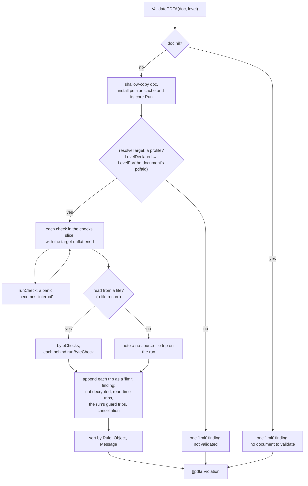
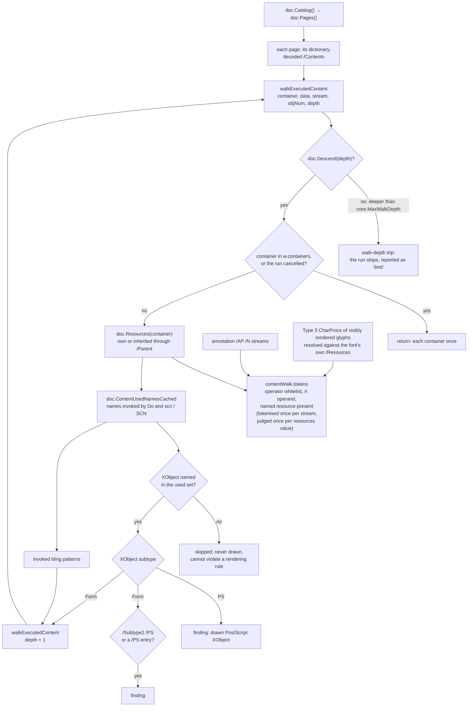

# Inside the PDF/A validator

[validators.md](validators.md) covers the validator *family*: which entry point
for which standard, and what a result promises. This doc is the engine below
`ValidatePDFA`: how a run goes, which file holds which rule, the level profile
and Level A and U, the per-run cache, and the executed-content model. Open it
when you are adding a PDF/A rule and need to know where it belongs, chasing a
false positive and need to know which check produced it, or looking at a rule
that seems oddly shaped and want the reason. `pdfa/pdfa.go` is most of the
engine; this is its map. The ratchet workflow that gates any rule change lives
in
[CONTRIBUTING](../CONTRIBUTING.md#the-corpus-ratchet--read-this-before-changing-a-validation-rule).

## How `ValidatePDFA` runs

`ValidatePDFA` (`pdfa_api.go`, dispatching to `pdfa`'s `validateView` through
`internal/bridge`) resolves the target level, runs the object-model checks,
then the byte-level checks over the file the document was read from, and last
appends what stopped any check as `limit` findings. Each check runs behind its
own `recover()` boundary, so a bug or an adversarial structure in one check
cannot crash the caller or cost the other checks their findings. The run works
on a shallow copy of the `Document` that carries its per-run cache, so it never
mutates the caller's document and is safe to run concurrently on the same
document.



A cancelled context stops the loop before its next check and skips the
byte-level checks. The cancellation is one of the trips the last step appends.

The byte-level rules read the file the document was read from
(`Document.Source`), as `Read` found it, and nothing else: they judge that file
even if the document has been edited since. To judge an edited document's bytes,
write it and read the result. A document built in memory has no file. For it
the byte-level rules do not run, and the result carries a `no-source-file`
checker finding saying so. (There used to be a variant that took the bytes as a
parameter. Bytes that were not the document's own produced findings about
neither file.)

## The anatomy of a rule

A PDF/A rule is a plain `func(core.View, Level) []Violation` in package `pdfa`:
it takes the document as seen from below (`core.View`) and the level being
validated, returns the violations it found and `nil` when there are none, and
must not mutate the document. A complete one, verbatim from `pdfa/pdfa.go`:

<!-- snippet verbatim pdfa/pdfa.go -->
```go
// Rule 6.1.3-2: Encrypt key must not be present in trailer dictionary.
func checkNoEncrypt(doc core.View, level Level) []Violation {
	if doc.Trailer.Get("Encrypt") != nil {
		return []Violation{{
			Rule:    "6.1.3",
			Level:   level,
			Message: "trailer must not contain /Encrypt",
		}}
	}
	return nil
}
```

`pdfa.Violation` has five fields. `Rule` is the ISO 19005 clause string. It is
what `RuleID()` returns and what the rule-coverage test matches against each
veraPDF rule's clause, so it is not free-form. `Level` is echoed from the
argument, `Message` is human prose, and `Object` is the anchoring object number
(`0` if none). `Check` names one requirement within `Rule`, for a validator that
composes on the PDF/A result and must tell that requirement apart from the rest
of its clause without reading the message. It is empty on findings nothing
composes on. Today only the identification rule's conformance-letter finding
sets it, to `pdfa.CheckPDFAIDConformance`. `Error()` renders as
`[PDF/A-2b 6.1.3] object 12: trailer must not contain /Encrypt`, dropping the
`object N:` segment when `Object` is 0.

Two conventions matter more than they look. **Resolve before type-asserting** —
`doc.ResolveName(dict.Get("Subtype"))`, not `dict.Get("Subtype").(Name)`, and
`doc.ResolveNumber(arr[i])` for an array element; a value hidden behind an
indirect reference (`/Subtype 12 0 R`) must neither evade a prohibition nor fail a
requirement. It has shipped at dozens of sites (2026-07-26 audit C12, C18;
2026-09-22 audit C36), so `internal/lint`'s `TestResolveBeforeAssert` now fails on a type
assertion, type switch or `==`/`!=` comparison against a `Dictionary.Get` or
`Lookup` result, an array element, a dictionary's `All`/`Values` value or an
`object.Object` parameter, in every validator package, with no allowlist. A
structural walk that deliberately visits each indirect object on its own says so
with a `case object.IndirectRef:`. `doc.Resolve` follows ref→ref chains with a
bounded hop count that doubles as a cycle guard. **Guard every recursion** — the validator eats untrusted files, so
recursive helpers thread a visited set (`map[*Dictionary]bool` or `map[int]bool`)
or a depth counter, and `arr[0]` is always length-checked.

**The panic boundary.** Every check runs through `runCheck`, which `recover()`s
and converts a panic into a finding with `Rule: "internal"` rather than crashing
the caller. Stack overflows from unbounded recursion are not recoverable and are
prevented at the source instead.

**The byte-level rules** have a different signature: they read a
`*core.FileRecord` — the file the document was read from, and what `Read`
learned about it (each object's region, each stream's keyword and declared
`/Length`, the cross-reference tables and trailers it located) — and nothing of
the object graph, which a caller may have edited since. `byteChecks` lists them,
and each runs through `runByteCheck`, its own recover boundary, so one that fails
internally costs only its own rule: `checkNoDataAfterEOF`, `checkFileHeaderBytes`,
`checkIndirectObjectSyntax`, `checkXRefTableFormat`, `checkNoXRefStreams`,
`checkStreamKeywordFormat`, `checkLinearizedTrailerID`,
`checkStreamLengthBytes`, `checkSignatureCoversFile`. A document built in memory
has no file record; the byte-level rules do not run for it, and the run records
a `no-source-file` checker finding saying so.

All findings are concatenated then sorted by `(Rule, Object, Message)`
(`finding.Sort`), so the report is the same on every run and diffs cleanly.

## Where the rules live

Every PDF/A check is dispatched from `validateView` in `pdfa/pdfa.go`: the
object-model rules from its `checks` slice, the byte-level rules from
`byteChecks`. They are spread across files by concern. Some files in `pdfa/`
hold no check at all, and `pdfa/outputintent.go` is the one people open by
mistake: the output-intent checks are in `pdfa/pdfa.go`.

| File | What it holds |
|------|---------------|
| `pdfa/pdfa.go` | The dispatch (`validateView`, `byteChecks`, `runCheck`, `runByteCheck`) and most object-model rules, including the output-intent checks (`checkOutputIntents`, `checkOutputIntentProfile`); two byte-level rules (`checkNoDataAfterEOF`, `checkSignatureCoversFile`). Mapped in [Inside `pdfa/pdfa.go`](#inside-pdfapdfago) |
| `pdfa/level.go` | The target profile: the levels, `pdfa.Levels`, `pdfa.LevelFor`, `resolveTarget`, the conformance hierarchy |
| `pdfa/identification.go` | Reading the pdfaid declaration through the XMP model (`readPDFAIdentification`); `pdfa.CheckPDFAIDConformance` |
| `pdfa/content_operators.go` | The executed-content walk (`walkExecutedContent`) and the rule it serves, `checkContentStreamOperators`; the PDF/A-4 ICC profile-identity rule (`checkICCProfileIdentity`); the content-stream implementation limits (`checkContentStreamLimits`, called from `checkImplementationLimits`) |
| `pdfa/content_facts.go` | One token pass per content stream (`scanContentBytes`, memoised per run by `contentBytesFactsOf`), shared by five token-level rules: the content-stream implementation limits, hexadecimal strings, inline-image filters, inline-image `/Interpolate` and `/Intent`, and marked-content ActualText |
| `pdfa/filestructure.go` | The byte-level clause-6.1 rules over the file record, and the object-model rules `checkNameUTF8`, `checkHexStringFormat`, `checkInlineImageFilters`, `checkStreamLength`, `checkObjectStreamDecodable` |
| `pdfa/fonts.go` | Font-dictionary rules (`checkFontDictionaries`), CMap embedding (`checkCMapEmbedded`) and CID limits (`checkCMapCIDLimit`), subset completeness (`checkFontSubsetCompleteness`), `/CIDSet` against the program (`checkCIDSetProgramComplete`, `checkCIDSetMatchesProgram`); see [fonts.md](fonts.md) |
| `pdfa/pdfa_levela.go`, `pdfa/pdfa_levela_content.go`, `pdfa/pdfa_levela_fonts.go` | Level A: tagged structure, artifacts, structure types, language, ActualText. Level A and U: Unicode character maps (`checkUnicodeMapping`) |
| `pdfa/final_rules.go` | Prohibited catalog and page entries, image intent and interpolation, the trailer `/ID`, PDF/A-4 trigger events, ActualText Private Use Area values, Type 5 halftones, embedded PDF/A files, inherited page XObjects |
| `pdfa/pdfa4_ef.go` | The PDF/A-4e and -4f variants' own requirements |
| `pdfa/xmp.go`, `pdfa/xmp_schemas.go` | XMP well-formedness, schema tables, property and extension-schema checks; see [xmp.md](xmp.md) |
| `pdfa/outputintent.go` | **No check.** The builder's side of output intents (`pdfa.OutputIntentSpec`, `pdfa.ICCComponents`). The output-intent checks are in `pdfa/pdfa.go` |
| `pdfa/trigger_events.go` | **No check.** `pdfa.TriggerEventForbidden`, the validator's `/AA` classification exported for `Repair` |
| `pdfa/create.go`, `pdfa/icc/` | **No check.** The document builder and the sRGB profiles it embeds |
| `pdfa/bridge.go` | Installs `validateView` on `internal/bridge` |
| `internal/core/function.go`, `internal/core/interp.go` | PDF function objects (types 0/2/3/4, behind tint transforms and shadings), and the content interpreter the colour and font rules read |
| `pdfa_api.go`, `embedded.go`, `limits_report.go`, `runcache.go`, `preflight.go` (root) | The entry points, the embedded-PDF/A budget, the limit reporting and run setup, the per-run cache, `Document.Repair` |

### Inside `pdfa/pdfa.go`

`pdfa/pdfa.go` is organised in `// --- … ---` sections, roughly in the order
below. Rule IDs vary by part, so the clause column gives the spread at part 1 /
parts 2 and 3 / part 4 where a helper table (`colourClause`, `annotActionClause`,
`metadataClause`, `imageClause`, `xobjectClause`, `filterClause`, `jpxClause`,
`fontClause`) resolves it. A check marked with parts runs only at those parts.

| Family | Checks | Clause |
|---|---|---|
| File structure | `checkNoEncrypt`, `checkFileID`, `checkHeader`, `checkTrailerInfo` (part 4); the byte check `checkNoDataAfterEOF` | 6.1.2, 6.1.3 |
| Metadata stream | `checkMetadataStream` | 6.7.2 |
| Output intents | `checkOutputIntents`, `checkOutputIntentProfile` | 6.2.2 / 6.2.3 / 6.2.3 |
| Catalog prohibitions | `checkNoCatalogAA` (parts 1–3), `checkNoOCProperties` (part 1), `checkPermsDict` (parts 2–4) | 6.6.1 / 6.5.2; 6.1.13; 6.1.12 |
| Streams & filters | `checkNoLZW`; `checkNoExternalStreams` | 6.1.10 / 6.1.7.2 / 6.1.6.2; 6.1.6 |
| Signatures (parts 2 and 3) | `checkSignatureContents`; the byte check `checkSignatureCoversFile` | 6.4.3 |
| Fonts (embedding) | `checkFontsEmbedded` | 6.3.4 / 6.2.11.4.1 / 6.2.10.4.1 |
| Font subsets (part 1) | `checkFontSubsets` (CharSet/CIDSet presence) | 6.3.5 |
| Annotations | `checkAnnotationSubtypes`, `checkAnnotationFlags`, `checkAnnotationAppearance` | 6.5.2, 6.5.3 / 6.3.1–6.3.3 |
| Interactive forms | `checkWidgetNoAction`; `checkNoXFA`; `checkNeedAppearances` | 6.6.2 / 6.4.1; 6.4.2; 6.4.1 |
| Actions | `checkNoForbiddenActions`, `checkNamedActions`; `checkAnnotationAA` (parts 1–3) | 6.6.1 / 6.5.1 / 6.6.1; 6.6.2 / 6.4.1 |
| Identification | `checkIdentification` | 6.7.11 / 6.6.4 / 6.7.3 |
| Info/XMP consistency (part 1) | `checkInfoXMPConsistency` | 6.7.3 |
| Transparency, prohibited (part 1) | `checkNoTransparency` | 6.4 |
| Transparency groups (parts 2–4) | `checkTransparencyBlending` | 6.2.4 |
| Images | `checkNoAlternateImages`, `checkInterpolate`, `checkNoOPI`; `checkJPXImages` (parts 2–4) | 6.2.4 / 6.2.8 / 6.2.7.1 (forms: `xobjectClause`); 6.2.8.3 / 6.2.7.3 |
| Version identification (part 4) | `checkCatalogVersion` (`/Version` must be `2.N`) | 6.1.12 |
| ExtGState & halftones | `checkExtGState` (+ `checkHalftoneErrors`) | 6.2.8 / 6.2.5 / 6.2.5 |
| Embedded files | `checkEmbeddedFiles` (forbidden at part 1; + `checkEmbeddedFileSpecs`, `/AF`) | 6.1.11 / 6.8 / 6.9 |
| Optional content (parts 2–4) | `checkOptionalContent` | 6.9 / 6.10 |
| Implementation limits (parts 1–3) | `checkImplementationLimits` (Annex C, q/Q nesting, page size) | 6.1.12 / 6.1.13 |
| Device colour | `checkDeviceColorSpaces` (+ output-intent coverage, `Default*`, group `/CS`) | 6.2.3.3 / 6.2.4.3 |
| ICCBased | `checkICCBasedProfiles`; `checkICCBasedUsageRules` (parts 2–4) | 6.2.3.2 / 6.2.4.2 |
| Separation / DeviceN | `checkSeparationDeviceN` (tint-transform consistency) | 6.2.4.4, and 6.2.3 / 6.2.4 for the colour-space values |

Section labels `MR-n` / `FP-n` / `C-n` are legacy audit IDs, not ISO numbering.
Content is not tokenised here: every rule that reads a content stream does it
through the one content lexer, `core.ContentLexer`, and the content interpreter
(`internal/core/interp.go`) that executes it with a graphics state.

### The other files

**`pdfa/final_rules.go`** — the low-frequency rules that arrived late and had no natural
home: prohibited catalog/page entries (6.11/6.12), image `/Interpolate` and
rendering intent on XObjects and inline images, file trailer `/ID` validity, A-4
trigger events (6.6.3), ActualText Private Use Area values (6.2.10.8), Type 5
halftone components (6.2.5), embedded PDF/A files (6.9) and the
inherited-page-XObject rule (6.2.2). Each embedded PDF is re-read and validated
at the level it declares (`Document.Conformance`, i.e. `LevelFor`), which applies
6.9 to its own embedded files in turn, down to `pdfa.MaxEmbeddedDepth` levels;
the file-type requirement holds at every depth. All nested validations of one
run share a budget (`maxEmbeddedPDFADocs` documents, and the run's per-stream
decode limit in bytes), so fan-out at each level cannot multiply the work. A
document deeper than the cap, or past the budget, is not validated and the run
says so under `limit`.

**`pdfa/content_operators.go`** — everything decided by reading content: the operator
whitelist (`contentOperators`, ISO 32000-1 Annex A Table A.1; anything outside it
is forbidden even inside a `BX`/`EX` compatibility section), the four
`standardRenderingIntents` for the `ri` operand, named-resource resolution for
`Do`/`sh`/`gs`/`cs`/`CS`/`Tf`, the drawn-PostScript-XObject prohibition and the
A-4 ICC profile-identity rule. `walkExecutedContent` lives here — see
[the executed-content model](#the-executed-content-model).

**`pdfa/content_facts.go`** — the rules that judge a content stream by its tokens
alone, whatever draws it and whatever its names resolve to. They read one
record per stream (`contentBytesFacts`), built by a single pass over every
token. They used to tokenise every stream once each, and once per page that drew
it.

**`pdfa/filestructure.go`** — the byte-level clause-6.1 rules, reading the file record
rather than the object model: header layout, indirect-object syntax (`obj`/`endobj`
placement, over each object's region as `Read` parsed it), the cross-reference
tables `Read` located and (at PDF/A-1) the absence of cross-reference streams,
hex-string form
(scanned in object bodies *and* in decoded content streams, with an
inline-image-aware tokenizer), `stream`/`endstream` layout, inline image filters
and intent, name UTF-8 validity. It also hosts `checkStreamLength` and
`checkObjectStreamDecodable`, object-model checks reporting defects the parser
recovered from during `Read`.

**`pdfa/pdfa_levela.go`, `pdfa/pdfa_levela_content.go`, `pdfa/pdfa_levela_fonts.go`** — the
Level A families (Tagged PDF, artifacts, structure types, language, ActualText
for Private Use Area code points), each returning early unless `level.IsA()`,
and the Unicode character-map rule shared by Level A and Level U
(`checkUnicodeMapping`, gated on `level.requiresUnicode()`): a rendered font
needs a ToUnicode CMap or one of the three exemptions, and at parts 2/3 a
ToUnicode may not map to U+0000, U+FEFF or U+FFFE. The glyph-name exemption reads
the names of the glyphs actually shown, through the font's encoding or, for a
symbolic Type 1 font with no `/Encoding`, the program's built-in encoding.

**`pdfa/create.go`** — the write side. `NewPDFADocument` /
`NewPDFADocumentWithInfo` / `NewPDFADocumentWith` build a five-object skeleton
(catalog, page tree, XMP metadata, output intent, ICC profile) that passes
pdf0's own validator at every level. All three return an error; the build →
`ValidatePDFA` round trip keeps builder and validator honest.

The sRGB destination profile is a real one from
`github.com/mgilbir/golittlecms`, versioned by level (v2.1 for PDF/A-1, which
targets PDF 1.4 and admits only ICC v2; v4 later). It is **embedded** rather
than built per document — `internal/cmd/genicc` writes the two files and
`TestTheEmbeddedProfilesAreWhatTheEngineBuilds` rebuilds them through
golittlecms and compares, so they cannot drift. Two reasons: building it per
document introduced a failure that could not happen and a panic standing in for
handling it, and an ICC profile carries its creation timestamp, so every
document used to embed a profile stamped with the moment it was generated.

**Reproducible output.** Two things in a generated document used to vary
between runs. The sRGB profile carried its own creation timestamp, which
embedding fixed. The file identifier is the other, and it is *meant* to vary —
it exists to tell this file from every other — so it is offered rather than
removed: set `pdfa.SkeletonOptions.FileID` and the bytes become a function of the
content alone. A digest of that content is the usual choice. The creation date
(`pdfa.SkeletonOptions.Created`, written as `xmp:CreateDate`) is the clock's
when left zero, so a reproducible build sets it too.

<!-- snippet
var contentDigest [32]byte
-->
```go
doc, err := pdf0.NewPDFADocumentWith(pdfa.SkeletonOptions{
    Level:        pdfa.PDFA4,
    FileID:       contentDigest[:16],
    Created:      time.Date(2026, 10, 27, 12, 0, 0, 0, time.UTC),
    OutputIntent: pdfa.OutputIntentSpec{ICCProfile: myProfile, OutputConditionIdentifier: "FOGRA51"},
})
```

With all three set, two builds of the same document are byte-identical — asserted in
`pdfa_reproducible_test.go`, along with the other direction: without a pinned
`FileID` the output *must* vary, or the first assertion is proving nothing.

The identifier is 16 random bytes from `core.RandomFileID`, shared by both
document builders. The PDF/A builder used to hash `time.Now()` with MD5, which
was a second answer to a question that already had one — and a worse one, since
two documents built inside a single clock tick would have shared an identifier.
MD5 remains in exactly one place, `internal/crypt`, where ISO 32000-1
Algorithm 2 specifies it for the standard security handler; that is the file
format, not a choice.

**Bringing your own profile.** `NewPDFADocumentWith` takes a
`pdfa.OutputIntentSpec` — the profile bytes and the output-condition identifier that
names what they characterise — and embeds it with `/N` read from the profile's
own header. Nothing of pdf0's colour management reaches the document. A profile
that is not one, that disagrees with its own declared length, that is in a
colour space a PDF/A output intent may not use (only GRAY, RGB and CMYK), or
that is ICC v4 at a level based on PDF 1.4, is refused rather than embedded —
which is what the error on these constructors is for.

**`preflight.go`** (in the root package) — `(*Document).Repair(level)`, the deliberately narrow repair
path: it removes encryption and the additional-action trigger events `level`
forbids — every `/AA` on the catalog, pages, annotations (through each page's
`/Annots`) and AcroForm fields before PDF/A-4, only the events 6.6.3 forbids at
PDF/A-4, per `pdfa.TriggerEventForbidden`, the validator's own classification —
and synthesizes a missing `/ID`. It refuses a Locked document and an unknown
level. Every fix is information-free — it deletes something
forbidden or supplies a value the producer may choose — so it can never turn a
conforming document non-conforming. Anything needing information the file does not
carry is left to the caller. Do not add a fix that has to guess.

## Level differences

A `pdfa.Level` names one **target profile** (`pdfa/level.go`): the part of ISO
19005, the conformance level (a, b or u at parts 1-3) and, at part 4, the variant
(e or f). The levels are `PDFA1a`, `PDFA1b`, `PDFA2a`, `PDFA2b`, `PDFA2u`,
`PDFA3a`, `PDFA3b`, `PDFA3u`, `PDFA4`, `PDFA4E` and `PDFA4F` (`pdfa.Levels()`).
Every rule gates on the target, never on what the document declares, with one
exception: the identification rule, which compares the declaration with the
target. So a 2u or 2a file validates clean at 2b, and a file declaring `F`
validated at plain PDF/A-4 is reported for its declaration and held to the
plain part's rules (no 4f relaxations).

The zero value is `LevelDeclared`, which is not a profile: it asks for the level
the document declares, resolved by `resolveTarget` through `LevelFor` before
anything runs. `LevelFor` is the one mapping from a declaration to a level,
which `Document.Conformance`, `Save` and the embedded-PDF/A rule share. A
document whose declaration cannot be read or names no level, and a `Level` that
names no profile (such as `pdfa.Level(99)`), get one finding under the `limit`
rule and are not validated. The builders (`NewPDFADocument`,
`NewPDFADocumentWith`, `pdfa.GenerateXMPMetadata`) refuse both with an error.

There is one pipeline for every level, and every check receives the target
**unflattened**. A check asks the profile what it means — `level.Part()`,
`level.Conformance()`, `level.IsA()`, `level.variant()`,
`level.requiresUnicode()` — and never compares a `Level` with a constant:
`level == PDFA4` is false at 4e and 4f, and that is how the variants' own rules
once became unreachable (audit C64). `internal/lint`'s
`TestPDFAChecksAskTheProfile` enforces it outside `pdfa/level.go`. One rule body
serves every level, via four idioms.

**Early return** where the rule does not apply at all: `checkNoTransparency` opens
with `if level.Part() != 1 { return nil }` — only Part 1 bans transparency outright
— and `checkNoOCProperties`, `checkFontSubsets` and `checkInfoXMPConsistency` are
Part-1-only the same way, at 1a as at 1b, each with a comment recording the
corpus evidence that Part 2 relaxed them. The Level A families return early
unless `level.IsA()`, and the Unicode-mapping rule unless
`level.requiresUnicode()` (A or U).

**A clause-helper table** for the rule ID, since the same requirement is numbered
differently per part: helpers hold a `[1b, 2b/3b, 4]` triple and switch on
`level.Part()`, so `colourClause("outputIntent", level)` yields `6.2.2` at part 1
and `6.2.3` later, and `annotActionClause("catalogAA", level)` yields `6.6.1` /
`6.5.2` / `6.6.3`. The numbering follows the veraPDF profiles and
`TestRuleCoverage` pins it: it validates each corpus fail file at its level and
ratchets how many veraPDF rules are reported under their own clause (see
[testing.md](testing.md#rule-coverage)).

**The declaration is judged in one place.** `checkIdentification` compares the
document's pdfaid identification (read through the XMP model,
`readPDFAIdentification`) with the target: the part must be the target's, part 4
must carry `pdfaid:rev 2020`, and the conformance letter must be one the target
accepts — `Level.acceptsConformance`, the one statement of the conformance
hierarchy. Following the veraPDF identification tests: a 2b/3b target accepts
`B`, `U` or `A`; 2u/3u accept `U` or `A`; 2a/3a only `A`; 1b accepts `B` or `A`
(ISO 19005-1 has no Level U) and 1a only `A`. Part 4 has no hierarchy: plain
PDF/A-4 accepts no conformance entry, 4e exactly `E`, 4f exactly `F`. The
comparison is case-sensitive (`e` is not `E`, the corpus's 6-7-3-t01-fail-c),
while `LevelFor` maps a letter case-insensitively, so a file writing `e` is held
to 4e and told about the case. No other rule reads the declaration: the PDF/A-4
variant relaxations and requirements are gated on the target's variant, so a
file declaring `F` validated as plain PDF/A-4 gets neither, plus the
identification finding. To check a file against whatever it claims, ask for
`LevelDeclared`.

**An inline `if level.Part() == 4` branch** where the requirement itself differs. The
genuine PDF/A-4 divergences:

- **Page-level output intents.** `checkOutputIntents` runs a separate A-4-only
  pass over the pages (`doc.Pages`), requiring each page `/OutputIntents` entry
  to carry `/S /GTS_PDFA1`. It runs even when the catalog has none. Their
  destination profiles are judged by `checkOutputIntentProfile` with the
  catalog's, each profile once.
- **No mandatory transparency group.** `transparencyGroupNotRequired` returns
  true at A-4 whenever *any* output intent — catalog or page — provides colour
  coverage, because at A-4 the output intent supplies the blending space
  implicitly. At 2b/3b the relaxation is narrower: catalog output intents, or
  `Default*` entries that cover every device space the page actually uses.
- **No implementation limits.** `checkImplementationLimits` returns `nil` at A-4:
  PDF 2.0 abolished the Annex C limits and ISO 19005-4 has no such clause.
- **XMP property validation deliberately off.** `checkXMPProperties`
  (`pdfa/xmp_schemas.go`) returns `nil` at every part-4 level, 4e and 4f
  included. This is a decision, not a TODO — enabling the 1b/2b/3b property
  checks at A-4 false-positives on conformant corpus files. The evidence, and
  the warning not to "implement" it, are in
  [xmp.md](xmp.md#pdfa-4-deliberately-skips-property-value-validation), which owns this
  decision.

A-4 also has its variants, gated on `level.variant()`: at `PDFA4F` and `PDFA4E`
the document-level `/AF` requirement on embedded files is relaxed and embedded
files need not be PDF/A; `PDFA4E` additionally permits `3D` and `RichMedia`
annotations and the 3D/multimedia actions plain A-4 forbids. In exchange 4f must
carry `/EmbeddedFiles` and 4e's 3D streams must be `/U3D` or `/PRC`
(`pdfa/pdfa4_ef.go`).

### Level A and Level U

**Level A** (1a/2a/3a) and **Level U** (2u/3u) are Level B plus more. Level U
adds the Unicode character-map requirement: every font used for rendering has a
ToUnicode CMap or meets one of the standard's three exemptions, and at parts 2/3
no ToUnicode maps to U+0000, U+FEFF or U+FFFE. Level A adds that and Tagged PDF
(`/MarkInfo` and a structure tree), content tagged or marked as an artifact,
role-mapped structure types without cycles, `/Lang` syntax wherever it is
written, and (parts 2/3) ActualText for Private Use Area code points. The
`PDF_A-1a`, `PDF_A-2a` and `PDF_A-2u` corpus suites are ratcheted at their own
levels (`TestCorpusLevelA`, FP=0, missed=0); part 3 has no a or u suite.

## The per-run cache

Many checks want the same expensive things, and recomputing them per check was
quadratic: content streams inflated up to three times per page, the page tree was
collected in about eight checks, and the dictionary → object number lookup
rescanned the whole object table on every font lookup (2026-07-26 audit C34 — a
real regression on documents with hundreds of thousands of objects). Every
validation therefore starts a run (`beginRunCancel`, `limits_report.go`) that
installs a per-run cache (`validationCache`, `runcache.go`) before the first
check. Its shared half is a `core.Run`, which every `core.View` built from the
run's document carries (`Document.view`). The run holds the trip recorder and
the work meter, and two kinds of memo:

- **Document services, as fields of `core.Run`**, because several subsystems
  read them: the page tree (`core.View.Pages`); the decoded bytes of each
  content stream, under the aggregate `WithMaxDecodedContentBytes` budget that
  negatively caches once exhausted, bounding what a flate bomb can force; the
  resource names each content stream invokes
  (`core.View.ContentUsedNamesCached`); parsed type-4 PostScript programs (a
  tint transform is evaluated per pixel); and the dictionary → object number
  reverse index behind `core.View.DictObjNum`.
- **Subsystem memos, in slots.** `core.Slot` returns the run's memo of a type
  the subsystem owns, creating it on first use. It is keyed by an unexported
  empty struct type the subsystem declares, so two packages cannot collide.
  PDF/A's slots include the annotations the document reaches
  (`pdfaMemoCache`), the Level A content facts, the token facts of
  `pdfa/content_facts.go` and content colour usage. PDF/UA keeps its
  per-stream content facts in one, and `internal/core` keeps its own memos
  this way too (the reachable graph, structure-type resolution, the XMP
  packet).

**It is installed on a shallow copy** of the `Document`. The copy shares the
(read-only during validation) `Objects`/`Trailer` and the immutable source
record, so it is cheap, and the caller's `*Document` is never touched. That is
what makes validation non-mutating and lets one document be validated
concurrently, at several levels at once.

**Lifetime rule.** The memos live for exactly one run and assume the document
does not change underneath it. Never mutate a dictionary, stream or the object
table from inside a check, and never keep a value from a memo beyond the call.

**Adding a memo.** A memo only PDF/A reads goes in a slot of its own: declare
an unexported empty struct as its key, and a memo type, and reach it with
`core.Slot`. Nothing on `core.Run` changes. Key entries inside it by pointer
identity (`*object.Stream`, `*object.Dictionary`) or object number, as the
existing memos do. A slot cannot tell "not computed yet" from "computed, and
the answer is the zero value", so a memo whose answer can be empty carries its
own flag, as `levelAContentMemo.valid` and `pdfaMemoCache.hasAnnots` do. Only a
memo several subsystems share belongs on `core.Run` as a field. Outside a run
(a nil `core.Run`) `core.Slot` returns a fresh memo on every call: the answers
stay right, nothing is memoised, and nothing says so. That is why a run is only
ever built by `newValidationCache`.

## The executed-content model

Many PDF/A rules apply only to content that is actually *used*, not merely
present. Colour spaces, fonts and ExtGState parameters are checked when a page
(or a form XObject, pattern or Type 3 glyph it invokes) actually references
them; see `walkExecutedContent` and `core.CollectFontTextUsage`. A form XObject
that is never drawn does not trigger font-embedding or colour rules. Two font
rules are deliberate exceptions and walk every dictionary the document reaches:
`checkCMapEmbedded` and `checkCMapCIDLimit`. This mirrors what veraPDF does, and
it is why the corpus is the oracle for rule semantics
([ADR 0001](adr/0001-corpus-as-oracle.md),
[ADR 0004](adr/0004-executed-content-model.md)).

The walk below is `checkContentStreamOperators` in
`pdfa/content_operators.go`, the operator and named-resource rule. The colour
and font rules reach the same executed content through the content interpreter.



The gate at `X` is the whole model: a form XObject present in `/Resources` but
never named by a `Do` is not executed content, so an undefined operator inside it
is not reported — and the corpus contains conforming files that rely on exactly
that. The `w.containers` set is shared across all pages, so a shared container
is walked once. The depth guard is the walk's bound against a chain of nested
forms too long for the stack, which a visited set alone cannot catch: past
`core.MaxWalkDepth` levels `doc.Descend` stops the run and the result reports it
under `limit`.

## Known limitations and edge cases

- **An empty result is not a conformance certificate** — it means no *implemented*
  check fired. For a document built in memory, `ValidatePDFA` also skips every
  byte-level rule, and says so with a `no-source-file` checker finding. A
  `Rule: "internal"` finding,
  conversely, is a pdf0 bug rather than a file defect: it is what `runCheck` emits
  after recovering a panic.
- **Every conformance suite is measured at its own level.** `TestCorpus` runs
  the `PDF_A-1b/2b/3b/4` suites, `TestCorpusLevelA` runs `PDF_A-1a`, `PDF_A-2a`
  and `PDF_A-2u` at `PDFA1a`/`PDFA2a`/`PDFA2u`, and `TestCorpusConformanceSuites`
  runs `PDF_A-4f`/`PDF_A-4e` at `PDFA4F`/`PDFA4E`, all at FP=0 and missed=0.
  The PDF/UA suites are walked at `PDFA2b`/`PDFA4` as a fail-file regression net
  only. `TestRuleCoverage` reads only the 1b/2b/3b/4 profiles.
- **The corpus has no Level U suite for part 3** and no 3a suite; `PDFA3u` and
  `PDFA3a` are the part-2 rules at part 3's clause numbers.
- **Content decoding is budgeted.** A stream over `WithMaxContentStreamBytes`
  decoded, or any stream once the run has spent `WithMaxDecodedContentBytes`,
  is not decoded, and the producer says why (`core.Reason`): a rule must read a
  declined stream as "unknown", never as "clean".
  Both trips *are* reported, under the reserved rule `limit`
  (`content-stream-size`, `decoded-content-total`) — see
  [limits.md](limits.md). `limit` and `internal` are the two rule identifiers a
  new check must never reuse: they name the checker, not the document, and
  `IsCheckerFinding` is the caller's way to tell the two apart. A cancelled
  `ValidatePDFAContext` run reports itself the same way.
- **Rule IDs are load-bearing.** `TestRuleCoverage` checks that each corpus
  fail file is reported under its veraPDF rule's clause, so emitting a working
  check under a different clause number breaks the coverage ratchet even when
  the file is still rejected. A finding about a dictionary that is not an
  object of its own anchors to object 0 (`core.View.ObjNumOf`), never to -1.
