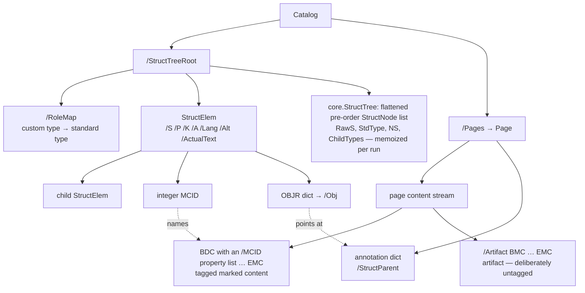
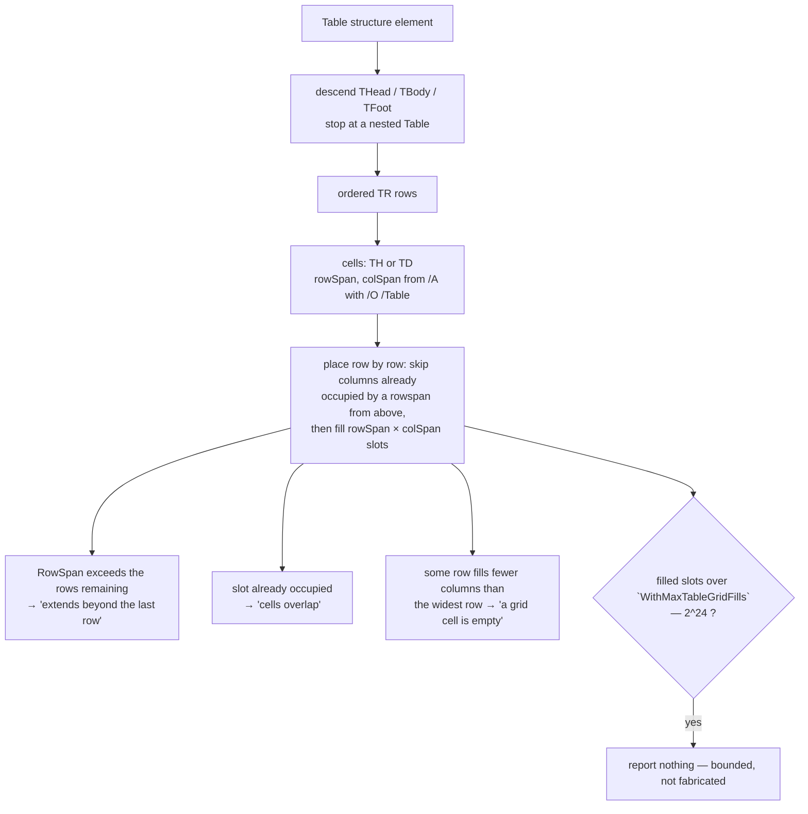

# PDF/UA accessibility validation

`ValidatePDFUA` (ISO 14289-1) and `ValidatePDFUA2` (ISO 14289-2) check whether a
document is *accessible*: whether an assistive technology can recover the
author's intended reading order, headings, table geometry, alternate text and
Unicode text from the file. Open this doc when you are adding a UA rule, chasing
a UA finding, or deciding how much a clean result is worth. The framing that
matters: **PDF/A mostly validates the page-content model — colour, fonts,
transparency, file structure — while PDF/UA mostly validates the tagged
structure tree hanging off the catalog.** Almost every UA check in pdf0 either
walks that tree, or walks page content in order to correlate it back to the
tree. [validators.md](validators.md) owns the family view and the entry-point
table; this doc is the inside of the two UA cells.

What a clean result is measured against, in short: the PDF Association's ten
conformant reference files report nothing, and over the veraPDF corpus pdf0
reports none of the PDF/UA-1 or PDF/UA-2 pass files and every fail file of
both (155 of 155 and 84 of 84). [The oracles](#the-oracles) says how that was
reached, where pdf0 and veraPDF part ways on purpose, and why.

## The structure tree comes first

Everything below depends on one traversal. `Catalog /StructTreeRoot` roots a
tree of *structure elements*: dictionaries whose `/S` names a structure type
(`Document`, `Sect`, `P`, `H1`, `Table`, `TR`, `TD`, `Figure`, …), whose `/K`
holds children, and whose `/P` points back at the parent. A child in `/K` is one
of three things: another structure element, an integer **MCID** naming a
marked-content sequence in a page's content stream, or an **OBJR** dictionary
pointing at an object (in practice an annotation).

Every element is in a structure **namespace** (ISO 32000-2 14.7.4, 14.8.6). One
with no `/NS` is in the default namespace — the PDF 1.7 standard one, in a PDF
2.0 file as in any other — and a non-standard type there is mapped by
`/RoleMap` on the structure tree root. One whose `/NS` names a namespace
dictionary is mapped by that dictionary's `/RoleMapNS`, into the default
namespace by name or into another by `[name nsdict]`. A type is resolved when
it is standard in the namespace it is in: the PDF 1.7 set
(`core.StandardStructTypes`, Table 333/337), the PDF 2.0 set (Annex M: without
Art, BlockQuote, TOC, TOCI, Index, Private, Quote, Note, Reference, BibEntry and
Code; with DocumentFragment, Aside, Title, FENote, Sub, Em, Strong, Artifact and
Hn for every n), or MathML, which needs no mapping. `core.ResolveStructType`
(`internal/core/structtree.go`) is the one resolver.

`internal/core/structtree.go` builds the tree once per run, because PDF/A Level
A asks it the same questions. `buildStructTree` walks `/K` depth-first,
descending transparently through arrays, and flattens the tree into a pre-order
`[]core.StructNode`. Each node records the element dictionary, its object number
(`-1` when reached directly), `RawS` (the type **as written**), `StdType`,
`NS`, `Mapped` and `Complete` (the resolution), `ChildTypes` (the resolved types
of its `/S` children, in order) and `Parent`. The `RawS`/`StdType` split is
load-bearing: the role-map checks report on `RawS` — it is the written type that
is unmapped — while every other check compares `StdType`, so a custom type
mapped to `H2` counts as a heading and an `/Img` mapped to `Figure` needs
alternate text. `internal/lint`'s `TestStructureChecksReadTheResolvedType` holds
that line: it fails on a read of `RawS` outside the role-map checks, and on a
validator function that walks `/K` itself and reads `/S`. `core.StructTree`
memoizes the list on the run, and `walkStructElems` filters it down to the `/S`
nodes; the nesting and annotation-placement checks read the list too, rather
than descending the tree again.

Guards on untrusted input, all verified in source. **Cycles:** every walk
(`buildStructTree`, `collectTableRows`, `checkUAFieldDescription`) dedupes on
`IndirectRef.Number`, and `forEachField` on the field dictionary,
so a `/K` pointing back at an ancestor terminates —
`TestStructTreeFlatten` builds exactly that and asserts the visit list.
**`/RoleMap` chains:** a role map may reach a standard type through intermediate
custom types (`MyPara → Para → P`), so both users of the map follow chains rather
than a single hop. `checkUARoleMapIntegrity` walks each key's chain to detect a
cycle; `core.ResolveStructType` walks it to resolve a type, across namespaces.
Both are bounded by a seen-set, so a cyclic map terminates, and both answer
each type once: a role map is a function, so every type a walk crosses shares
the walk's answer, and the answers are memoised — per run for the resolution
(for a chain in the default namespace; a namespaced type's answer is memoised
for the type itself), per check for the cycle test. The whole map costs
O(keys), charged to the run's work meter (audit 2026-09-22 C41: a per-chain
step budget let 2,000 elements each walk a 100,000-long chain, for ninety
seconds, without ever tripping). A run whose budget runs out while a chain is
followed is stopped, and the check unwound, so `checkUARoleMap` never reports
*"neither standard nor mapped"* from a truncated walk
(`TestRoleMapChainResolves`, `TestRoleMapChainTerminates`,
`TestRoleMapChainBudgetDeclines`). **Mutation:** validation installs its
per-run cache on a **shallow copy** of the `Document`, so the caller's document
is never touched (`TestUAValidationCacheIsolation`).

## The rule families

Every family below is dispatched from the single `validateView(doc, part)`
function in `pdfua/pdfua.go`. The clause column is the string the finding carries in
`pdfua.Violation.Clause`; a few cite the Matterhorn Protocol checkpoint that pins the
rule, noted in the source comments.

| Family | Clause(s) | Checks | What actually fires |
|---|---|---|---|
| Tagging and document setup | 7.1 | `checkUACatalogBasics`, `checkUASuspects` | `/MarkInfo << /Marked true >>` absent, no `/StructTreeRoot`, `/ViewerPreferences /DisplayDocTitle` not true, `/MarkInfo /Suspects` true |
| PDF/UA declaration | 5 | `checkUAIdentifier`, `checkUAIdentifierPrefix` | no XMP, no `pdfuaid:part`, a `part` that disagrees with the requested part, or a `part`/`amd`/`corr` element written with a prefix other than `pdfuaid` while bound to the PDF/UA-id namespace URI |
| Document title | 7.1 | `checkUATitle` | XMP has no `dc:title` (Matterhorn 06) — the companion to `DisplayDocTitle` |
| Header version | 6.1 | `checkUAHeaderVersion` | header is not `1.x`. **UA-1 only** — selected by the `part` parameter, not filtered afterwards |
| Structure typing | 7.1 | `checkUARoleMap`, `checkUARoleMapIntegrity`, `checkUAStructParent` | a `/S` neither standard nor mapped to a standard type (reported once per distinct type), a `/RoleMap` that remaps a standard type or is circular, an element with no `/P` |
| Element nesting | 7.2 | `checkUAStructNesting` | violates the `uaAllowedParents` / `uaAllowedChildren` tables: `TD`/`TH` outside `TR`, `TR` outside `Table`/`THead`/`TBody`/`TFoot`, `LI` outside `L`, `LBody` outside `LI`, `TOCI` outside `TOC`, and the mirror child constraints |
| Container well-formedness | 7.2 | `checkUATableListStructure` | more than one `Caption`/`THead`/`TFoot` on a `Table`, a `THead`/`TFoot` with no `TBody`, a `Table` `Caption` that is neither first nor last child, an `L`/`TOC` `Caption` that is not first |
| Table grid | 7.2 | `checkUATableGrid` | see [Table grids](#table-grids) |
| Table headers | 7.5 | `checkUATableGrid` (`tableHeaderDefects`) | in a table laid out without defects where some `TH` has no `Scope`, a `TD` whose headers cannot be determined: no `/Headers`, or one naming an `/ID` no `TH` carries — see [Table grids](#table-grids) |
| Headings | 7.4, 7.4.2, 7.4.4 | `checkUAHeadings`, `checkUAOneHPerNode`, `checkUAStrongWeak` | a skipped level (`H1` then `H3`), a first numbered heading that is not `H1`, more than one child `<H>` under one node, a document mixing `<H>` with `<H1>`–`<H6>` |
| Figures and formulas | 7.3, 7.7 | `checkFigureAlt` | a `Figure` — and, in PDF/UA-1, a `Formula` — with neither a non-empty `/Alt` nor an `/ActualText`. Any `/ActualText` counts, the empty string included: it is replacement text, and veraPDF reads it so (`ActualText != null`) |
| Notes | 7.9 | `checkUANotes` | a `Note` with no `/ID`, or two `Note`s sharing one |
| Language | 7.2 | `checkUALang`, `checkUA1LangDeterminable`, `checkUA2CatalogLang` | a *present* `/Lang` — catalog, structure element or marked-content property list — that is not an RFC 3066 Language-Tag (`uaLanguageTag`: `1*8ALPHA *("-" 1*8alphanum)`; the empty string is not one); for PDF/UA-2, no catalog `/Lang`; for PDF/UA-1 without a catalog `/Lang`, each piece of text whose language cannot be determined another way — see [Natural language](#natural-language) |
| Annotations | 7.18.1, 7.18.2, 7.18.5, 7.18.8 | `checkUAAnnotations` | `TrapNet` present, a visible annotation with no `/StructParent`, a `PrinterMark` that *has* a `/StructParent`; and, **PDF/UA-1 only**, a `Link` with no `/Contents`, or any other non-`Widget` annotation with neither `/Contents` nor an `/Alt` on its enclosing structure element. Hidden (`/F` bit 2) and `Popup` annotations are exempt throughout, and an annotation whose `/Rect` lies outside its page's crop box from the description rules |
| Annotation placement | 7.18.1 | `checkUAAnnotStructType` | an OBJR-reached annotation under the wrong structure type: `Widget` wants `<Form>`, `Link` wants `<Link>`, everything else `<Annot>` |
| Tab order | 7.18.3 | `checkUATabOrder` | a page carrying `/Annots` without `/Tabs /S` |
| Form fields | 7.18.1, 7.15 | `checkUAFieldDescription`, `checkUAXFA` (and the `Widget` arm of `checkUAAnnotations`) | a field with no `/TU` whose description sits on a pure-widget child, a `Widget` (PDF/UA-1, inside the crop box) with neither an effective `/TU` (inherited up `/Parent`, bounded to 32 hops) nor an `/Alt` on its enclosing structure element, and a dynamic XFA form (`dynamicRender` required, detected in the *decoded* packet) |
| Link targets | UA-2 8.2.5.20 | `checkUA2LinkTargets` | **PDF/UA-2 only**: one structure element enclosing `Link` annotations whose structure destinations (`/SD`, else `/D`, of a GoTo action, or `/Dest`) are different structure elements |
| Part 2's own rules | UA-2 5, 8.2.5.2, 8.2.5.12, 8.2.5.25, 8.8, 8.9.2.2, 8.9.2.4.10, 8.10.1, 8.10.2.3, 8.14.1 | `checkUA2Revision`, `checkUA2DocumentRoot`, `checkUA2NoH`, `checkUA2ListNumbering`, `checkUA2StructDestinations`, `checkUA2InvisibleAnnots`, `checkUA2FileAttachments`, `checkUA2FormOneWidget`, `checkUA2WidgetDescription`, `checkUA2EmbeddedFileDesc` | **PDF/UA-2 only**: `pdfuaid:rev`, the `Document` root, no `H`, `ListNumbering`, structure destinations, invisible annotations, `AFRelationship`, one widget per `Form`, a widget's label, an embedded file's `/Desc` — see [PDF/UA-2](#pdfua-2) |
| Media clips | 7.18.6.2 | `checkUAMediaClips` | a `/Type /MediaClip` dictionary anywhere in the document (`core.View.ReachableDicts`, direct dictionaries included) missing `/CT`, missing `/Alt`, or with an `/Alt` carrying no non-empty string |
| Fonts | 7.21.3.1–7.21.8, 7.21.4.1/.2, 7.21.5, 7.21.6 | `checkUAFonts`, `checkUAFontDicts`, `checkUACMaps`, `checkUACMapWMode`, `checkUACIDSystemInfo`, `checkUAToUnicodeValues`, `checkUAFontSubsetGlyphs`, `checkUANotdefCID`, `checkUAFontWidths` | not embedded, `CIDFontType2` without `/CIDToGIDMap` or with a non-`Identity` name, symbolic TrueType with an `/Encoding`, non-symbolic TrueType not on MacRoman/WinAnsi, or with a `/Differences` naming a glyph not in the Adobe Glyph List (`fontcheck.AGLListed`: the list's names and `.notdef`, not `uniXXXX`) or, its program embedded, with no (3,1) cmap subtable to look the names up in, a shown glyph whose declared width differs from the program's by more than 1/1000 (text in rendering mode 3 only is exempt), a CMap neither predefined nor embedded, an embedded CMap whose `/WMode` disagrees with the stream's own, a `CIDSystemInfo` Registry/Ordering/Supplement mismatch with the CMap, a `ToUnicode` mapping to U+0000/U+FEFF/U+FFFE, a subset `/CharSet` or `/CIDSet` disagreeing with the embedded program, and a shown CID 0 (`.notdef`) |
| Character mapping | 7.2 | `checkUACharMapping` | text shown with a Type 0 Identity-encoded font that has no `ToUnicode` (Matterhorn 10-001), unless its descendant is in the Adobe-GB1, -CNS1, -Japan1 or -Korea1 collection, whose Unicode mapping Adobe publishes. A deliberately narrow case of 7.21.7, not all of it |
| Real content vs artifacts | 7.1 | `checkUARealContent` | text, a painted path, an inline image, an image XObject, or what a form XObject paints, outside any marked-content sequence; see [Content-level checking](#content-level-checking) |
| XObjects | 7.20 | `checkUAReferenceXObjects`, `checkUAFormXObjectMCID` | a Form XObject carrying `/Ref` (a reference XObject), or a form containing `/MCID` painted by more than one `Do` |
| Security | 7.16 | `checkUASecurity` | an encrypted document with no `/P`, or `/P` with permission bit 10 (extract for accessibility) clear |
| Optional content | 7.10 | `checkUAOptionalContent` | an OC configuration (`/D` or an entry of `/Configs`) with an empty `/Name`, or carrying `/AS` |
| Embedded files | 7.11 | `checkUAEmbeddedFiles` | a file specification with `/EF` whose `/F` or `/UF` is empty |

Every font family above iterates `core.CollectFontTextUsage` — the same
**executed-content model** PDF/A uses ([ADR 0004](adr/0004-executed-content-model.md)):
a font dictionary that is never used to *show text* is not checked. The content
interpreter behind it memoises its executions on the run, so every font check
reads the same answer and the content is executed once.

## Content-level checking

`pdfua/pdfua_content.go` and, for language, `pdfua/pdfua_lang.go` are where UA
validation reads content streams. The first tokenizes each stream once, with the
one content lexer (`core.ContentLexer`),
and derives a `streamContentFacts` — memoized per `*Stream` in the run's PDF/UA
slot (`core.Slot`) — holding
the distinct real-content violation messages, the sequence of XObject names in
effect at each `Do` (and those painted outside any marked content), and the
property lists' `/Lang` values. The real-content model (Matterhorn checkpoint 01) classifies
each marked-content sequence as `BDC`/`BMC` opens it: **artifact** (first operand
`/Artifact`), **tagged** (the property list carries an `/MCID`), or
**transparent** — anything else, notably `/OC` optional content and
property-less `BMC`, which participates in nesting balance but in no rule.

Three conditions then fire. Content with an empty marked-content stack is
untagged real content (01-005; veraPDF 7.1-t03): a text-showing operator (`Tj`,
`TJ`, `'`, `"`), a path-painting operator (not `n`, so a clipping path is not
content), an inline image, an image XObject painted by `Do`, and the content of
a form XObject painted by `Do`, which `checkUARealContent` enters and judges as
if it stood outside any sequence, as veraPDF does. An artifact opened inside a
tagged ancestor is 01-003, and tagged content opened inside an artifact
ancestor is 01-004. `TestUARealContent` pins all three plus the `/OC`-wrapping
case that must stay clean; `TestUARealContentImage` pins the content kinds.

A shading painted by `sh` outside marked content is content too, and veraPDF
reports it, but pdf0 does not: the PDF Association's PDFUA-Reference-06 paints
its page backgrounds that way, and the reference files are the oracle that wins
(see [The oracles](#the-oracles)).

A form XObject painted outside marked content is judged once for the run when
it has resources of its own, however many pages or forms paint it: forms
painting forms are a graph whose paths multiply, and
`TestFormFanOutIsWalkedOnce` builds 210 forms with 30^7 paths through them.

The lexer yields tokens one at a time into a reused token rather than returning
a slice of them, and the analysis keeps no operand buffer — only the few
facts a `BDC`/`BMC` actually consults (its tag, an `/MCID`, a `/Lang`, a named
property list; `mcOperands`). The two are the same point: a real
document's page can hold millions of operands, none of which any rule reads back,
and materializing them cost more than the whole scan. On a 117 MB file the token
slice alone was 45 GB of allocation, about 94% of the run's total;
`BenchmarkContentHeavyUAValidation` watches `allocs/op` for the regression.

The tie back to the structure tree is `checkUAFormXObjectMCID` (7.20): a form
XObject whose decoded bytes contain the `/MCID` token is tagged content, and
tagged content must map one-to-one onto structure, so painting it twice is a
violation. Counting the paints resolves the `doNames` sequence against each
container's `/XObject` resources — pages *and* other forms, since a form may
invoke a form. `TestRealContentSharedStreamMemo` builds 20 000 pages sharing one
stream and requires one cache entry but 20 000 findings, one per page object:
the memo must collapse the *analysis*, never the *reports*.

Note what the real-content model does **not** do: it never resolves an `/MCID`
integer to the structure element that owns it. Marked-content sequences are
classified by shape, not matched to the tree. The language rules below are the
one place an `/MCID` is resolved, and they resolve it through the structure
tree's `/K` entries (an integer kid on the element's `/Pg` page, or an MCR),
not through `/ParentTree`.

## Natural language

ISO 14289-2 8.4.4 requires the catalog `/Lang`, and `checkUA2CatalogLang`
reports a PDF/UA-2 file without one. ISO 14289-1 7.2 requires less: that the
natural language be declared, which the catalog `/Lang` does for everything at
once and `/Lang` entries on structure elements and marked content do piece by
piece. Requiring the catalog entry reported 21 veraPDF PDF/UA-1 pass files that
declare the language only piecewise (`7.2-t21-pass-b` … `7.2-t34-pass-d`).

So for PDF/UA-1, `checkUA1LangDeterminable` does what the veraPDF profile does:
when the catalog has no `/Lang` string (any string settles it — an empty or
malformed one is `checkUALang`'s to report), it asks each text-bearing object
whether its language can be determined another way.

| veraPDF rule | Object | Determined by |
|---|---|---|
| 7.2-t02 | outline entries | nothing but the catalog: an outline with a `/First` entry is reported |
| 7.2-t21, t22, t23 | a structure element's `/ActualText`, `/Alt`, `/E` | a `/Lang` on the element or an ancestor |
| 7.2-t24 | an annotation's `/Contents` | a `/Lang` on its enclosing structure element |
| 7.2-t25 | a form field's `/TU` | likewise |
| 7.2-t30, t31, t32 | a `Span` marked-content sequence's `/ActualText`, `/Alt`, `/E` | a `/Lang` in scope (below) |
| 7.2-t33 | an XMP language alternative | reported when its only item is `x-default` |
| 7.2-t34 | text shown in content | a `/Lang` in scope (below) |

A language is in scope for a marked-content sequence when its property list
has a `/Lang`, when its `/MCID` belongs to a structure element that has one or
whose ancestor does, or when an enclosing sequence's language is in scope. A
form XObject's content inherits the scope it is painted in, and an
annotation's appearance stream the `/Lang` of the annotation's enclosing
structure element (`langScope`). Each content stream is tokenized once for
this (`langEvents`, memoized per stream) and replayed per page, charged to the
work meter. `TestUA1LanguageDeterminable` holds each row, and that a catalog
`/Lang` clears all of them.

The syntax rule applies to both parts. A `/Lang` must match RFC 3066's
Language-Tag, as ISO 32000-1 14.9.2 cites it and the veraPDF CosLang rule
reads it: a primary subtag of one to eight letters, then subtags of one to
eight letters or digits. BCP 47's stricter shape is not the rule — the corpus
passes `p` and `p-pt` (`7.2-t29-pass-b`, `-d`, `-f`) — and the empty string is
not a language identifier (`7.2-t29-fail-n`, `-o`, `-p`), though ISO 32000 lets
it mean "unknown": an unknown language is not a declared one.

## Table grids

`pdfua/pdfua_tablegrid.go` reconstructs a table's logical grid, because the defects
PDF/UA cares about are invisible to a tree walk. A walk can tell you a `TD` sits
under a `TR` under a `Table`; it cannot tell you row 2 has a hole, because
whether row 2 is complete depends on `/RowSpan` values declared in row 1 and on
`/ColSpan` values declared by *earlier cells in the same row*. Occupancy is a
two-dimensional fact and needs a two-dimensional model.

`collectTableRows` gathers the rows in document order, descending through
`THead`/`TBody`/`TFoot` row groups but stopping at a nested `Table` (which is
laid out separately, on its own pass through the flattened tree).
`collectRowCells` reduces each `TR` to `TH`/`TD` cells with their spans, read by
`cellSpan` from an attribute dictionary whose owner `/O` is `Table`; a missing or
non-positive value becomes 1. `layoutTable` then places the cells, recording
each cell's slot (`gridDefects` is its defects alone):

Two design points are deliberate and tested. **Only unambiguous defects are
reported**, so a well-formed table never raises a false positive. **The layout is
budgeted:** `WithMaxTableGridFills` counts *actually filled* slots, not the nominal
rows × columns area, so a genuinely large sparse table is unaffected while a cell
claiming a two-billion-column span trips the budget and the table is skipped
rather than laid out — and the trip is reported, as `table-grid-fills` under the
reserved clause `limit`, so "no grid defects" cannot be read as "clean" when the
grid was never built ([limits.md](limits.md)). Tables that share one `/K`
array are laid out once, and the slots every layout fills are charged to the
run's work meter, so many tables each near the per-table bound still cost the
run what they cost. The work meter (`work`) and a cancelled
`ValidatePDFUAContext` run report through the same clause. `TestGridDefectsSpanBomb` throws four shapes at it (huge
ColSpan, huge RowSpan, near-int-max spans that must not overflow the budget
arithmetic, and many moderate cells that cumulatively blow it) and requires a
return within 25 s. `TestGridDefectsSparseHuge` builds 60 000 × 30 000 and
requires O(rows) — which is why the hole test compares `len(occupied[r])` against
the max width instead of scanning the grid.

A table laid out without defects is then asked about its headers (7.5,
`tableHeaderDefects`), the way veraPDF's GFSETable asks. When every `TH` has a
`Scope` the table is determinable. Otherwise every `TD` must name its headers in
a `/Headers` table attribute, each name the `/ID` of a `TH` in the table; in
PDF/UA-2 a `TD` that does not may instead find a header by position
(`positionalHeaders`): going up a column or left along a row, a `TH` whose
`Scope` points that way, or — without a `Scope` — whose slot does (`Column` in
the first row, `Row` in the first column, `Both` elsewhere). veraPDF 1.30.3
does not search by position for PDF/UA-1, and neither does pdf0. A `Scope` is
read as written: one of the empty name is present, and points nowhere
(`8.2.5.26-t05-fail-a`). The positional search walks each column and row once,
carrying its state, so it costs the slots the layout already paid for.

The `TD` at the top-left slot is exempt: it is the stub head, where the header
row and the header column cross, and no header pertains to it. veraPDF knows
only that position. pdf0 exempts a stub head wherever the crossing is
(`stubHeads`: a `TD` every other slot of whose rows and columns is a `TH`),
because PDFUA-Reference-08 has two, blank cells starting a column-header row in
the middle of a table whose first column is all row headers, and veraPDF 1.30.3
reports both.

The rule is about the data cells. The rule it replaced asked every `TH` for a
`Scope` or an `/ID`; a conforming table need not give one to a header no data
cell refers to (`7.5-t01-pass-e`, `8.2.5.26-t05-pass-e`).
`TestUATableHeaderAssociation` holds the boundaries.

## PDF/UA-2

`ValidatePDFUA2` runs the same checks with `part` "2" (`pdfua/pdfua2.go` holds no
code, only a comment, after its package clause, describing what part 2 shares
and what it changes). Parameterizing by `part` (rather than
post-filtering findings by message text, as an earlier version did — audit C39)
is what makes the identification rule demand `pdfuaid:part 2`, makes the UA-1
`1.x`-header rule not run at all, and adds the rules only part 2 has: the
declared version (the header, or a later catalog `/Version`) must be 2.0 — one
that cannot be read is not; a type in an explicit namespace must not be
role-mapped back into that namespace (ISO 14289-2 8.2.4); MathML's `math`
must sit in a `Formula` (8.2.5.29); `Link` annotations targeting different
locations must sit in different structure elements (8.2.5.20); and the rules
in the table below. Where the two
standards differ on a shared rule, the part selects that too: PDF/UA-2 requires
the catalog `/Lang` where PDF/UA-1 asks only that languages be determinable;
PDF/UA-1's annotation-description rules (7.18.1, 7.18.5) and `Formula` rule
(7.7) are not PDF/UA-2's — ISO 14289-2 makes a `Link`'s `/Contents` a "should"
(8.9.2.4.2) and lets markup annotations omit it (8.9.2.3), and the veraPDF
PDF/UA-2 profile has none of them; and PDF/UA-2 finds table headers by
position. Every finding carries `Part`, and `Error()`
prints it: `[PDF/UA-2 …]`. The shared rules keep their ISO 14289-1 clause
numbers; read the clause against the standard you invoked.

The rest of part 2's own rules are in `pdfua/pdfua2_ident.go`,
`pdfua/pdfua2_struct.go` and `pdfua/pdfua2_interactive.go`, and
`pdfua/pdfua2_rules_test.go` holds each one's boundaries. The veraPDF
PDF/UA-2 profile states each rule; what its properties read — which children
of the root count, what a widget's label is — is veraPDF 1.30.3's model code,
and each check reads the same:

| Clause | Check | Reports |
|---|---|---|
| 5 | `checkUA2Revision` | a packet declaring a PDF/UA part whose `pdfuaid:rev` is absent, is not `2024`, or is written with a prefix other than `pdfuaid` |
| 8.2.5.2 | `checkUA2DocumentRoot` | a structure tree root whose children are not exactly one `Document`, or whose `Document` is not in the PDF 2.0 namespace. Children are read through `NonStruct`, `Div` and `Part`, and only types that resolve count, as veraPDF reads them. A `Part` holding the `Document` passes this rule; veraPDF reports it under ISO/TS 32005's containment rules, which pdf0 does not implement |
| 8.2.5.12 | `checkUA2NoH` | an element whose type resolves to `H` |
| 8.2.5.25 | `checkUA2ListNumbering` | an `L` with an `LI` that has an `Lbl` (both through grouping elements) and whose `ListNumbering` is absent or `None`. The attribute is the first one owned by `List` in `/A`, else in the `/ClassMap` classes `/C` names, else the parent element's |
| 8.8 | `checkUA2StructDestinations` | an outline item's or a `Link` annotation's `/Dest` (when the dictionary has no `/A`), or an array `/OpenAction`, that is not a structure destination; a GoTo action with no `/SD` whose `/D` is not a name or string naming one. The actions are those of outline items and annotations, the open action, the `/AA` of the catalog, the pages, the annotations and the form fields, and their `/Next` chains |
| 8.9.2.2 | `checkUA2InvisibleAnnots` | an annotation with the Invisible flag (bit 1) enclosed by a structure element that neither is nor sits inside an `Artifact` |
| 8.9.2.4.10 | `checkUA2FileAttachments` | a `FileAttachment` annotation whose `/FS` is not a dictionary with an `/AFRelationship` name; a string `/FS` is reported, as veraPDF reports it |
| 8.10.1 | `checkUA2FormOneWidget` | a `Form` element with more than one OBJR child naming a `Widget` |
| 8.10.2.3 | `checkUA2WidgetDescription` | a field's widget (it has `/T` or a `/Parent`) in the structure tree, outside any `Artifact`, with no `/Contents` string and no `Lbl` with content beside it in its enclosing element. An empty `/Contents` is one |
| 8.14.1 | `checkUA2EmbeddedFileDesc` | a file specification in the `EmbeddedFiles` name tree with no `/Desc` |

Two walks here follow what the file says without a bound of their own, and are
made safe instead: an action's `/Next` chain is followed iteratively, each
indirect object once, so an array that holds itself ends
(`TestUA2ActionChainTerminates`); and a list's inherited `ListNumbering` is
memoised per element, so nested lists each asking their whole ancestry cost
linear time, not quadratic (`TestUA2ListNumberingDeepNesting`). Both, and the
outline walk, are charged to the run's work meter.

Validated as PDF/UA-2, every file of both corpus suites and the ten reference
files draws each of these rules exactly when veraPDF 1.30.3's `-f ua2` does,
and the same number of times, with one exception: 8.10.2.3 reads an
annotation's enclosing element through the OBJR that names it
(`annotContext`), where veraPDF looks its `/StructParent` up in `/ParentTree`
([Confirmed limitations](#confirmed-limitations)), and `8.10.2.3-t01-fail-a`
has a second widget that only its `/ParentTree` entry places in a `Form`.

Structure types are resolved in the element's namespace (above), so a `/Title`
in the PDF 2.0 namespace is a standard type. What is not done: rules of the
veraPDF PDF/UA-2 profile that no corpus file fails, among them 8.2.5.25-t02
(real content directly in an `LI`), 8.9.2.2-t02 (an annotation with NoView
set), 8.10.1-t03 (an XFA form of any kind) and 8.10.2.3-t02 (a widget with
`/AA` needs `/Contents`), and PDF/UA-2's rules for the 2.0-only types (FENote,
Title). The WTPDF examples, real PDF/UA-2 documents that veraPDF passes, are
not held to `ValidatePDFUA2` by any test, and four of them are reported, for
rules shared with part 1: a first heading that is not `H1`, table headers, an
untagged annotation, and an XMP packet pdf0 cannot parse. This does not assert
full ISO 14289-2 conformance.

`ValidatePDFUA2` is also unreachable from the CLI: `pdf0 ua` only ever calls
`ValidatePDFUA` ([cli.md](cli.md)).

## The oracles

A UA rule is held to two external sets of files, and a new or changed rule must
leave both where they are. Neither is committed: `spec/` and `testdata/` are
gitignored.

**The PDF Association reference files.** `TestUAReferenceFilesNoFalsePositives`
(`pdfua_reference_test.go`) reads the ten conformant PDFUA-Reference-Files in
`spec/pdfua/reference-files/` and fails on *any* violation, with the message
"false positive on a conformant file". There is no `make` target; place them by
hand. Like every hand-placed data set (`internal/testfiles`), the test skips when
the directory is absent and fails when it is present but holds no PDF.

**The veraPDF corpus.** `TestCorpusPDFUA` (`pdfua_corpus_test.go`) runs
`ValidatePDFUA` over the corpus's `PDF_UA-1` suite and `ValidatePDFUA2` over its
`PDF_UA-2` suite (`make corpus`, at the pinned revision). A `-pass-` file is one
veraPDF accepts, a `-fail-` file one it rejects; a finding about the checker
rather than the document (`IsCheckerFinding`) counts neither way. It is a
ratchet, like the PDF/A `TestCorpus`: it fails if more pass files are reported
or fewer fail files caught than its baselines, and logs the numbers to update
them with after an intended change. veraPDF 1.30.3 itself agrees with every
file's expected result in both suites.

| Suite | Pass files reported | Fail files caught |
|---|---|---|
| `PDF_UA-1` | 0 of 141 | 155 of 155 |
| `PDF_UA-2` | 0 of 54 | 84 of 84 |

Until the docs audit of 2026-10-11 (D12) only the reference files were held,
and nothing ratcheted the corpus. It had drifted both ways: 30 PDF/UA-1 and 8
PDF/UA-2 pass files were reported, while this doc called the character-mapping
rule false-positive-free; and the PDF/UA-1 catch rate, recorded as 155 of 155
in July 2026, was 150. The drop was not a regression. Five fail files
(`7.1-t03-fail-a`, `7.7-t01-fail-a`, `-b`, `7.21.5-t01-fail-a`,
`7.21.6-t02-fail-d`) were caught only by a false positive: their catalog
`/Lang` is the UTF-16 text "EN-US", which `checkUALang` judged as raw bytes.
Commit d0c9bde (2026-09-23) decoded it, and the five were honestly missed. All
five are caught again now, by the rules they test; the last two, with their
PDF/UA-2 twins `8.4.5.6-t01-fail-a` and `8.4.5.7-t02-fail-d`, by the width and
`/Differences` rules the PDF/A engine shares through `internal/fontcheck`. On
both suites and the ten reference files pdf0 now reports 7.21.5 (8.4.5.6), and
the base-encoding and `/Differences` half of 7.21.6 (8.4.5.7), on exactly the
files veraPDF 1.30.3 does.

The reported pass files were each the rule's fault, and each rule now reads as
veraPDF's does:

| Pass files | Rule | What was wrong |
|---|---|---|
| `7.2-t21-pass-b` … `7.2-t34-pass-d` (21) | catalog `/Lang` | PDF/UA-1 does not require it (see [Natural language](#natural-language)) |
| `7.2-t29-pass-b`, `-d`, `-f`; UA-2 `8.4.4-t02-pass-b`, `-d`, `-f` | `/Lang` syntax | BCP 47 is not the grammar; `p` is a Language-Tag |
| `7.18.1-t02-pass-a`, `-e`; `7.18.1-t03-pass-b` | annotation description | the `/Alt` is on the enclosing structure element |
| `7.18.1-t02-pass-d`, `-h`; `7.18.1-t03-pass-d` | annotation description | the annotation is outside the crop box |
| UA-2 `8.2.5.20-t02-pass-a`, `-b` | `Link` `/Contents` | not a PDF/UA-2 requirement |
| `7.21.7-t01-pass-a`; UA-2 `8.4.5.8-t01-pass-a` | character mapping | an Adobe-Japan1 font needs no `ToUnicode` |
| `7.3-t01-pass-c`; UA-2 `8.2.5.28.2-t01-pass-c` | figure alternate text | an empty `/ActualText` is replacement text |
| `7.5-t01-pass-e`; UA-2 `8.2.5.26-t05-pass-e` | table headers | the rule is about data cells naming their headers |

No fail file in either suite is missed. The last ones were the four font fail
files — `7.21.5-t01-fail-a` and `7.21.6-t02-fail-d`, and their PDF/UA-2 twins
`8.4.5.6-t01-fail-a` and `8.4.5.7-t02-fail-d` — caught by the width and
`/Differences` rules above, and the fourteen PDF/UA-2 fail files of part 2's
own rules — `5-t04` and `5-t05`, `8.2.5.2`, `8.2.5.12`, `8.2.5.25`, `8.8`,
`8.9.2.2`, `8.9.2.4.10`, `8.10.1-t02`, `8.10.2.3` and `8.14.1` — each caught by
the rule it tests ([PDF/UA-2](#pdfua-2)).

**When the two oracles disagree, the reference files win.** veraPDF 1.30.3
reports five of the ten reference files; pdf0 reports none. Two of veraPDF's
findings are rules pdf0 applies and narrows on purpose, so the reference file
stays clean:

- PDFUA-Reference-06 paints its page backgrounds with `sh` outside marked
  content (veraPDF 7.1-3). Untagged shadings are not reported.
- PDFUA-Reference-08 has two blank stub-head data cells with no `/Headers`
  (veraPDF 7.5-1). A stub head is exempt wherever it is ([Table
  grids](#table-grids)).

The rest are font rules pdf0 implements more narrowly or not at all: 7.21.4.2-2
(`/CIDSet` completeness) on Reference-02, -06, -07, -08 and -10, and 7.21.4.1-1
and 7.21.7-1 on Reference-10. When the spec as written would flag a reference
file, the reference file wins — the same corpus-as-oracle discipline as PDF/A
([ADR 0001](adr/0001-corpus-as-oracle.md)).

A third external set backstops the *parser* rather than the validator:
`TestWTPDFExamples` (`wtpdf_test.go`) runs the LaTeX Project's Well Tagged PDF /
PDF/UA-2 examples — real PDF 2.0 files with structure trees, associated files,
MathML and custom role maps — asserting each parses, reports version `2.0`, has
pages, and survives Read → Write → Read. Fetch with `make wtpdf`
(`testdata/wtpdf/`, also gitignored). The data sets and their provenance are
tabulated in [testing.md](testing.md).

## File map

| File | Owns | Governing clauses |
|---|---|---|
| `pdfua/pdfua.go` | `pdfua.Violation`, the `validateView(doc, part)` dispatch (reached from the root's `ValidatePDFUA` and `ValidatePDFUA2` in `pdfua_api.go`), and most rules: identification, title, fonts and CMaps, annotations, form fields, media clips, optional content, embedded files, headings, figures and formulas, PDF/UA-2 link targets | 5, 6.1, 7.1–7.4, 7.7, 7.10, 7.11, 7.15, 7.16, 7.18.x, 7.20, 7.21.x, UA-2 8.2.5.20 |
| `pdfua/pdfua_lang.go` | natural language: `/Lang` syntax, the PDF/UA-2 catalog `/Lang`, and PDF/UA-1's per-object determinability with its content replay (`langScope`) | 7.2, UA-2 8.4.4 |
| `pdfua/pdfua_fontprog.go` | the glyph-width rule, over `internal/fontcheck`, and its rendering-mode exemption | 7.21.5 (UA-2 8.4.5.6) |
| `pdfua/pdfua_annotctx.go` | `annotContext`: each page annotation's enclosing structure element and its page's crop box | 7.18.1, 7.18.5 |
| `pdfua/pdfua_struct.go` | Its names for `core.StructTree` and `walkStructElems`, element nesting tables, container well-formedness, heading strength, `Note` IDs, `/Suspects`, UA-1 header version, the two PDF/UA-2 namespace rules | 7.1, 7.2, 7.4.4, 7.9, 6.1, UA-2 8.2.4 and 8.2.5.29 (and ISO 32000-1 14.8.4.3) |
| `pdfua/pdfua_content.go` | `streamContentFacts`, real-content vs artifact analysis, the form-XObject paint count, OBJR annotation placement | 7.1, 7.18.1, 7.20 |
| `pdfua/pdfua_tablegrid.go` | the table grid reconstruction and the data cells' header association | 7.2, 7.5 |
| `pdfua/pdfua2_ident.go` | `pdfuaid:rev`, PDF/UA-2's half of the identification | UA-2 5 |
| `pdfua/pdfua2_struct.go` | part 2's structure rules: the `Document` root, no `H`, `ListNumbering`, one widget per `Form`; the grouping-element view of an element's children they share (`semanticParents`) | UA-2 8.2.5.2, 8.2.5.12, 8.2.5.25, 8.10.1 |
| `pdfua/pdfua2_interactive.go` | part 2's navigation, annotation, widget and embedded-file rules: structure destinations and the actions that hold them, invisible annotations, `AFRelationship`, a widget's label, an embedded file's `/Desc` | UA-2 8.8, 8.9.2.2, 8.9.2.4.10, 8.10.2.3, 8.14.1 |
| `pdfua/pdfua2.go` | No code: a comment (after the package clause, so not the package's doc comment) on what part 2 shares with part 1 and what it changes; the rules themselves are in the files above, selected by `part` | ISO 14289-2 clauses 4, 8.2.4, 8.2.5.20, 8.2.5.29, 8.4.4, the part-2 files' clauses and the shared clauses |

Shared machinery lives outside these files, in `internal/core`: the content
interpreter behind `core.CollectFontTextUsage`, the run and its memos
(`core.Run`), the content lexer (`core.ContentLexer`), `core.DecodeXMPToUTF8`,
and `core.LoadFontProgram` over forme's font parsers. The font checks PDF/A
states in the same words — the width comparison, a CIDFont's `/W`, the Adobe
Glyph List — are `internal/fontcheck`'s, which both engines call
([fonts.md](fonts.md#encodings-and-character-mapping)).

## Confirmed limitations

- **No `/ParentTree` validation.** The number tree mapping `/StructParents` and
  `/StructParent` keys back to structure elements is never read. Annotations are
  checked for the *presence* of `/StructParent` and correlated to the tree
  through OBJR only, and content-stream MCIDs are resolved, for the language
  rules only, through the structure tree's `/K` entries. veraPDF reads
  `/ParentTree` for both; on a file whose two disagree, the answers can differ
  — and do on `8.10.2.3-t01-fail-a`, where PDF/UA-2's widget-label rule
  reports one widget to veraPDF's two ([PDF/UA-2](#pdfua-2)).
- **A `Scope` value is read, not validated.** One other than `Row`, `Column` or
  `Both` counts as a `Scope` and points nowhere; nothing reports it.
- **A panic is contained, but a stack overflow is not.** Every UA check now runs
  behind a `recover()` boundary and a panic is reported as an `internal` finding
  (this closed C27). Unbounded recursion that overflows the stack remains fatal
  and is guarded at the source instead — see [validators.md](validators.md).
- **Two font rules are narrowed on purpose:** the `/CIDSet` arm of 7.21.4.2 is
  skipped unless `CIDToGIDMap` is `Identity`, and the simple-font `.notdef` case
  of 7.21.8 is unimplemented — both documented in-source as false-positive
  avoidance, not oversights.
- **The width rule (7.21.5) is narrower than veraPDF's in three places.**
  Rendering modes are recorded per font, not per glyph
  (`core.FontTextUsage.Modes`), so a font is exempt only when all its text is
  in mode 3; one that mixes mode 3 with another has every glyph compared, where
  veraPDF exempts the mode-3 glyphs. A TrueType code pdf0 reads as `.notdef` is
  not compared: when the encoding's glyph name finds nothing, veraPDF looks the
  code itself up in the cmap and compares that glyph, a fallback pdf0 does not
  model (corpus `7.21.6-t02-fail-a`, whose `/BaseEncoding /Identity` names
  nothing, is no 7.21.5 failure to veraPDF). And a font program pdf0 cannot
  read is not compared. The `/Differences` half of 7.21.6 likewise says
  nothing of a program it cannot read, where veraPDF fails a program it could
  not parse.
- **A clean result is not conformance.** Matterhorn checkpoints covering reading
  order, colour-as-sole-meaning and most semantic judgements are outside what a
  static checker can assert.
