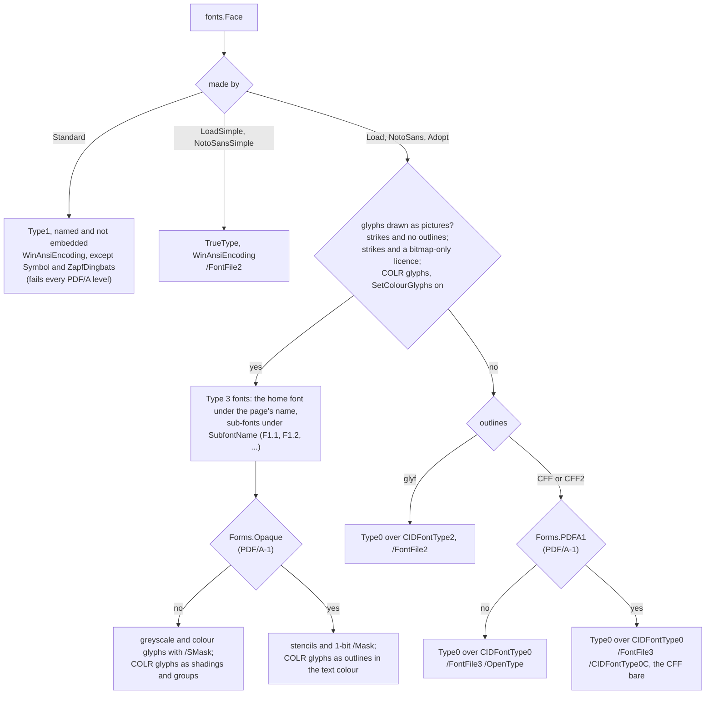

# Setting text

How to put text on a page with a font, embed the font, and get the text back
out. Reach for this when you build a document with `content.Builder` and want
words on it. For what the writer puts in the file — the font dictionaries,
`/CIDSet`, CFF, Type 3 bitmap and colour fonts — see
[font-embedding.md](font-embedding.md). For why a validator reports a font, see
[fonts.md](fonts.md). HTML and CSS set their text through this same package;
[htmlpdf.md](htmlpdf.md) is that route.

```go
face, err := fonts.NotoSans() // bundled: Latin, Greek, Cyrillic, Devanagari
if err != nil {
    return err
}
doc := pdf0.NewDocument()

var b content.Builder
b.BeginText().SetFont("F1", 24).MoveText(72, 720)
face.DrawShaped(&b, "Office files, naïve café — हिन्दी", 24)
b.EndText()

// Naming the face here embeds it once the page is drawn, subset to the
// glyphs it set.
if _, err := doc.AddPage(pdf0.Page{
    Width: 595, Height: 842, Content: &b,
    Faces: map[object.Name]*fonts.Face{"F1": face},
}); err != nil {
    return err
}
return doc.Write(w)
```

That is the whole of it for most documents: load a face, draw with it inside a
text object whose font is selected under some name, and name the face on the
page under that name. `examples/text` does the same with line breaking, and
embeds by hand with `Face.Embed` instead (see [Embed after drawing, or let the
page do it](#embed-after-drawing-or-let-the-page-do-it)).

## Pick a face

| call | is | use it for |
|---|---|---|
| `fonts.NotoSans` | the bundled Noto Sans, composite | anything, with no font file to find; no Arabic or Hebrew (`Scripts` says what it has) |
| `fonts.Load` | a TrueType, OpenType or WOFF program you have, composite | any script the font covers; the form shaping needs |
| `fonts.LoadSimple`, `fonts.NotoSansSimple` | the same program as a simple font: one WinAnsi byte per character | Western European text only, in a smaller stream; refuses CFF outlines and bitmap-only fonts |
| `fonts.Standard` | one of the fourteen faces every reader has (`fonts.StandardNames`) | a file that carries no font at all; never PDF/A |
| `fonts.Adopt` | a face you already have from forme (`shape.Face`) | a face out of a cache, or a variable-font instance from `shape.LoadInstance` |

A face records the glyphs it draws, and that record is the subset embedded. So
one face draws one document: for a second document take `Face.Clone`, which
shares the parse and starts a fresh record. `fonts.Load` keeps the bytes it is
given; do not modify them afterwards.

## Draw

Every call writes into a text object (`BeginText` … `EndText`) whose font the
builder has selected with `SetFont`, at the size the call is given.

| call | shapes | places | use it for |
|---|---|---|---|
| `Face.DrawShaped` | yes | every glyph, marks included | the common case: a string in, glyphs on the page |
| `Face.Draw` | no — takes glyphs you shaped (`Face.ShapeGlyphs`, or forme's layout) | every glyph | text you measured and broke into lines yourself |
| `Face.Shape`, `Face.ShapeWith` | yes | along the line only, as spans for `ShowTextAdjusted` | plain lines of letters; a mark that sits above or below the baseline lands on it |
| `Face.Encode` | no: one glyph per character | nothing; bare codes for `ShowText` | a simple or standard face, or text you know needs no shaping |

`Draw` and `DrawShaped` are the calls that lose nothing. `Encode` returns codes
with no room for an `/ActualText`, so a glyph the font reaches from two
characters (日 and the radical ⽇ are one glyph in a CJK face) extracts as the
one the font's cmap prefers. `Encode`, `Shape`, `ShapeWith` and `DrawShaped`
count the characters the face has no glyph for, which are drawn as `.notdef` in
a composite face and as a space in a simple or standard one.

`Face.DrawReplaced` draws as `Draw` does, for glyphs that do not stand in the
page's text for what they were shaped from, and says what they stand for
instead: the run is one `/ActualText` with the replacement. An empty
replacement says the glyphs are no text at all — htmlpdf draws text shadows
and emphasis marks this way — and a one-character replacement says a set of
pieces is that character once, as a formula's stretched bracket is.
`Face.DrawUprightReplaced` is the same for `DrawUpright`. htmlpdf draws all
its text through `Draw`, `DrawUpright` and these two.

### Glyphs drawn by index

A glyph drawn by index that no shaping reached — a piece of a stretched
operator, from a MATH table — is recorded as used when it is drawn (forme's
`shape.Face.Use`), since shaping records only what it returns. So the face is
still subset with the glyph in it, and the glyph is in the program, `/W`,
`/CIDSet` and the ToUnicode CMap. A simple or standard face, whose codes are
characters, cannot draw a glyph by index.

## Embed after drawing, or let the page do it

Embedding subsets a face to the glyphs it has drawn so far. That fixes the
order: draw, then embed. Two ways to get it right:

- **Name the face in `Page.Faces`** (and `Form.Faces`, `TilingPattern.Faces`).
  `AddPage` embeds it after the page's drawing is final. A face is embedded
  once per document; when a later page draws glyphs the font lacks, the font
  is rewritten in place under the same object numbers, so every page that
  named it gets the larger subset. This is the way to use.
- **Call `Face.Embed` yourself** and put the reference in `Page.Fonts`. It
  writes a font of the glyphs drawn *so far*. A face that has drawn nothing is
  refused with an error. A glyph drawn after the call is not in that font: the
  page shows it, a reader finds no glyph for it, and a PDF/A validator reports
  a width or glyph finding. Each call writes a separate font.

`Face.EmbedForms` is `Embed` with the choices spelled out (`fonts.Forms`):
which of a face's fonts to write, and whether the document claims PDF/A-1.
`Page.Faces` sets those for you.

## Text you do not control

Shaping runs the font's own lookup programs over the text, and a hostile font,
or text that is simply long, can make that cost more than a caller can afford.
`Shape`, `ShapeWith` and `DrawShaped` are unbounded, as forme's `ShapeGlyphs`
is. Their bounded forms, `ShapeContext`, `ShapeWithContext` and
`DrawShapedContext`, shape under a context and `fonts.RunLimits` (input bytes,
glyphs, lookup work). They fail with the context's error, or with one wrapping
`fonts.ErrRunLimit`, and then nothing is drawn or recorded. When they succeed,
they produce exactly what the unbounded calls would. A zero limit takes forme's
default. htmlpdf's text is shaped inside forme's layout, and is bounded the
same way by `htmlpdf.RenderContext` (see
[htmlpdf](htmlpdf.md#documents-you-do-not-control)).

## Licences

A font says what its licence lets a document do with it, in the `fsType` field
of its OS/2 table, and embedding honours it. This is the rule; the rest of the
docs link here.

- **Installable, Preview & Print or Editable**, or no OS/2 table at all: the
  face is embedded, subset to the glyphs drawn. Where several usage bits are
  set the least restrictive wins, as the OpenType specification says, so
  0x0006 embeds.
- **Restricted License** (0x0002, with neither more permissive bit beside it):
  refused with `fonts.ErrRestrictedLicense`, whatever the face.
- **Bitmap embedding only** (0x0200): only the font's bitmaps may be embedded.
  A face with bitmap strikes — outlines beside them or not — is written as Type
  3 fonts that paint them (see
  [font-embedding.md](font-embedding.md#bitmap-only-faces)); in a face that
  also has outlines, a glyph with no bitmap in any strike is refused with
  `fonts.ErrBitmapEmbeddingOnly` when it is drawn, which the page's `AddPage`
  reports. A face with no strikes, and a simple face, which is never written
  as Type 3 fonts, are refused with `fonts.ErrBitmapEmbeddingOnly` when they
  are embedded.
- **No subsetting** (0x0100): a font program is embedded whole, as it was
  loaded, without a subset tag. A face written as Type 3 fonts carries only
  the glyphs drawn, which is a subset, and is refused with
  `fonts.ErrBitmapNoSubsetting`.

One case is not yet held to this: a face drawn in its COLR colour glyphs is
written as Type 3 fonts of its paintings, outlines included, even when its
licence permits embedding only bitmaps and it has none.
`Face.SetColourGlyphs(false)` restores the refusal; see [Confirmed
limitations](font-embedding.md#confirmed-limitations).

## PDF/A

Start from `pdf0.NewPDFADocument` and write with `Document.Save`, which reads
the file back and refuses to write one that fails the level it claims. With
`Page.Faces` the fonts follow the claim on their own:

- A standard face is never embedded, so every PDF/A level reports it. Use
  `fonts.NotoSans` or a font you load.
- A document claiming PDF/A-1 is based on PDF 1.4. `AddPage`, `AddForm` and
  `AddTilingPattern` read the claim from the document's XMP and set
  `fonts.Forms.PDFA1` and `fonts.Forms.Opaque`: a CFF program is written bare
  rather than in an OpenType wrapper, and a Type 3 face is written without
  transparency. A font embedded before the claim was made is rewritten with the
  next page that names it.
- A caller embedding with `Face.Embed` for a PDF/A-1 document gets neither,
  because `Embed` cannot see the claim. Use `Face.EmbedForms` with both set,
  or `Page.Faces`.

What each of those changes in the file is in
[font-embedding.md](font-embedding.md#pdfa-1).

## Upright text down the page

`Face.DrawUpright` draws a run shaped with `shape.Features.Vertical` (forme's
`ShapeGlyphsInContext` takes it): the pen moves down by each glyph's vertical
advance and each glyph is hung from its vertical origin (the font's `vmtx` and
`VORG`, as forme reads them). How it is written depends on the form of the
face it is called on:

- **The vertical form** (`Face.Vertical`), which a composite face has, is the
  standard way: a Type 0 font with `Identity-V` encoding (writing mode 1, ISO
  32000-2 9.7.4.3) over the same CIDFont as the face's `Identity-H` font. The
  CIDFont's `/W2` and `/DW2` state each kept glyph's own vertical advance and
  position vector, from forme's `shape.Face.GlyphVerticalMetrics`, as `/W`
  states its own width from `GlyphAdvance`. What shaping changed — a mark's
  advance taken away, `vkrn`, `vpal`, an offset — is written as displacements
  against those metrics: TJ numbers down the line, and a `Td` across it. A
  reader knows the text is vertical; poppler's `pdftotext` reads the column.
- **Any other face** is written in its horizontal font, which is all a simple
  or standard face has: each glyph placed explicitly, with a displacement and
  a rise. A face written as Type 3 fonts is placed this way too: a Type 3
  font has no writing mode, and `Face.Vertical` refuses one.

Either way the run is one `/ActualText`, since where upright glyphs stand — a
letter-spaced column, a glyph centred in an em longer than its advance, a mark
moved across the line — is not where a reader rebuilding text from positions
looks for words.

Name the vertical form on the page as its own font: `Page.Faces` takes either
form under its own name, and writes the forms a document names over one
descendant — one program, one descriptor, one ToUnicode CMap. `/W2` is written
only when the vertical font is.

## Getting the text back

`Document.ExtractText` reads the text back through each font's ToUnicode CMap,
and a document written with `Draw` or `DrawShaped` extracts as the string it
was drawn from:

- each glyph's ToUnicode entry is what it was drawn for: a ligature's is the
  letters it replaced ("ffi", not the U+FB03 the font registers the glyph
  under), a conjunct's its cluster ("क्ष"), a positional form's its letter, a
  plain character's the character the font's cmap prefers (日 over the radical
  ⽇);
- a cluster whose glyphs, read in drawing order, do not spell it — a vowel sign
  drawn before its consonant, a glyph already mapped to other text — is wrapped
  in an `/ActualText` (ISO 32000-2 14.9.4), and so is every run drawn in an
  order other than the order it is read, which is every right-to-left run;
- the CMap covers the glyphs drawn and nothing else.

`Shape` and `ShapeWith` decide the same entries and wrap the same stretches,
as `ActualTextStart` and `ActualTextEnd` spans. `Encode` cannot wrap anything.

## Which PDF font a face becomes



Before any program is written the face's [licence](#licences) is checked. What
each of these carries — `/W`, `/CIDSet`, `/CIDSystemInfo`, the procedures of a
Type 3 glyph — is [font-embedding.md](font-embedding.md).
