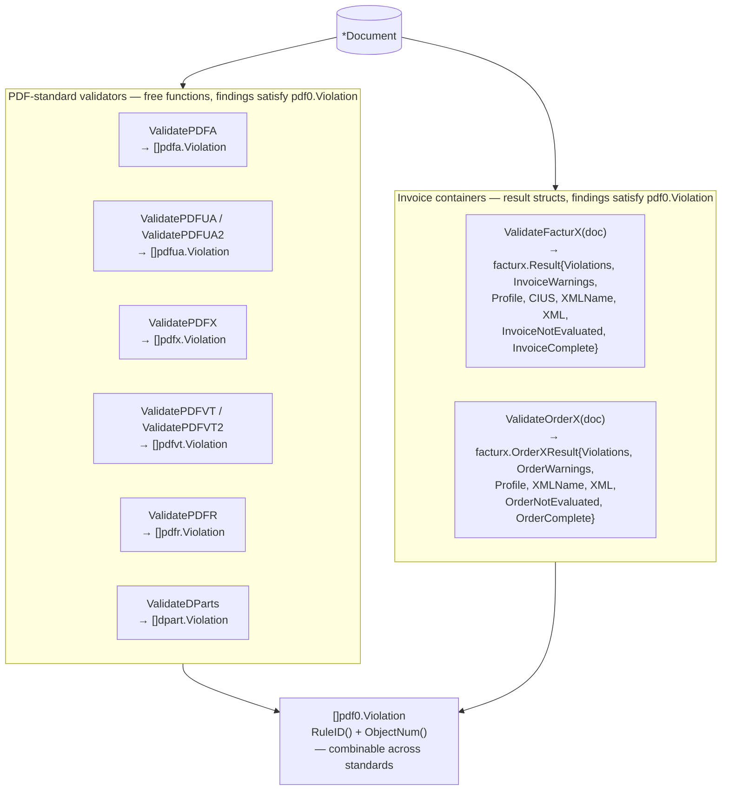
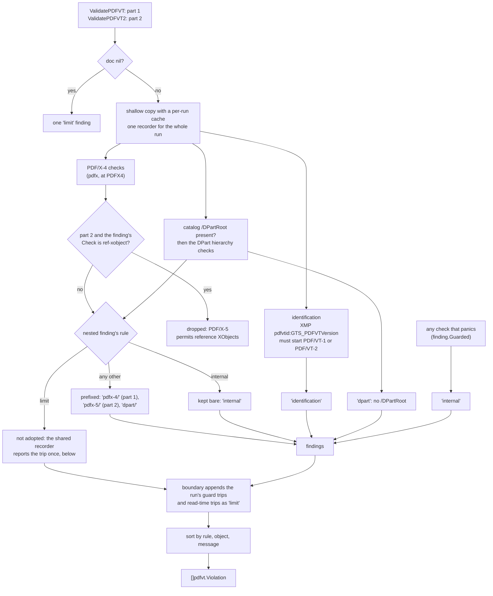

# Validators

pdf0 validates a `*Document` against PDF conformance standards: PDF/A, PDF/UA,
PDF/X, PDF/VT, PDF/R, the DPart hierarchy, and the Factur-X and Order-X invoice
containers. Each is one free function of the root package that takes the
document and returns that standard's findings. Reach for this doc to choose an
entry point and to read what it returns. An empty result is narrower than "the
file conforms", and a run that could not finish says so in its result. The
internals of each engine have their own docs: [pdfa.md](pdfa.md) for PDF/A,
[pdfua.md](pdfua.md) for PDF/UA.

## Pick an entry point

| Standard | Call | Returns | Under a context | Before you rely on it |
|----------|------|---------|-----------------|-----------------------|
| PDF/A (ISO 19005) 1a/1b/2a/2b/2u/3a/3b/3u/4/4e/4f | `ValidatePDFA(doc, level)` | `[]pdfa.Violation` | `ValidatePDFAContext` | The zero `pdfa.Level`, `pdfa.LevelDeclared`, validates against the level the document declares ([pdfa.md](pdfa.md#level-differences)) |
| PDF/UA-1 (ISO 14289-1) | `ValidatePDFUA(doc)` | `[]pdfua.Violation` | `ValidatePDFUAContext` | The finding names its rule in `Clause`, not `Rule` (see [Reading a result](#reading-a-result)) |
| PDF/UA-2 (ISO 14289-2) | `ValidatePDFUA2(doc)` | `[]pdfua.Violation` | `ValidatePDFUA2Context` | Partial, mostly ISO 14289-1 clause numbers, not in the CLI: see [Checking for PDF/UA-2](#checking-for-pdfua-2) |
| PDF/X-1a/3/4/4p/6 (ISO 15930) | `ValidatePDFX(doc, level)` | `[]pdfx.Violation` | `ValidatePDFXContext` | **The zero `pdfx.Level` is `pdfx.PDFX4`**: a level left unset validates PDF/X-4 and says nothing. Always name the level |
| PDF/VT-1 (ISO 16612-2) | `ValidatePDFVT(doc)` | `[]pdfvt.Violation` | `ValidatePDFVTContext` | Composes PDF/X-4 and DPart, and inherits how partial they are ([PDF/VT](#pdfvt)) |
| PDF/VT-2 | `ValidatePDFVT2(doc)` | `[]pdfvt.Violation` | `ValidatePDFVT2Context` | The PDF/X-5 external-reference rules are not asserted |
| PDF/R (ISO 23504-1) | `ValidatePDFR(doc)` | `[]pdfr.Violation` | `ValidatePDFRContext` | Written from knowledge of the standard, with no corpus to calibrate it |
| DPart hierarchy (ISO 32000-2 §14.12) | `ValidateDParts(doc)` | `[]dpart.Violation` | `ValidateDPartsContext` | A document with no `/DPartRoot` has no hierarchy and gets no DPart finding: the structure is optional |
| Factur-X / ZUGFeRD container | `ValidateFacturX(doc)` | `facturx.Result` | `ValidateFacturXContext` | A result struct, not a slice: read three of its fields ([Factur-X and Order-X](#factur-x-and-order-x)) |
| Order-X container | `ValidateOrderX(doc)` | `facturx.OrderXResult` | `ValidateOrderXContext` | As Factur-X, with `OrderWarnings` and `OrderNotEvaluated` / `OrderComplete` |

Every finding type satisfies `pdf0.Violation`, including the two inside the
invoice result structs (`facturx.Violation`, `facturx.OrderXViolation`).
Signatures and PAdES are `*Document` methods with their own result types; see
[signing.md](signing.md). The CLI runs only PDF/A (`pdf0 validate`) and
PDF/UA-1 (`pdf0 ua`). Everything else in the table is library-only
([cli.md](cli.md#what-the-cli-does-not-expose)).

### Checking for PDF/UA-2

`ValidatePDFUA2` runs the PDF/UA-1 checks with part 2's identification, and
adds the few rules only part 2 has. Before you report its result as "PDF/UA-2":

- **The clause numbers are mostly ISO 14289-1's.** Only part 2's own rules
  carry ISO 14289-2 numbers. The shared checks keep their ISO 14289-1 clauses,
  even though `Error()` prints `[PDF/UA-2 …]`. Read a clause against the
  standard that numbers it ([pdfua.md](pdfua.md#pdfua-2)).
- **Filter the checker findings out first**, as for every validator
  ([Reading a result](#reading-a-result)).
- **It is not full ISO 14289-2.** Several part-2 rules are not implemented, and
  how many corpus fail files that leaves uncaught is measured in
  [pdfua.md](pdfua.md#the-oracles).
- **The CLI cannot run it.** `pdf0 ua` calls `ValidatePDFUA` only. Call
  `ValidatePDFUA2` from Go.

## Reading a result

Every validator can return findings about pdf0 rather than about the document.
Two rule identifiers are reserved for them, `limit` and `internal`, and
`IsCheckerFinding` recognises both, whichever validator reported them. Drop
them before asking "does this file conform?":

```go
var real []pdf0.Violation
for _, e := range pdf0.ValidatePDFAContext(ctx, doc, pdfa.PDFA2b) {
	if !pdf0.IsCheckerFinding(e) {
		real = append(real, e)
	}
}
```

A checker finding means **unknown**, not failed. `internal` is a check that
panicked and was recovered, which is a pdf0 bug. `limit` names the guard that
stopped a check. Some guards are resource budgets, which trip on adversarial or
unusually large input or under a bound the caller lowered. Others are coverage
gaps that ordinary documents hit: a document built in memory has no file for
the byte-level rules (`no-source-file`), and an encrypted one that was not
decrypted is ciphertext (`not-decrypted`). The `IsCheckerFinding` godoc lists
both kinds, and [limits.md](limits.md) describes each guard. A run that stopped
early keeps the findings it had already made. Its result is never empty, so it
cannot be read as a clean pass.

`RuleID()` returns the rule a finding names. It reads the `Rule` field of every
finding type except `pdfua.Violation`, whose field is named for what ISO 14289
calls it, `Clause`. Code that reads findings through `pdf0.Violation` never sees
the difference. Code that reads the concrete type must use `Clause` for PDF/UA.

A nil `*Document` is never a panic: every validator answers it with one `limit`
finding, "no document to validate" (`TestEveryValidatorAnswersANilDocument`).
This is the case a caller hits after a failed `Read` whose error was not
checked.

### What an empty result means

Nothing fired that pdf0 checks. It is **not** a conformance guarantee: the PDF/A
validator implements a subset of ISO 19005, and the other validators are
narrower still. `ValidatePDFX` checks the structural rules its godoc lists.
`ValidatePDFVT` and `ValidatePDFVT2` are as partial as the PDF/X and DPart
validators they compose, and `ValidatePDFVT2` does not assert the PDF/X-5
external-reference rules. `ValidatePDFUA2` does not assert full ISO 14289-2.
Three rule sets rest on the author's knowledge of standards this repository does
not hold, and say so in their source: the PDF/X per-level table
(`pdfx/levels.go`, ISO 15930; PDF/X-4 is also calibrated against the Cal Poly
suite), PDF/R (`pdfr/pdfr.go`, ISO 23504, including its identification schema),
and the X-1a colour rule, which covers device RGB but not CIE-based spaces. The
measured claim is the corpus ratchet, not the API; see
[CONTRIBUTING](../CONTRIBUTING.md#the-corpus-ratchet--read-this-before-changing-a-validation-rule).

## Properties every validator has

- **Read-only, and safe to run concurrently.** Each run installs its per-run
  cache on a shallow copy of the `Document`, so the caller's document is never
  mutated. The same document can be validated from several goroutines at once
  (`TestValidateConcurrentSameDoc`, `TestUAValidationCacheIsolation`).
- **Panic safety.** Every check runs behind a `recover()` boundary. PDF/A and
  PDF/UA have one per check. PDF/X, PDF/VT, PDF/R and DPart use the shared
  `finding.Guarded`. Factur-X and Order-X have one at the entry point. A check
  that panics on hostile input becomes a finding under `internal` instead of
  crashing the caller, and the findings collected before it survive. **This
  holds through composition too.** PDF/VT, Factur-X and Order-X nest other
  validators and prefix the findings they adopt ("pdfx-4/", "dpart/",
  "pdfa-3/"), but `internal` and `limit` keep their bare names
  (`finding.Namespaced`). A recovered panic in a nested validator is therefore
  still a checker finding. `TestNestedCheckerFindingsKeepTheirReservedNames`
  (`pdfvt`) and `TestAdoptPDFAFindingsKeepsReservedRulesBare` (`facturx`) pin
  it. The limit: a stack overflow from unbounded recursion cannot be recovered,
  so recursion is bounded at its source instead.
- **Deterministic order.** Every validator sorts its findings by rule, then
  object, then message, through the one shared `finding.Sort`, on every return
  path. Results are stable across runs and safe to diff or snapshot.
- **Rules judge the document, not the object table.** A rule about what the
  document contains walks `core.View.ReachableDicts`: every dictionary the
  trailer reaches, direct ones included, orphans not. Only a rule about the
  file's syntax ranges over every object, and it is marked `// allobjects:`
  (`internal/lint`'s `TestValidatorsWalkTheReachableGraph`).
- **A checker that stops early says so,** under `limit` or `internal`, as
  [Reading a result](#reading-a-result) describes. A cancelled context is
  reported the same way.

### One shape

Every conformance validator has the same shape, and `internal/lint` holds it
(`TestValidatorsHaveOneShape`, `TestEveryFindingTypeIsAViolation`):

- **A free function of the root package**, `ValidateX(doc *Document, …)`. What
  follows `doc` is what the standard itself varies by (a PDF/A or PDF/X level)
  and nothing else. The document parameter is `doc` in every one.
- **A `…Context` twin**, `ValidateXContext(ctx context.Context, doc *Document, …)`,
  with the same parameters after `ctx` and the same result.
- **Findings of the standard's own type**, returned as a slice, or inside a
  result struct when the validator has more than findings to return (the
  invoice containers return the invoice XML and its rule coverage too). Every
  finding type satisfies `pdf0.Violation`, so findings combine across standards
  and `IsCheckerFinding` classifies all of them.
- **No raw bytes.** A rule about the file's bytes reads the file the document
  was read from (`Document.Source`), never a parameter that could name another
  file.
- **A nil document is one `limit` finding**, never a panic.

The Context twin and the finding type go together for a reason. Cancellation
is reported *as a finding* under `limit`, so an entry point whose findings
`IsCheckerFinding` cannot classify has no honest way to report a cancelled run
(see [architecture.md](architecture.md#which-entry-points-have-one)). The two
invoice containers lacked both until `formalis` v0.2.0. Their findings were
`formalis.Violation`, an external type this package could not extend, and the
invoice rule engine took no context. Both gaps are closed.

Why standards are free functions and signatures are methods: a conformance
validator answers "does this document conform to standard S?", and several of
them are asked of one document. The standard is the subject, so the function is
named for it and takes the document, and a nil document still has a finding type
to be reported in. Signature verification (`Document.VerifySignatures`,
`Document.ValidatePAdES`, `Document.DSSCerts`) answers questions about material
the document carries, and it returns `(results, error)`. Its results are not
findings, and a run that could not finish (an internal failure on a hostile
file) has no finding type to become, so it is an error.

The functions the validators are built from take the internal `core.View` and
are not exported; see
[architecture.md](architecture.md#crossing-the-boundary-internalbridge).



### Combining findings

The PDF-standard validators keep their own concrete finding types but all
satisfy `pdf0.Violation` (`error` + `RuleID()` + `ObjectNum()`), so a
multi-standard report is a plain append:

```go
var all []pdf0.Violation
for _, e := range pdf0.ValidatePDFA(doc, pdfa.PDFA2b) {
	all = append(all, e)
}
for _, e := range pdf0.ValidatePDFUA(doc) {
	all = append(all, e)
}
```

## The composite validators

PDF/VT, Factur-X and Order-X are built from other validators. Their findings
carry a prefix that names the validator they came from, and the checker
findings never do.

### PDF/VT

A PDF/VT file is a PDF/X file that also carries a document part hierarchy and
identifies itself as PDF/VT. `ValidatePDFVT` runs the PDF/X-4 checks, the
identification rule and the DPart checks as one run, with one recorder for
guard trips. `ValidatePDFVT2` is the same with a PDF/X-5 base. pdf0 has no
PDF/X-5 validator, so that base is the PDF/X-4 rules without the
reference-XObject prohibition, which PDF/X-5 lifts. Every finding carries
`Part`, "1" or "2", and `Error()` prints it.



The XMP identification rule reports nothing when the packet was over the
size limit. Whether the file identifies as PDF/VT is then unknown, and the
packet's `limit` finding says so.

### Factur-X and Order-X

A Factur-X or Order-X file is a PDF/A-3 file that carries the invoice (or
order) XML as an associated file and declares it in XMP. The container half is
pdf0's. The rules about the XML itself are the `formalis` module's, and pdf0
hands the extracted XML over.

```mermaid
flowchart TD
    E["ValidateFacturX / ValidateOrderX"] --> N{"doc nil?"}
    N -->|yes| NL["Violations: one 'limit' finding"]
    N -->|no| A3["ValidatePDFAContext at PDFA3b<br/>a run of its own, with its own recorder"]
    A3 --> AD{"PDF/A-3 finding's rule"}
    AD -->|"limit, internal"| ADB["kept bare"]
    AD -->|any other| ADP["prefixed 'pdfa-3/'"]
    ADB --> V
    ADP --> V
    A3 --> L{"document Locked?"}
    L -->|yes| TAIL
    L -->|no| C["container checks: catalog,<br/>/AF attachment and its relationship,<br/>XMP fx: DocumentType, ConformanceLevel"]
    C --> CF["'structure', 'attachment', 'metadata'"]
    CF --> V
    C --> P["ConformanceLevel sets Profile<br/>or CIUS (Factur-X only)"]
    C --> X{"XML found?"}
    X -->|no| TAIL
    X -->|yes| F["formalis<br/>Factur-X: Validate at Profile,<br/>or ValidateCIUS when a CIUS was named<br/>Order-X: ValidateOrderXML"]
    F --> FE["XML unreadable:<br/>'invoice-xml' / 'order-xml'"]
    FE --> V
    F --> SEV{"severity"}
    SEV -->|fatal| V["Violations"]
    SEV -->|warning| W["InvoiceWarnings / OrderWarnings"]
    F --> NE["InvoiceNotEvaluated / OrderNotEvaluated<br/>InvoiceComplete / OrderComplete"]
    V --> TAIL["on every return: a recovered panic as 'internal',<br/>this run's guard trips as 'limit',<br/>a cancellation if none was reported,<br/>then Violations sorted"]
```



The adopted `formalis` findings keep their rule identifiers verbatim (`BR-01`,
`ORDER-…`). Instead of a prefix they carry `Source`, the authority that
defines the rule. `Source` is the zero `formalis.Source` on pdf0's own
container findings. A rule identifier such as `BR-01` is unique within its
authority and not outside it. Their findings append to a combined report like
any other:

<!-- snippet
var all []pdf0.Violation
-->
```go
res := pdf0.ValidateFacturX(doc)
for _, v := range res.Violations {
	all = append(all, v)
}
```

Three fields on the result are worth reading together:

- `Violations` is the verdict: pdf0's container findings, the PDF/A-3 base's,
  and the invoice engine's **fatal** findings. The PDF/A-3 base is validated at
  PDF/A-3b, which a container declaring 3a or 3u also satisfies. Whether such a
  container meets the rest of its own claim is a PDF/A question
  (`ValidatePDFA` at `pdfa.LevelDeclared`).
- `InvoiceWarnings` is the invoice engine's **advisory** findings. CEN flags
  1,168 of the two EN 16931 syntax bindings' assertions `warning`, and a
  conforming Factur-X EXTENDED invoice trips dozens by design, since carrying
  more than the EN 16931 core is what EXTENDED is *for*. `pdf0.Violation` has no
  severity, so folding these into `Violations` would make them indistinguishable
  from a PDF/A-3 failure in any combined report.
- `InvoiceNotEvaluated` / `InvoiceComplete` say what the rule set that ran does
  **not** implement. "No findings" and "no findings, and here is what nobody
  looked at" are different answers, and this is the second one. They are not
  turned into findings: every rule set has gaps, so a finding per gap would fire
  on every invoice ever validated.

Which rule set the XML is run through follows what the container declared. A
Factur-X profile routes to the EN 16931 core at that profile. A CIUS
conformance level (`XRECHNUNG`) routes to the rule set the invoice itself
declares in BT-24. A level that names neither is a `metadata` finding rather
than a guess. See [ADR 0002](adr/0002-formalis-extraction.md).

## Where the code lives

**PDF/A** is in `pdfa/`. Its dispatch, its level profile, Level A and U, the
executed-content model, the per-run cache and the map of which rule is in which
file are in [pdfa.md](pdfa.md#where-the-rules-live).

The other standards each own their package: `pdfua/` (`pdfua/pdfua.go`,
`pdfua/pdfua_content.go`, `pdfua/pdfua_struct.go`, `pdfua/pdfua_tablegrid.go`,
`pdfua/pdfua_lang.go`, `pdfua/pdfua_annotctx.go`, `pdfua/pdfua2.go`; mapped in
[pdfua.md](pdfua.md#file-map)), `pdfx/pdfx.go` and `pdfx/levels.go`,
`pdfvt/pdfvt.go`, `pdfr/pdfr.go`, `dpart/dpart.go`, and `facturx/` for Factur-X
and Order-X. Each is reached from its `*_api.go` file in the root.
`violations.go` holds the shared `Violation` interface and is the canonical
statement of the contract above. `internal/finding` holds what every validator
shares: the reserved rule names, `finding.Guarded`, `finding.Namespaced` and
`finding.Sort`.

To add a rule, see
[CONTRIBUTING](../CONTRIBUTING.md#adding-a-validation-rule).
